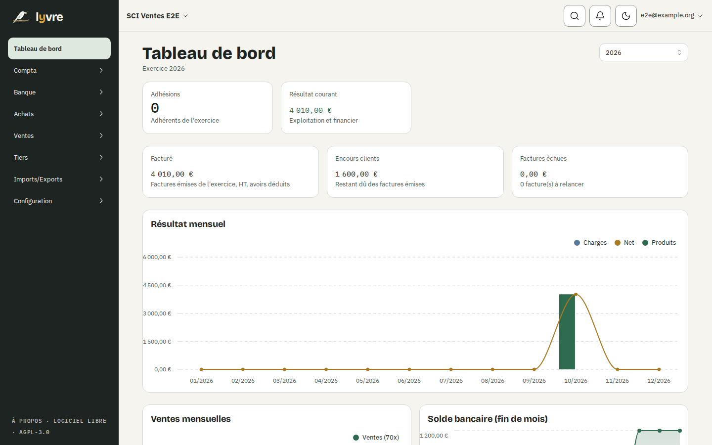
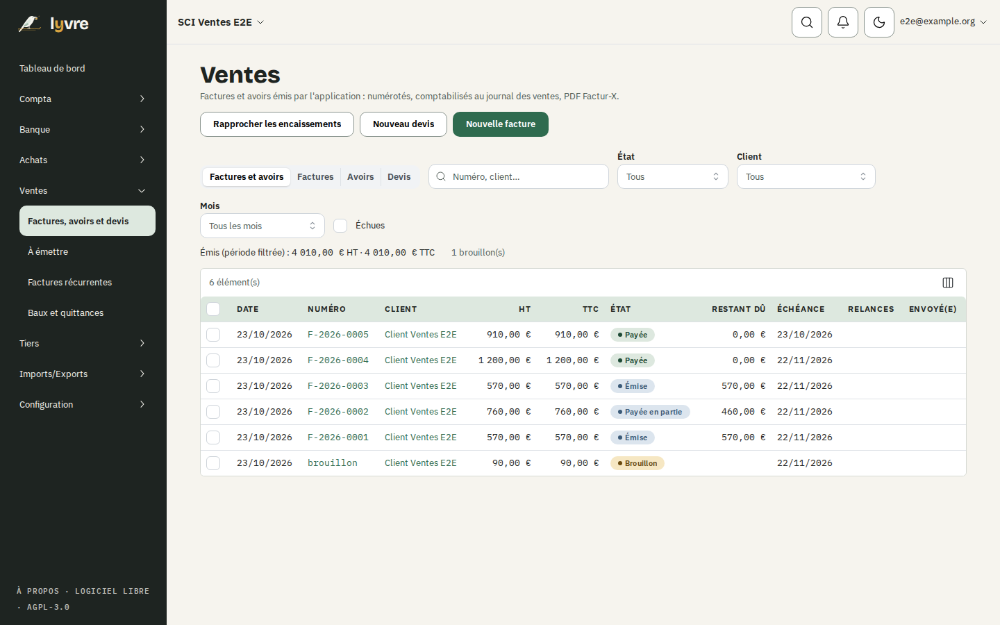
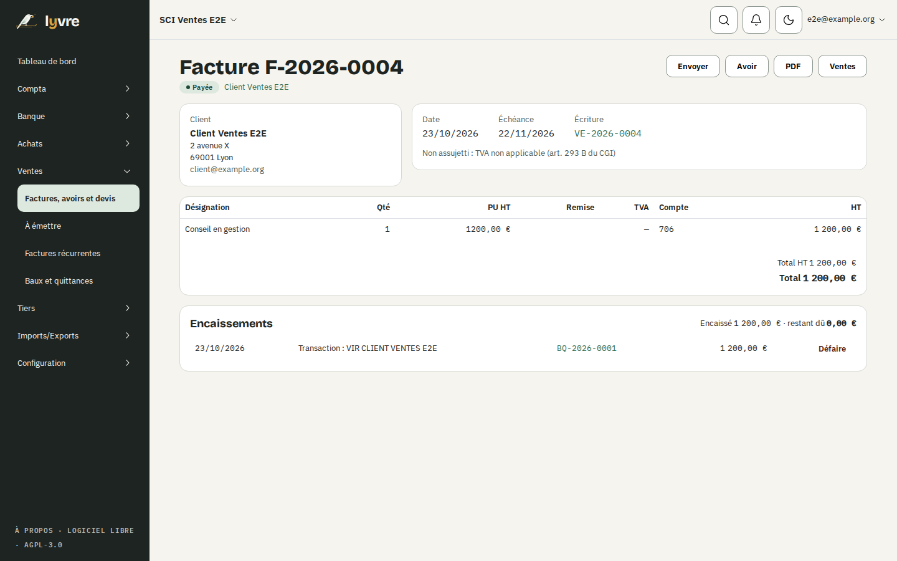
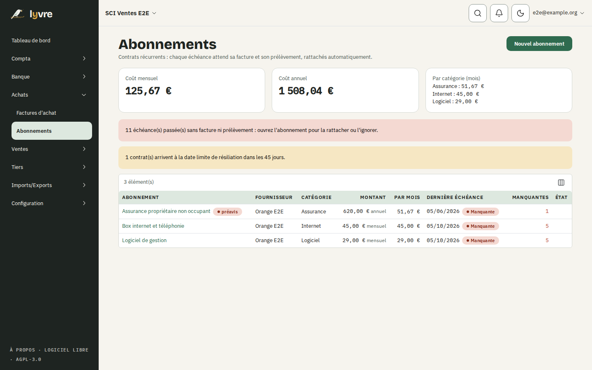
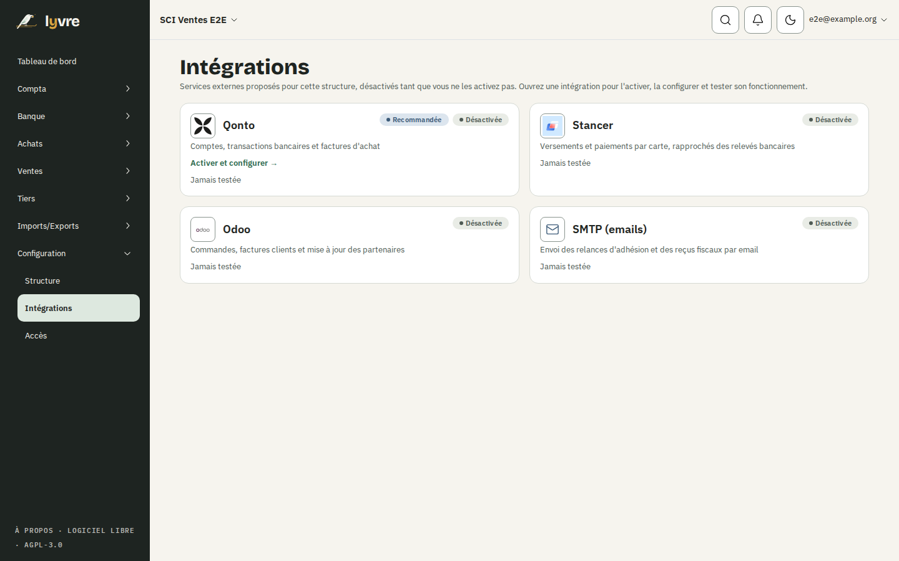
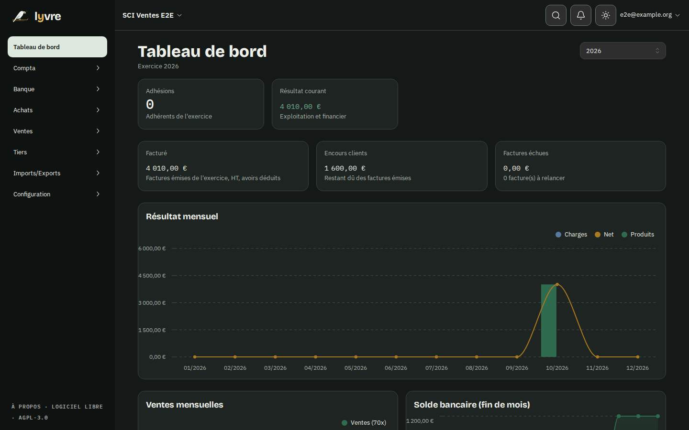

<div align="center">

<picture>
  <source media="(prefers-color-scheme: dark)" srcset="frontend/src/assets/lyvre-symbole-inverse.svg">
  
</picture>

# Lyvre

**La comptabilité des associations, libre, sobre et souveraine.**

De la saisie au bilan, pour une association loi 1901 ou une SCI : banque et caisse, achats et
ventes, adhésions, dons et reçus fiscaux, budget, clôture et FEC pour l'expert-comptable.

[](LICENSE)
[](doc/docker.md)
[](requirements.txt)
[](frontend/package.json)
[](doc/ventes.md)



</div>

---

## Pourquoi Lyvre ?

- **Pensé pour les associations** : plan comptable associatif (règlement ANC 2018-06) ou plan SCI,
  choisi par structure ; comptabilité simplifiée (recettes / dépenses) pour les petites structures,
  passage en partie double sans ressaisie.
- **Sans friction au quotidien** : import OFX ou synchronisation Qonto, rapprochement au clavier
  avec suggestions, règles de catégorisation, factures d'achat lues automatiquement (Factur-X, PDF,
  photo).
- **Prêt pour l'expert-comptable** : clôture guidée en 8 étapes, à-nouveaux, fonds dédiés, export
  **FEC** conforme, accès en lecture seule.
- **Libre et chez vous** : AGPL-3.0, une base par structure, sauvegardes avec les pièces jointes,
  aucune donnée envoyée ailleurs sans intégration activée.

## Aperçu

<table>
  <tr>
    <td width="50%"><br><sub><b>Ventes</b> : devis, factures et avoirs numérotés, restant dû, encaissements rapprochés.</sub></td>
    <td width="50%"><br><sub><b>Facture</b> : PDF Factur-X, écriture au journal des ventes, encaissement depuis la banque.</sub></td>
  </tr>
  <tr>
    <td><br><sub><b>Baux</b> : avis d'échéance récurrents, dépôt de garantie, quittances en un clic.</sub></td>
    <td><br><sub><b>Abonnements</b> : coût mensuel, échéances manquantes, préavis de résiliation.</sub></td>
  </tr>
  <tr>
    <td><br><sub><b>Intégrations</b> : proposées selon la structure, désactivées par défaut.</sub></td>
    <td><br><sub><b>Thème sombre</b>, interface au clavier, lisible sur mobile.</sub></td>
  </tr>
</table>

## Fonctionnalités

| Domaine | Ce que fait Lyvre |
|---|---|
| 📒 **Comptabilité** | Partie double au clavier, journaux, grand livre, balance, bilan et compte de résultat N / N-1 ; comptabilité simplifiée ; contributions volontaires en nature ; TVA par exercice |
| 🏦 **Banque et caisse** | Import OFX et Qonto dédoublonnés, rapprochement en masse et annulable, caisse en espèces, prévisionnel de trésorerie sur 12 mois |
| 🧾 **Achats** | Factures fournisseurs Qonto ou déposées (Factur-X, PDF, OCR), catalogue, engagement 401, règlements rapprochés ; **abonnements** (internet, assurance, banque…) suivis échéance par échéance |
| 💶 **Ventes** | Devis, factures et avoirs (`D-`, `F-`, `AV-`), PDF **Factur-X**, journal VE, TVA à l'encaissement ou sur les débits, relances, factures récurrentes, **baux et quittances** ; émission par Qonto en option |
| 🤝 **Adhérents et tiers** | Répertoire des tiers, adhésions HelloAsso et caisse, relances par email, bénévolat valorisé |
| 🎁 **Dons et reçus fiscaux** | Dons repris de la comptabilité, reçus Cerfa 11580 / 16216 numérotés, PDF figés, envoi par email |
| 🏛️ **Associés (SCI)** | Registre des parts (usufruit, nue-propriété), comptes courants d'associés, répartition du résultat |
| ✅ **Clôture** | Assistant en 8 étapes, écritures d'inventaire, fonds dédiés, clôture provisoire puis définitive, FEC |
| 📊 **Pilotage** | Tableau de bord, budget prévu / réalisé, comptabilité par projet, rapport d'activité pour l'AG |
| 🔐 **Collaboration** | Plusieurs structures par installation, rôles administrateur / trésorier / expert-comptable |

**Intégrations** (désactivées par défaut, proposées selon la structure) : Qonto, SMTP, Stancer,
Odoo, HelloAsso, Google Analytics, Facebook. Voir [doc/integrations.md](doc/integrations.md).

## Démarrage rapide

### Avec Docker

```bash
git clone git@github.com:asso-seconde-nature/seconde-compta.git
cd seconde-compta
$EDITOR .env        # à créer : au minimum SECRET_KEY, ADMIN_EMAIL, ADMIN_PASSWORD
docker compose up -d --build
```

Ouvrez **http://localhost:5000** et connectez-vous avec `ADMIN_EMAIL` / `ADMIN_PASSWORD`.
Migrations et plan comptable sont appliqués au démarrage ([doc/docker.md](doc/docker.md)).

### En local

```bash
python3 -m venv .venv && source .venv/bin/activate
pip install -r requirements.txt
FLASK_APP=run.py flask db upgrade
python seed_accounts.py            # ou : python seed_accounts.py sci
python seed_meta.py
npm --prefix frontend ci && npm --prefix frontend run build
python run.py
```

Prérequis : Python 3.10+, Node.js 22 pour le front, Tesseract (`fra`) en option pour l'OCR.
Détails dans [doc/installation.md](doc/installation.md).

### Vérifier

```bash
make check     # typage, tests du front, build et pytest
make e2e       # parcours de bout en bout (Playwright) sur une base jetable
```

## Documentation

| | |
|---|---|
| [Installation](doc/installation.md) · [Docker](doc/docker.md) · [Sauvegardes](doc/backups.md) | Installer, déployer, sauvegarder |
| [Saisie et rapprochement](doc/saisie_rapprochement.md) · [Imports](doc/imports.md) | Le quotidien du trésorier |
| [Achats](doc/achats.md) · [Ventes](doc/ventes.md) · [Associés](doc/associes.md) | Guides par module |
| [Clôture](doc/cloture.md) · [États financiers](doc/reports.md) | Fin d'exercice |
| [Architecture](doc/architecture.md) · [Multi-structures](doc/multi_tenant.md) · [Modèles](doc/models.md) | Pour contribuer |

Sommaire complet : [doc/README.md](doc/README.md).

## Sous le capot

Flask + SQLAlchemy (une base SQLite par structure, migrations Alembic), interface React 19 +
Mantine 9 servie par Flask, WeasyPrint pour les PDF, [factur-x](https://github.com/akretion/factur-x)
pour la facture électronique, Gunicorn dans une image Docker unique.

## Licence

[GNU Affero General Public License v3.0](LICENSE) — vous pouvez utiliser, modifier et héberger
Lyvre ; une version modifiée proposée en ligne doit publier son code source.
