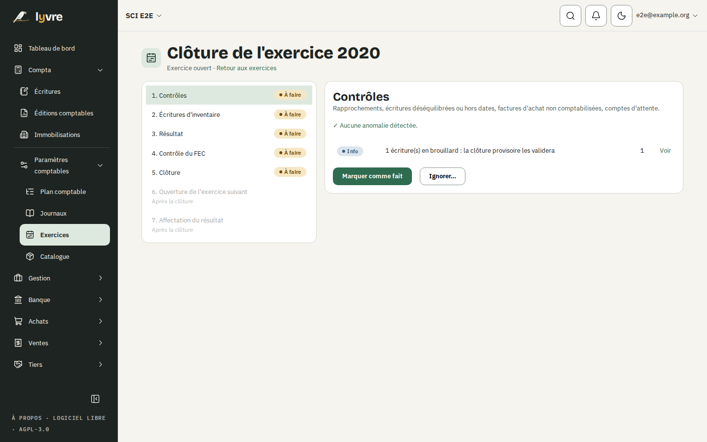

<div align="center">

<picture>
  <source media="(prefers-color-scheme: dark)" srcset="frontend/src/assets/lyvre-symbole-inverse.svg">
  
</picture>

# Lyvre

**La comptabilité des associations et des SCI, libre, sobre et souveraine.**

De la saisie au bilan : banque et caisse, achats et ventes, adhésions et reçus fiscaux, baux,
budget, immobilisations, clôture et FEC pour l'expert-comptable. Hébergé chez vous.

<!-- version -->[](CHANGELOG.md)<!-- /version -->
[](LICENSE)
[](doc/docker.md)
[](doc/ventes.md)
[](doc/cloture.md)
[](doc/architecture.md)

<br>

<picture>
  <source media="(prefers-color-scheme: dark)" srcset="doc/images/tableau-de-bord-sombre.png">
  
</picture>

[Pour qui](#pour-qui) · [Aperçu](#aperçu) · [Fonctionnalités](#fonctionnalités) · [Intégrations](#intégrations) · [Démarrage rapide](#démarrage-rapide) · [Nouveautés](CHANGELOG.md) · [Documentation](doc/README.md)

</div>

---

## En bref

<table>
  <tr>
    <td width="25%" valign="top"><b>📒 Comptabilité complète</b><br><sub>Partie double au clavier ou comptabilité simplifiée, plan associatif ou SCI, lettrage, immobilisations.</sub></td>
    <td width="25%" valign="top"><b>🏦 Banque sans ressaisie</b><br><sub>Qonto ou OFX, rapprochement au clavier avec suggestions, règles, factures lues automatiquement.</sub></td>
    <td width="25%" valign="top"><b>✅ Prêt pour l'expert-comptable</b><br><sub>Écritures validées intangibles, clôture guidée, à-nouveaux, FEC conforme, accès en lecture seule.</sub></td>
    <td width="25%" valign="top"><b>🔐 Libre et chez vous</b><br><sub>AGPL-3.0, une base par structure, sauvegardes avec les pièces, aucune donnée envoyée sans intégration activée.</sub></td>
  </tr>
</table>

## Pour qui

<table>
  <tr>
    <td width="50%" valign="top">
      <h3>🌱 Une association</h3>
      <ul>
        <li>Plan comptable associatif (règlement ANC 2018-06), contributions volontaires, fonds dédiés.</li>
        <li>Adhésions HelloAsso et caisse, échéances, relances par e-mail, bénévolat valorisé.</li>
        <li>Reçus fiscaux Cerfa numérotés, PDF figés, envoi et état annuel.</li>
        <li>Liste des adhérents synchronisée vers <b>Brevo</b>, sans doublon.</li>
      </ul>
    </td>
    <td width="50%" valign="top"></td>
  </tr>
  <tr>
    <td valign="top"></td>
    <td valign="top">
      <h3>🏡 Une SCI</h3>
      <ul>
        <li>Associés : registre des parts (usufruit, nue-propriété), comptes courants, intérêts.</li>
        <li>Baux par lots, carte des parcelles et bâtiments (IGN), modèles relus, texte figé.</li>
        <li>Signature électronique (Documenso auto-hébergé), quittances, révision des loyers sur les indices INSEE.</li>
        <li>Reprise d'une comptabilité Ekylibre.</li>
      </ul>
    </td>
  </tr>
  <tr>
    <td valign="top">
      <h3>🧮 L'expert-comptable</h3>
      <ul>
        <li>Accès en lecture seule à la structure, sans rien pouvoir modifier.</li>
        <li>Validation par lots, verrouillage de période, historique de chaque écriture.</li>
        <li>Assistant de clôture : contrôles, inventaire, CCA / PCA, dotations, résultat, FEC.</li>
        <li>Reprise d'historique depuis un FEC ou un tableur.</li>
      </ul>
    </td>
    <td valign="top"></td>
  </tr>
  <tr>
    <td valign="top"></td>
    <td valign="top">
      <h3>🛠️ L'hébergeur</h3>
      <ul>
        <li>Une image Docker, plusieurs structures, une base SQLite par structure.</li>
        <li>Migrations de toutes les bases au démarrage, sauvegardes <code>.zip</code> avec les pièces jointes.</li>
        <li>Intégrations activées structure par structure, testées depuis l'écran.</li>
        <li>Version et nouveautés dans l'application ; <a href="CHANGELOG.md">CHANGELOG</a> avec les actions requises.</li>
      </ul>
    </td>
  </tr>
</table>

## Aperçu

<table>
  <tr>
    <td width="50%"><br><sub><b>Rapprochement</b> : suggestions classées, tout au clavier, annulable.</sub></td>
    <td width="50%"><br><sub><b>Ventes</b> : devis, factures et avoirs numérotés, restant dû, encaissements rapprochés.</sub></td>
  </tr>
  <tr>
    <td><br><sub><b>Facture</b> : PDF Factur-X, écriture au journal des ventes, encaissement depuis la banque.</sub></td>
    <td><br><sub><b>Bail</b> : avis d'échéance récurrents, dépôt de garantie, quittances en un clic.</sub></td>
  </tr>
  <tr>
    <td><br><sub><b>Sirene</b> : structure et tiers complétés depuis l'INSEE, champ par champ.</sub></td>
    <td><br><sub><b>Brevo</b> : aperçu sans écriture, rattachements, désinscrits respectés.</sub></td>
  </tr>
  <tr>
    <td><br><sub><b>Abonnements</b> : coût mensuel, échéances manquantes, préavis de résiliation.</sub></td>
    <td><br><sub><b>Nouveautés</b> : chaque version expliquée dans l'application, actions requises en tête.</sub></td>
  </tr>
</table>

## Fonctionnalités

<details>
<summary><b>📒 Comptabilité</b></summary>

- Plan comptable associatif (ANC 2018-06) ou SCI, choisi par structure.
- Partie double au clavier : journaux, grand livre, balance, bilan et compte de résultat N / N-1.
- Comptabilité simplifiée (recettes et dépenses par catégorie), passage en partie double sans ressaisie.
- Validation par lots, écritures intangibles corrigées par extourne, historique, verrouillage de période.
- Lettrage automatique ou au clavier, à-nouveaux détaillés ; immobilisations et amortissements ;
  charges et produits constatés d'avance ; contributions volontaires en nature ; TVA par exercice.
</details>

<details>
<summary><b>🏦 Banque et caisse</b></summary>

- Import OFX et synchronisation Qonto, dédoublonnés ; opérations annulées gérées.
- Rapprochement au clavier avec suggestions, en masse, annulable ; règles de catégorisation.
- Caisse en espèces et dépôts en banque ; prévisionnel de trésorerie sur 12 mois.
</details>

<details>
<summary><b>🧾 Achats</b></summary>

- Factures fournisseurs Qonto ou déposées : lecture Factur-X, PDF ou photo (OCR), pièce conservée.
- Catalogue de produits, engagement (compte par fournisseur), règlements rapprochés.
- Fournisseur trouvé dans Sirene ; abonnements suivis échéance par échéance.
</details>

<details>
<summary><b>💶 Ventes et baux</b></summary>

- Devis, factures et avoirs numérotés, PDF **Factur-X**, journal des ventes, envoi par e-mail.
- Encaissements rapprochés, TVA à l'encaissement ou sur les débits, relances, factures récurrentes.
- Baux : assistant, modèles, carte IGN, signature Documenso, avis d'échéance, quittances, révision
  des loyers (ILC, ILAT, IRL, fermages) ; émission par Qonto en option.
</details>

<details>
<summary><b>🤝 Tiers, adhérents, dons</b></summary>

- Tiers pré-remplis et mis à jour depuis l'API Sirene de l'INSEE (SIREN, adresse, NAF, TVA).
- Adhésions HelloAsso et caisse, relances, bénévolat ; synchronisation Brevo.
- Reçus fiscaux particuliers (Cerfa 11580) et entreprises (16216), dons en nature, état annuel.
</details>

<details>
<summary><b>📊 Pilotage et clôture</b></summary>

- Tableau de bord, budget prévu / réalisé, comptabilité par projet, rapport d'activité.
- Assistant de clôture en étapes, clôture provisoire puis définitive, affectation du résultat, FEC.
- Reprise d'historique : FEC, tableur, export Ekylibre.
</details>

## Intégrations

Désactivées par défaut, proposées selon la structure, silencieuses tant qu'elles le restent
([doc/integrations.md](doc/integrations.md)).

| Service | Usage | Structures |
|---|---|---|
| **Qonto** | Comptes, transactions, factures d'achat, ventes | toutes |
| **HelloAsso** | Adhésions et formulaires | associations |
| **Brevo** | Liste de contacts des adhérents | associations |
| **Stancer** | Versements et paiements par carte | toutes |
| **Odoo** | Caisse, factures clients | toutes |
| **SMTP** | Relances, reçus, factures par e-mail | toutes |
| **Documenso** | Signature électronique des baux | toutes |
| **Google Analytics, Facebook** | Visibilité et impact | associations |
| **Sirene (INSEE)** | Pré-remplissage de la structure et des tiers | toutes (clé du serveur) |

## Démarrage rapide

### Avec Docker

```bash
git clone git@github.com:asso-seconde-nature/seconde-compta.git
cd seconde-compta
cp .env.example .env      # puis renseigner SECRET_KEY, ADMIN_EMAIL, ADMIN_PASSWORD
docker compose -f docker-compose.yml -f docker-compose.local.yml up -d --build
```

Ouvrez **http://localhost:5000** et connectez-vous avec `ADMIN_EMAIL` / `ADMIN_PASSWORD`.
Migrations et plan comptable sont appliqués au démarrage ; les données vont dans `./instance`.
Déploiement sur un serveur (Dokploy, proxy, sauvegardes) : [doc/docker.md](doc/docker.md).

### En local

```bash
python3 -m venv .venv && source .venv/bin/activate
pip install -r requirements.txt
FLASK_APP=run.py flask db upgrade
python seed_accounts.py            # ou : python seed_accounts.py sci
python seed_meta.py
npm --prefix frontend ci && npm --prefix frontend run build
python run.py
```

Prérequis : Python 3.10+, Node.js 22 pour le front, Tesseract (`fra`) en option pour l'OCR.
Détails dans [doc/installation.md](doc/installation.md).

## Nouveautés

Chaque version est datée au format `AAAA.MM.N` et décrite dans l'application (menu utilisateur ›
Nouveautés) comme dans [CHANGELOG.md](CHANGELOG.md), actions requises à la mise à jour en tête.
Les dernières : **Brevo** (synchronisation des adhérents), **Structure et Sirene**, **mise en
production**, **baux** (carte, signature, révision des loyers), **fiabilité comptable**.

## Contribuer

```bash
make check     # typage, tests du front, build et pytest
make e2e       # parcours de bout en bout (Playwright) sur une base jetable
```

- Une nouveauté s'ajoute sous `next` dans `data/changelog.yml` ; `python scripts/release.py publish`
  fixe le numéro et régénère CHANGELOG, `package.json` et le badge ci-dessus.
- Les captures de ce README viennent de `scripts/readme_screenshots.mjs`, sur des données fabriquées
  (`scripts/e2e_server.py --demo`).
- Architecture, modèles, routes : [doc/README.md](doc/README.md).

## Sous le capot

Flask + SQLAlchemy (une base SQLite par structure, migrations Alembic), interface React 19 +
Mantine 9 servie par Flask, WeasyPrint pour les PDF, [factur-x](https://github.com/akretion/factur-x)
pour la facture électronique, Gunicorn dans une image Docker unique.

## Licence

[GNU Affero General Public License v3.0](LICENSE) — vous pouvez utiliser, modifier et héberger
Lyvre ; une version modifiée proposée en ligne doit publier son code source.
