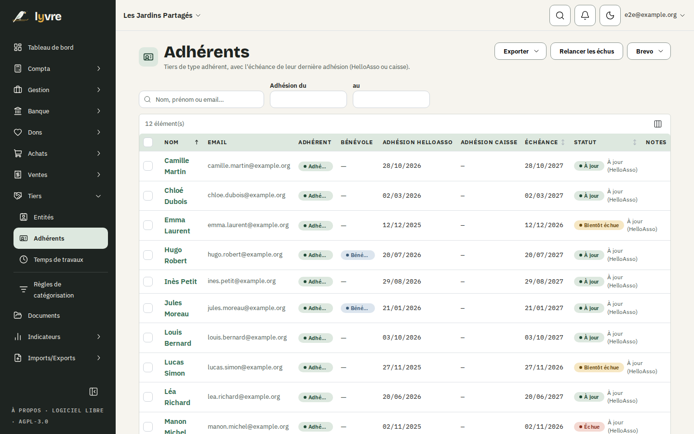
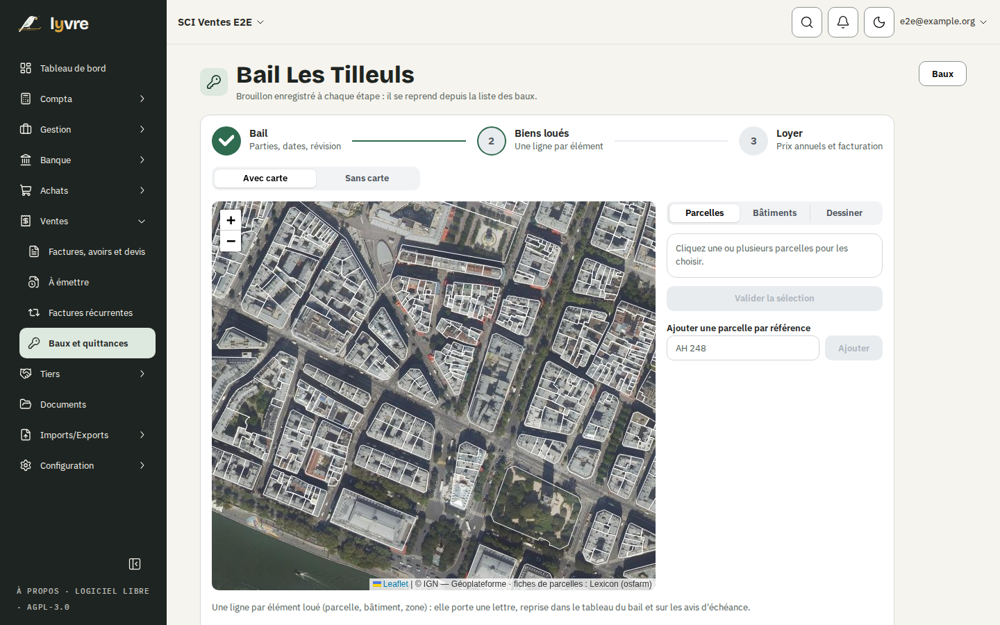
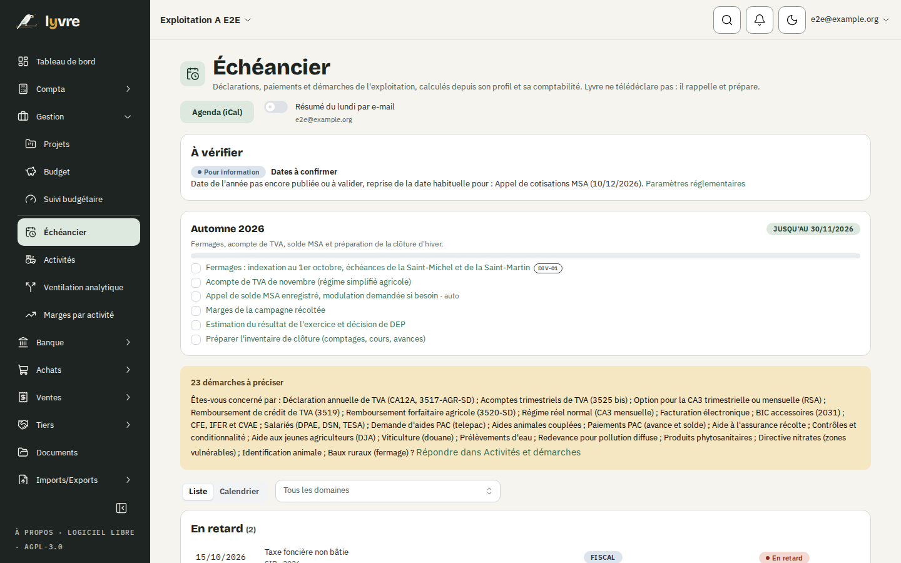
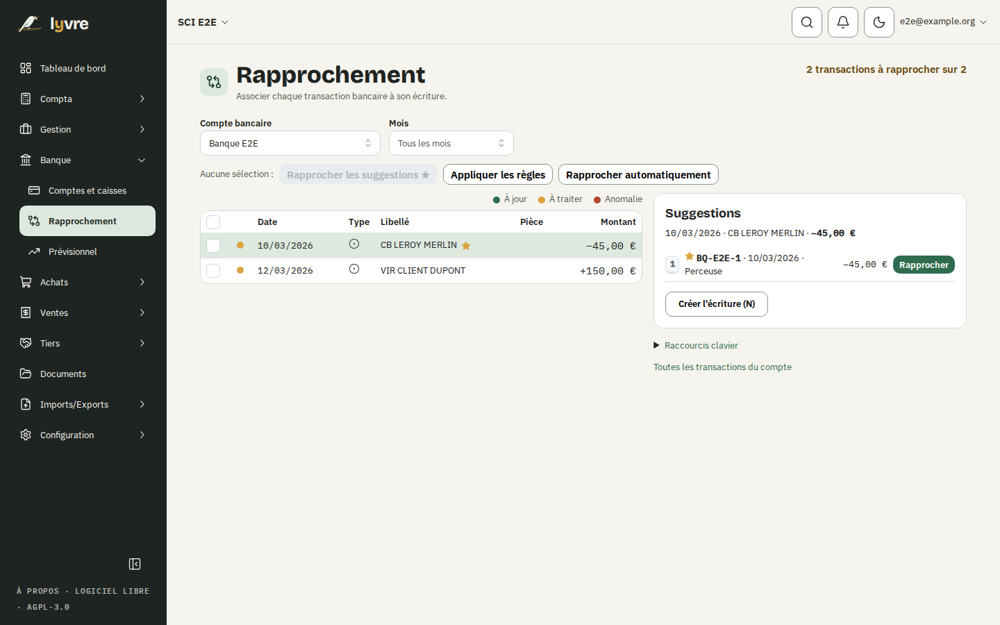
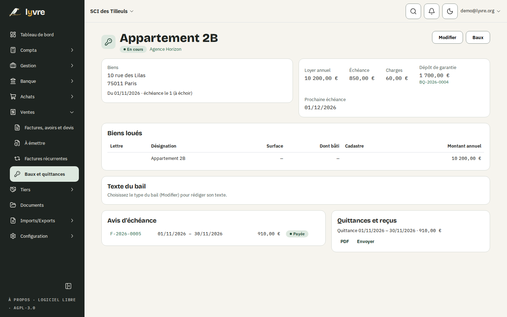
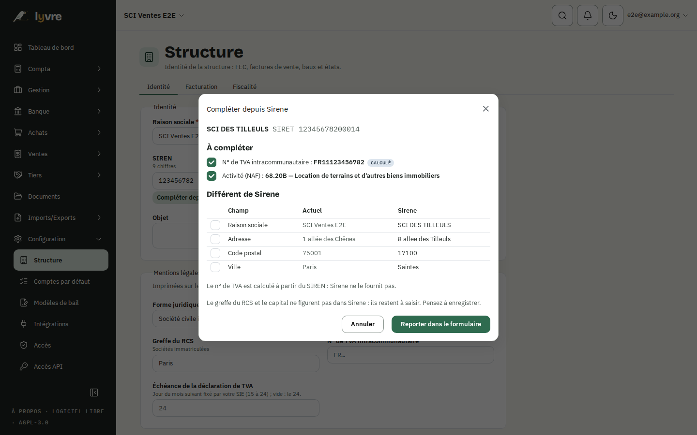
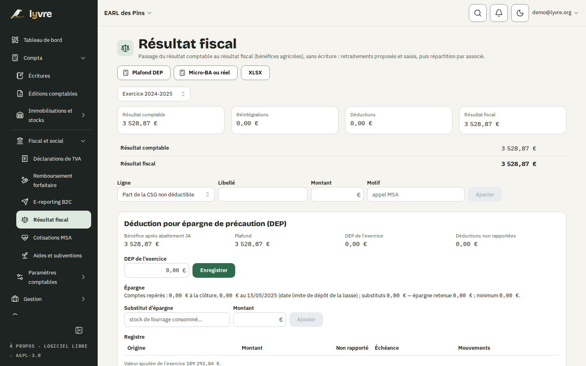
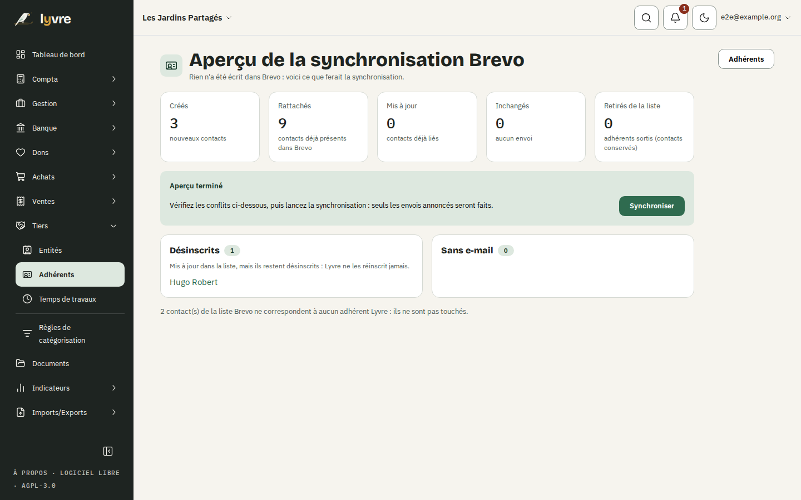
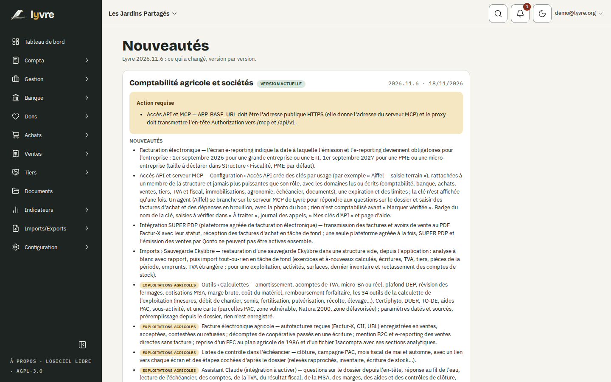

<div align="center">

<picture>
  <source media="(prefers-color-scheme: dark)" srcset="frontend/src/assets/lyvre-symbole-inverse.svg">
  
</picture>

# Lyvre

**La comptabilité innovante, libre, sobre et souveraine** : association, SCI, exploitation agricole ou société.

De la saisie au bilan : banque et caisse, achats et ventes, adhésions et reçus fiscaux, baux,
inventaire agricole et résultat fiscal, TVA, immobilisations, clôture et FEC pour l'expert-comptable.
Hébergé chez vous.

**[lyvre.org](https://lyvre.org)** · **[Essayer la démo](https://demo.lyvre.org)** · [Installer](#démarrage-rapide)

<!-- version -->[](CHANGELOG.md)<!-- /version -->
[](https://lyvre.org)
[](LICENSE)
[](doc/docker.md)
[](doc/ventes.md)
[](doc/cloture.md)
[](doc/architecture.md)

<br>

<picture>
  <source media="(prefers-color-scheme: dark)" srcset="doc/images/tableau-de-bord-sombre.png">
  
</picture>

[Pour qui](#pour-qui) · [Aperçu](#aperçu) · [Fonctionnalités](#fonctionnalités) · [Intégrations](#intégrations) · [Démarrage rapide](#démarrage-rapide) · [Nouveautés](CHANGELOG.md) · [Documentation](doc/README.md)

</div>

---

## En bref

<!-- highlights -->
<table>
  <tr>
    <td width="25%" valign="top"><b>📒 Comptabilité complète</b><br><sub>Partie double au clavier ou comptabilité simplifiée, plan associatif, SCI, agricole ou général, lettrage, immobilisations.</sub></td>
    <td width="25%" valign="top"><b>🏦 Banque sans ressaisie</b><br><sub>Qonto ou OFX, rapprochement au clavier avec suggestions, règles, factures lues automatiquement.</sub></td>
    <td width="25%" valign="top"><b>✅ Prêt pour l'expert-comptable</b><br><sub>Écritures validées intangibles, clôture guidée, à-nouveaux, FEC conforme, accès en lecture seule.</sub></td>
    <td width="25%" valign="top"><b>🔐 Libre et chez vous</b><br><sub>AGPL-3.0, une base par structure, sauvegardes avec les pièces, aucune donnée envoyée sans intégration activée.</sub></td>
  </tr>
</table>
<!-- /highlights -->

## Pour qui

<!-- audiences -->
<table>
  <tr>
    <td valign="top">
      <h3>🌱 Une association</h3>
      <ul>
        <li>Plan comptable associatif (règlement ANC 2018-06), contributions volontaires, fonds dédiés.</li>
        <li>Adhésions HelloAsso et caisse, échéances, relances par e-mail, bénévolat valorisé.</li>
        <li>Reçus fiscaux Cerfa numérotés, PDF figés, envoi et état annuel.</li>
        <li>Liste des adhérents synchronisée vers <b>Brevo</b>, sans doublon.</li>
      </ul>
    </td>
    <td valign="top"></td>
  </tr>
  <tr>
    <td valign="top"></td>
    <td valign="top">
      <h3>🏡 Une SCI</h3>
      <ul>
        <li>Associés : registre des parts (usufruit, nue-propriété), comptes courants, intérêts.</li>
        <li>Baux par lots, carte des parcelles et bâtiments (IGN), modèles relus, texte figé.</li>
        <li>Signature électronique (Documenso auto-hébergé), quittances, révision des loyers sur les indices INSEE.</li>
        <li>Reprise d'une comptabilité Ekylibre.</li>
      </ul>
    </td>
  </tr>
  <tr>
    <td valign="top">
      <h3>🌾 Une exploitation agricole</h3>
      <ul>
        <li>Plan comptable agricole (EI, EARL, GAEC, SCEA), micro-BA ou réel, bilan et compte de résultat agricoles.</li>
        <li>Inventaire de clôture, avances aux cultures, biens vivants et lots d'animaux, valeur fiscale des stocks.</li>
        <li>Résultat fiscal, abattement jeune agriculteur, DEP, assiette des cotisations MSA, aide à la liasse BA.</li>
        <li>Aides PAC et subventions suivies, TVA agricole (CA12A, acomptes), échéancier de l'exploitation.</li>
      </ul>
    </td>
    <td valign="top"></td>
  </tr>
  <tr>
    <td colspan="2" valign="top">
      <h3>🏢 Une société</h3>
      <ul>
        <li>Plan comptable général 2026, bilan et compte de résultat présentés comme la liasse 2050.</li>
        <li>Codes de TVA sur les écritures, autoliquidation, déclarations CA3 calculées depuis les écritures.</li>
        <li>Facturation électronique (Factur-X, plateforme agréée), relevés de compte conservés.</li>
        <li>Statut de jeune entreprise innovante, archive de l'exercice pour l'expert-comptable.</li>
      </ul>
    </td>
  </tr>
  <tr>
    <td valign="top">
      <h3>🧮 L'expert-comptable</h3>
      <ul>
        <li>Accès en lecture seule à la structure, sans rien pouvoir modifier.</li>
        <li>Validation par lots, verrouillage de période, historique de chaque écriture.</li>
        <li>Assistant de clôture : contrôles, inventaire, CCA / PCA, dotations, résultat, FEC.</li>
        <li>Reprise d'historique depuis un FEC, un tableur ou une sauvegarde Ekylibre.</li>
      </ul>
    </td>
    <td valign="top"></td>
  </tr>
  <tr>
    <td valign="top"></td>
    <td valign="top">
      <h3>🛠️ L'hébergeur</h3>
      <ul>
        <li>Une image Docker, plusieurs structures, une base SQLite par structure.</li>
        <li>Migrations de toutes les bases au démarrage, sauvegardes <code>.zip</code> avec les pièces jointes.</li>
        <li>Intégrations activées structure par structure, testées depuis l'écran.</li>
        <li>Version et nouveautés dans l'application, changelog avec les actions requises.</li>
      </ul>
    </td>
  </tr>
</table>
<!-- /audiences -->

## Aperçu

<!-- overview -->
<table>
  <tr>
    <td width="50%"><br><sub><b>Rapprochement</b> : suggestions classées, tout au clavier, annulable.</sub></td>
    <td width="50%"><br><sub><b>Ventes</b> : devis, factures et avoirs numérotés, restant dû, encaissements rapprochés.</sub></td>
  </tr>
  <tr>
    <td width="50%"><br><sub><b>Facture</b> : PDF Factur-X, écriture au journal des ventes, encaissement depuis la banque.</sub></td>
    <td width="50%"><br><sub><b>Bail</b> : avis d'échéance récurrents, dépôt de garantie, quittances en un clic.</sub></td>
  </tr>
  <tr>
    <td width="50%"><br><sub><b>Sirene</b> : structure et tiers complétés depuis l'INSEE, champ par champ.</sub></td>
    <td width="50%"><br><sub><b>Échéancier</b> : déclarations, paiements et démarches calculés depuis le profil, listes de contrôle de saison.</sub></td>
  </tr>
  <tr>
    <td width="50%"><br><sub><b>Résultat fiscal</b> : du résultat comptable aux bénéfices agricoles, plafond DEP, répartition par associé.</sub></td>
    <td width="50%"><br><sub><b>Brevo</b> : aperçu sans écriture, rattachements, désinscrits respectés.</sub></td>
  </tr>
  <tr>
    <td width="50%"><br><sub><b>Abonnements</b> : coût mensuel, échéances manquantes, préavis de résiliation.</sub></td>
    <td width="50%"><br><sub><b>Nouveautés</b> : chaque version expliquée dans l'application, actions requises en tête.</sub></td>
  </tr>
</table>
<!-- /overview -->

## Fonctionnalités

<!-- features -->
<details>
<summary><b>📒 Comptabilité</b></summary>

- **Plans comptables** : Plan associatif (ANC 2018-06), SCI, agricole (Recueil PCG 2026) ou général 2026, choisi à la création de la structure.
- **Partie double au clavier** : Journaux, grand livre, balance, bilan et compte de résultat N / N-1.
- **Comptabilité simplifiée** : Recettes et dépenses par catégorie, passage en partie double sans ressaisie.
- **Écritures intangibles** : Validation par lots, écritures corrigées par extourne, historique, verrouillage de période.
- **Lettrage et immobilisations** : Lettrage automatique ou au clavier, à-nouveaux détaillés, immobilisations et amortissements, charges et produits constatés d'avance, contributions volontaires en nature.
</details>

<details>
<summary><b>🏦 Banque et caisse</b></summary>

- **Relevés importés** : Import OFX et synchronisation Qonto, dédoublonnés, opérations annulées gérées, relevés de compte conservés.
- **Rapprochement au clavier** : Suggestions classées, rapprochement en masse et annulable, règles de catégorisation proposées depuis un mois.
- **Factures réglées en plusieurs fois** : Acomptes, échéanciers et virements échelonnés rattachés à une facture d'achat ou de vente.
- **Caisse et trésorerie** : Caisse en espèces et dépôts en banque, solde bancaire face au solde comptable, prévisionnel de trésorerie sur 12 mois.
</details>

<details>
<summary><b>🧾 Achats</b></summary>

- **Factures fournisseurs lues** : Qonto ou dépôt d'un fichier, lecture Factur-X, PDF ou photo (OCR), pièce conservée.
- **Catalogue et engagements** : Catalogue de produits, compte proposé par fournisseur, règlements rapprochés.
- **Abonnements** : Coût mensuel, échéances manquantes et préavis de résiliation suivis échéance par échéance.
</details>

<details>
<summary><b>💶 Ventes et facturation électronique</b></summary>

- **Devis, factures et avoirs** : Numérotés, PDF Factur-X, journal des ventes, envoi par e-mail, relances et factures récurrentes.
- **Encaissements rapprochés** : Facture encaissée depuis le relevé, TVA à l'encaissement ou sur les débits.
- **Facturation électronique** : Envoi et réception par une plateforme agréée (SUPER PDP), e-reporting, autofactures et décomptes de coopérative.
</details>

<details>
<summary><b>🏡 Baux et associés</b></summary>

- **Baux** : Assistant, modèles relus, carte IGN, avis d'échéance, dépôt de garantie, quittances en un clic.
- **Signature et révision** : Signature électronique Documenso, révision des loyers (ILC, ILAT, IRL, fermages) sur les indices INSEE.
- **Associés** : Registre des parts (usufruit, nue-propriété), comptes courants d'associés et intérêts.
</details>

<details>
<summary><b>🤝 Tiers, adhérents, dons</b></summary>

- **Tiers et Sirene** : Structure et tiers pré-remplis et mis à jour depuis l'API Sirene de l'INSEE (SIREN, adresse, NAF, TVA).
- **Adhésions** : Adhésions HelloAsso et caisse, échéances, relances, bénévolat, liste synchronisée vers Brevo.
- **Reçus fiscaux** : Particuliers (Cerfa 11580) et entreprises (16216), dons en nature, état annuel.
</details>

<details>
<summary><b>🌾 Exploitation agricole</b></summary>

- **Plan « Exploitation agricole »** : EI, EARL, GAEC, SCEA, micro-BA ou réel, bilan et compte de résultat agricoles, soldes intermédiaires de gestion.
- **Inventaire de clôture** : Stocks ligne par ligne, avances aux cultures, lots d'animaux, valeur fiscale des stocks, écriture de stock.
- **Biens vivants** : Reproducteurs et plantations immobilisés, en-cours, entrées en production, morts, sinistres et abattage sanitaire.
- **Résultat fiscal et liasse** : Résultat fiscal des bénéfices agricoles, abattement jeune agriculteur, DEP, plus-values, aide à la liasse 2139 ou 2143.
- **Cotisations MSA** : Assiette sociale par exploitant, historique et comparaison entre moyenne triennale et annuelle.
- **Aides et subventions** : Registre des dossiers PAC, ICHN, MAEC, DJA, virements rapprochés, aides à recevoir à la clôture.
- **Activités et marges** : Ateliers et productions par campagne, ventilation des charges et produits, marges brutes.
- **Calculettes** : Micro-BA ou réel, plafond DEP, fermages, MSA, coût du matériel, acomptes de TVA, préremplies depuis le dossier.
</details>

<details>
<summary><b>🏛️ TVA et fiscalité</b></summary>

- **Déclarations de TVA** : CA3 mensuelles calculées depuis les écritures, codes de TVA, autoliquidation, PDF et tableur pour la télédéclaration.
- **TVA agricole** : CA12A, acomptes trimestriels, remboursement forfaitaire, livres des ventes et des achats.
- **Échéancier** : Déclarations, paiements et démarches en liste ou en calendrier, listes de contrôle, résumé du lundi, agenda iCal.
- **Profil fiscal** : Forme juridique, régimes datés et options fiscales avec leur date limite de renonciation.
</details>

<details>
<summary><b>📊 Pilotage et clôture</b></summary>

- **Tableau de bord** : Résultat, facturé, encours, carte « À traiter » ; budget prévu / réalisé, comptabilité par projet, rapport d'activité.
- **Clôture guidée** : Assistant en étapes, clôture provisoire puis définitive, affectation du résultat, FEC et archive pour l'expert-comptable.
- **Reprise d'historique** : FEC, tableur, export Ekylibre, restauration d'une sauvegarde Ekylibre.
</details>

<details>
<summary><b>🤖 Agents et API</b></summary>

- **Clés d'API** : Par structure et par utilisateur, domaines en lecture ou en écriture, expiration, révocation, journal des appels.
- **Serveur MCP** : Un agent pose ses questions sur le dossier et saisit achats et dépenses en brouillon, jamais comptabilisés sans vérification.
- **Assistant** : Questions sur le dossier depuis l'en-tête (intégration à activer), réponses tirées de la comptabilité et de l'échéancier.
</details>
<!-- /features -->

## Intégrations

Désactivées par défaut, proposées selon la structure, silencieuses tant qu'elles le restent
([doc/integrations.md](doc/integrations.md)).

<!-- integrations -->
| Service | Usage | Structures |
|---|---|---|
| **Qonto** | Comptes, transactions, relevés, factures d'achat, ventes | toutes |
| **HelloAsso** | Adhésions et formulaires | associations |
| **Brevo** | Liste de contacts des adhérents | associations |
| **Stancer** | Versements et paiements par carte | toutes |
| **Odoo** | Caisse, factures clients | toutes |
| **SMTP** | Relances, reçus, factures par e-mail | toutes |
| **Documenso** | Signature électronique des baux | toutes |
| **SUPER PDP** | Facture électronique : envoi des ventes, réception des achats (une seule plateforme agréée à la fois) | toutes |
| **Sirene (INSEE)** | Pré-remplissage de la structure et des tiers | toutes (clé du serveur) |
| **Claude** | Assistant de questions sur le dossier | toutes |
| **Google Analytics, Facebook** | Visibilité et impact | associations |
<!-- /integrations -->

## Démarrage rapide

Pour voir Lyvre sans l'installer : **[demo.lyvre.org](https://demo.lyvre.org)** (données fictives,
remises à zéro chaque nuit).

### Avec Docker

```bash
git clone https://github.com/ekylibre/lyvre.git
cd lyvre
cp .env.example .env      # puis renseigner SECRET_KEY, ADMIN_EMAIL, ADMIN_PASSWORD
docker compose -f docker-compose.yml -f docker-compose.local.yml up -d --build
```

Ouvrez **http://localhost:5000** et connectez-vous avec `ADMIN_EMAIL` / `ADMIN_PASSWORD`.
Migrations et plan comptable sont appliqués au démarrage ; les données vont dans `./instance`.
Déploiement sur un serveur (Dokploy, proxy, sauvegardes) : [doc/docker.md](doc/docker.md).

### En local

```bash
python3 -m venv .venv && source .venv/bin/activate
pip install -r requirements.txt
FLASK_APP=run.py flask db upgrade
python seed_accounts.py            # ou : python seed_accounts.py sci
python seed_meta.py
npm --prefix frontend ci && npm --prefix frontend run build
python run.py
```

Prérequis : Python 3.10+, Node.js 22 pour le front, Tesseract (`fra`) en option pour l'OCR.
Détails dans [doc/installation.md](doc/installation.md).

## Nouveautés

Chaque version est datée au format `AAAA.MM.N` et décrite dans l'application (menu utilisateur ›
Nouveautés), sur [lyvre.org/nouveautes](https://lyvre.org/nouveautes/) (avec un flux RSS) et dans
[CHANGELOG.md](CHANGELOG.md), actions requises à la mise à jour en tête. Les dernières :

<!-- news -->
- **2026.11.6 — Comptabilité agricole et sociétés** (18/11/2026)
  - Facturation électronique — l'écran e-reporting indique la date à laquelle l'émission et l'e-reporting deviennent obligatoires pour l'entreprise : 1er septembre 2026 pour une grande entreprise ou une…
  - Accès API et serveur MCP — Configuration › Accès API crée des clés par usage (par exemple « Aiffel — saisie terrain »), rattachées à un membre de la structure et jamais plus puissantes que son rôle…
  - ⚠️ Accès API et MCP — APP_BASE_URL doit être l'adresse publique HTTPS (elle donne l'adresse du serveur MCP) et le proxy doit transmettre l'en-tête Authorization vers /mcp et /api/v1.
- **2026.11.5 — Solde bancaire des comptes** (03/11/2026)
  - Banque › Comptes bancaires — colonne « Solde bancaire » à côté du solde comptable, calculée depuis le solde d'ouverture du relevé et les transactions importées.
- **2026.11.4 — Correctif : menu des déclarations de TVA** (01/11/2026)
  - Compta › Déclarations de TVA — le menu réapparaît pour les instances dont un exercice prépare la TVA (il était masqué en production).
- **2026.11.3 — Correctif : saisie d'une facture d'achat sans fichier** (01/11/2026)
  - Achats › Nouvelle facture — le lien « Saisir sans fichier » ouvre de nouveau le formulaire vide (il fallait recharger la page).
- **2026.11.2 — Factures réglées en plusieurs fois** (01/11/2026)
  - Une facture se règle en plusieurs fois — acomptes, échéancier, virements échelonnés.
  - « Rattacher à une facture » dans Banque › Transactions — une ligne de relevé règle (ou encaisse) en tout ou partie une facture d'achat ou de vente déjà saisie, avec le restant après rattachement.

Toutes les versions : [CHANGELOG.md](CHANGELOG.md) · [lyvre.org/nouveautes](https://lyvre.org/nouveautes/)
<!-- /news -->

## Contribuer

```bash
make check     # typage, tests du front, build et pytest
make e2e       # parcours de bout en bout (Playwright) sur une base jetable
```

- Une nouveauté s'ajoute sous `next` dans `data/changelog.yml` ; `python scripts/release.py publish`
  fixe le numéro et régénère CHANGELOG, `package.json` et les sections du README.
- La présentation (« En bref », « Pour qui », « Aperçu », « Fonctionnalités », « Intégrations ») vient de
  `data/features.yml` : la modifier, puis `python scripts/release.py build`. Les mêmes fichiers alimentent
  le site [lyvre.org](https://lyvre.org) (`site/`, [doc/site.md](doc/site.md)), reconstruit à chaque push sur `main`.
- `python scripts/release.py check` (lancé par `pytest`) échoue si le README n'est pas régénéré ou si un texte
  public contient un terme de la liste noire (`release.py denylist "terme"`).
- Les captures viennent de `make captures` (`scripts/readme_screenshots.mjs`, sur des données fabriquées).
- Architecture, modèles, routes : [doc/README.md](doc/README.md).

## Sous le capot

Flask + SQLAlchemy (une base SQLite par structure, migrations Alembic), interface React 19 +
Mantine 9 servie par Flask, WeasyPrint pour les PDF, [factur-x](https://github.com/akretion/factur-x)
pour la facture électronique, Gunicorn dans une image Docker unique.

## Licence

[GNU Affero General Public License v3.0](LICENSE) — vous pouvez utiliser, modifier et héberger
Lyvre ; une version modifiée proposée en ligne doit publier son code source.
