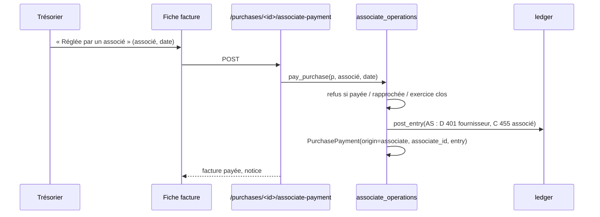

# Conception — module « Associés »

> Entrée : `claudedocs/besoins_associes.md` (F1–F9, US1–US9, décisions Q1–Q10 du 23/10/2026).
> Statut : conception (`/sc:design`), à valider avant `/sc:implement`. Pas de code.

## 1. Principes

- **Tout dans la base de l'instance** (tables tenant, migration Alembic) : registre, réglages,
  notes de frais. Rien dans la base méta : le module suit l'instance dans ses sauvegardes.
- **Le compte courant est un sous-compte 455**, pas une nouvelle trésorerie. Son solde se lit
  dans le grand livre (`ledger.account_balance`) : pas de solde stocké, pas de double vérité.
- **Le registre des parts est hors comptabilité** (Q1) : des lignes datées, la situation se
  recalcule à une date.
- **Réutiliser les mécanismes existants** : écritures (`ledger.post_entry`), paiements de
  facture (`PurchasePayment`), écritures depuis une transaction bancaire
  (`ledger.post_validated_entry`), règles bancaires (`Rule.account_code`), affectation de la
  clôture (`closing.allocate`), pièces (`attachments`), aperçu puis import des imports CSV
  existants.

## 2. Décisions de conception

| # | Décision | Raison |
|---|---|---|
| D1 | Option dans `organization.has_associates` (tenant). Le menu est filtré par une **fonctionnalité** passée à `build_nav` | Modifiable par l'administrateur de l'instance (Q9) ; suit la sauvegarde ; indépendante du plan (R4) |
| D2 | `organization.get()` coche l'option à la création de la ligne si `Instance.chart == "sci"` (F1.2) ; pour une instance existante, c'est l'administrateur qui l'active | La migration tenant ne connaît pas le plan |
| D3 | Un associé = une ligne `associates` liée à **une entité** (tiers) et à **un compte** 455 | Identité et coordonnées restent sur l'entité ; un tiers ne peut pas être deux associés |
| D4 | Sous-compte proposé : premier libre de `4551001` à `4551999`, créé (type `TIERS` comme 455, parent 455, libellé « Compte courant — Nom ») ; un 455 existant peut être choisi (Q5, reprise) | Convention retenue |
| D5 | Registre = `share_movements` (en-tête : date, type, pièce) + `share_movement_lines` (associé, nature, **variation signée** de parts) | Un modèle unique couvre souscription, cession, donation avec démembrement, réunion, réduction et reprise |
| D6 | Situation à une date = somme des variations jusqu'à cette date, par (associé, nature) ; jamais négative ; parts du capital = Σ PP + Σ NP, et Σ NP = Σ usufruit (contrôle) | R2 (pas de lots liés), R3 |
| D7 | Valeur nominale portée par le mouvement (souscription, reprise, réduction) ; la valeur courante est celle du dernier mouvement qui la porte | Capital = parts × nominal, contrôle F3.4 sans réglage de plus |
| D8 | Journal unique **AS « Associés »** (créé à la première écriture) pour : facture réglée par un associé, note de frais, intérêts. Les **apports et remboursements bancaires restent dans le journal de la banque** (ce sont des opérations de banque, rapprochées). L'affectation reste en **OD** (mécanisme de clôture existant) | Q3 adapté : le journal suit la nature de l'opération, comme partout ailleurs dans l'application |
| D9 | Facture réglée par un associé = `PurchasePayment(origin="associate", associate_id, journal_entry_id)` + écriture AS : 401 du fournisseur au débit, 455 de l'associé au crédit | La facture sort de « à payer » comme pour un paiement bancaire ; défaire = supprimer paiement et écriture |
| D10 | Note de frais = table `associate_expenses` + écriture AS (charge et 44566 au débit, 455 au crédit) ; pièce rangée sous `frais/AAAA/MM/` | Pas de faux fournisseur ni de 401 de transit |
| D11 | Intérêts : taux de la société (`organization.associate_interest_rate_bp`, 0 par défaut), surchargeable par associé (`associates.interest_rate_bp`, nul = taux société). Calcul **jour par jour** sur le solde créditeur ; écriture AS au dernier jour de l'exercice : 6615 au débit, **455 de l'associé** au crédit. 6615 est créé s'il manque (absent du plan SCI) | Q2 ; intérêts dus à l'associé, disponibles sur son compte courant |
| D12 | Affectation : `closing` ne change pas. Une fonction `associates.allocation_proposal(fy)` répartit le résultat au prorata des parts PP + usufruit à la date de clôture ; l'écran de la clôture propose cette répartition, modifiable (F8) | Q4 ; un seul mécanisme d'affectation |
| D13 | Import CSV en deux temps : aperçu (rien n'est écrit), puis import (tout ou rien) | F9.2, même ergonomie que les imports existants |
| D14 | Les soldes d'ouverture importés deviennent une **écriture de reprise** (journal AN, datée de la reprise), seulement si le 455 de l'associé n'a encore aucune écriture. La **contrepartie est choisie à l'import** (aucun compte par défaut : ni 890 ni compte d'attente n'existent dans les plans) | Évite de doubler des soldes déjà présents dans le grand livre ; pas de contrepartie inventée |

## 3. Données

### 3.1 Tables nouvelles (base de l'instance)

**`associates`**

| Colonne | Type | Règle |
|---|---|---|
| id | int PK | |
| entity_id | FK entities, **unique**, not null | ondelete RESTRICT |
| account_id | FK accounts, **unique**, not null | code commençant par 455 |
| interest_rate_bp | int, null | null = taux de la société |
| notes | text | |
| created_at, updated_at | datetime | |

**`share_movements`**

| Colonne | Type | Règle |
|---|---|---|
| id | int PK | |
| movement_date | date, not null, index | |
| kind | varchar(20) | `opening`, `subscription`, `transfer`, `donation`, `succession`, `reunion`, `reduction` |
| nominal_cents | int, null | obligatoire pour `opening`, `subscription` et `reduction` |
| price_cents | int, null | prix ou valeur déclarée (informatif) |
| description | text | |
| attachment_path, attachment_name, attachment_mime, attachment_size | | comme `purchases` |
| created_at, created_by_id | | |

**`share_movement_lines`**

| Colonne | Type | Règle |
|---|---|---|
| id | int PK | |
| movement_id | FK share_movements, cascade | |
| associate_id | FK associates, RESTRICT | |
| nature | varchar(10) | `full`, `usufruct`, `bare` |
| parts | int, non nul, ≠ 0 | **signé** : + reçoit, − cède |

Validation par type (dans le service, pas en base) :

| Type | Lignes attendues | Effet sur le capital |
|---|---|---|
| opening / subscription | parts > 0 seulement | + |
| reduction | parts < 0 seulement | − |
| transfer, succession | Σ parts = 0 **par nature** | nul |
| donation | Σ PP + Σ NP inchangée et Σ NP = Σ usufruit après le mouvement (ex. donateur −300 PP, +300 usufruit ; donataires +150 NP, +150 NP) | nul |
| reunion | −N usufruit (usufruitier), −N NP, +N PP (au nu-propriétaire) | nul |

Pour tous les types, aucune situation (associé, nature) ne devient négative à la date du
mouvement ni à une date postérieure. Une modification ou une suppression qui casserait cette
règle est refusée, avec le premier mouvement postérieur en cause.

**`associate_expenses`**

| Colonne | Type |
|---|---|
| id, associate_id (FK), expense_date, label | |
| account_id (charge 6…), untaxed_cents, vat_rate_bp, vat_cents, total_cents | |
| attachment_* | comme `purchases` |
| journal_entry_id (FK journal_entries, SET NULL) | |
| created_at | |

### 3.2 Colonnes ajoutées

| Table | Colonne | Défaut |
|---|---|---|
| organization | has_associates bool | false |
| organization | associate_interest_rate_bp int | 0 |
| purchase_payments | associate_id FK associates, null | null ; renseigné quand `origin = "associate"` |

Contrainte : au plus un paiement `associate` par facture (index unique partiel
`purchase_id WHERE origin='associate'`). Une facture qui a déjà un paiement bancaire ne peut pas
recevoir un paiement d'associé, et inversement (contrôle dans le service).

### 3.3 Écritures générées

| Opération | Journal | Débit | Crédit | `source` / `source_ref` |
|---|---|---|---|---|
| Facture réglée par un associé | AS | 401 du fournisseur | 455 de l'associé | `ASSOCIATE` / `PURCHASE_PAYMENT:<id>` |
| Note de frais | AS | charge (+ 44566) | 455 de l'associé | `ASSOCIATE` / `EXPENSE:<id>` |
| Apport (transaction créditrice) | journal de la banque | 512 | 455 | écriture saisie depuis la transaction, rapprochée |
| Remboursement (transaction débitrice) | journal de la banque | 455 | 512 | idem |
| Intérêts de l'exercice | AS, au dernier jour | 6615 | 455 de l'associé | `ASSOCIATE` / `INTEREST:<fy>:<associate>` |
| Affectation | OD de N+1 | 120 | 455 des associés (et 10x/11x) | existant (`ALLOCATION`) |
| Solde d'ouverture importé | AN | contrepartie choisie à l'import | 455 | `ASSOCIATE` / `OPENING:<associate>` |

Toute écriture d'un exercice clôturé est intouchable : les actions correspondantes sont refusées
avec le message de clôture habituel.

## 4. Services

`app/services/associates.py` — registre et comptes courants

| Fonction | Rôle |
|---|---|
| `enabled()` | `organization.get().has_associates` |
| `next_account_code()` | Premier code libre 4551001… |
| `create(entity, account_code=None, interest_rate_bp=None)` | Crée l'associé et, au besoin, son compte 455 |
| `holdings(at: date)` | `[(associate, nature, parts)]` et total des parts du capital ; contrôles D6 |
| `capital(at)` | Parts, nominal, capital, solde du 101, écart |
| `validate_movement(kind, date, lines, nominal)` | Règles du § 3.1 sur la situation simulée à toutes les dates ≥ date |
| `add_movement` / `update_movement` / `delete_movement` | Avec la validation ci-dessus |
| `balances(at)` | Solde de chaque 455 (grand livre) ; somme comparée au solde 455 global |
| `statement(associate, start, end)` | Lignes du 455 avec origine et lien vers la pièce |
| `balances_by_fiscal_year()` | Solde à la fin de chaque exercice, pour le graphique |
| `allocation_proposal(fy)` | Lignes `{account_code, amount_cents}` au prorata PP + usufruit à `fy.end_date`, centimes répartis au plus fort reste |
| `disable_warnings()` | Associés dont le solde n'est pas nul (F1.3) |

`app/services/associate_operations.py` — opérations du compte courant

| Fonction | Rôle |
|---|---|
| `pay_purchase(purchase, associate, paid_on, amount=None)` | D9 ; refus si payée ou liée à une transaction ; écriture AS |
| `unpay_purchase(payment)` | Supprime l'écriture et le paiement (exercice ouvert) |
| `create_expense(associate, data, token)` / `delete_expense` | D10, pièce via `attachments` généralisé |
| `interest_preview(fy)` | Par associé : taux, nombres de jours × soldes créditeurs, intérêts |
| `post_interest(fy)` | Écritures D11 (remplacées si on relance avant la clôture) |
| `bank_entry_payload(transaction, associate)` | Préremplit l'écriture 512 / 455 de la transaction (l'enregistrement passe par `post_validated_entry`) |

`app/services/associates_import.py` — `preview(file)` → lignes analysées et erreurs ;
`run(file)` → tout ou rien.

Colonnes CSV (UTF-8, séparateur `;` ou `,`, en-têtes insensibles à la casse et aux accents) :

| Colonne | Obligatoire | Contenu |
|---|---|---|
| nom | oui | Entité rapprochée par nom normalisé (`counterparties.name_key`), sinon créée |
| compte | non | 455… existant ou à créer ; vide = prochain 4551… |
| nature | oui | PP / US / NP (ou « pleine propriété », « usufruit », « nue-propriété ») |
| parts | oui | entier > 0 |
| date | oui | date de reprise (JJ/MM/AAAA) ; une ligne de mouvement `opening` par date |
| nominal | oui sur au moins une ligne | valeur d'une part |
| solde | non | solde d'ouverture du compte courant, créditeur positif (D14) |
| taux | non | taux d'intérêt annuel en % |

Un associé démembré a une ligne par nature, ce qui correspond à l'export d'Ekylibre.

Généralisation de `attachments` : `store(target, token, folder)` et `path_of(target)` pour tout
objet portant les colonnes `attachment_*` (factures, mouvements de parts, notes de frais).

`app/menu_config.py` : clé `"feature": "associates"` sur le menu ; `build_nav(..., features=set())`
masque une entrée dont la fonctionnalité est absente ; `api/session.py` passe
`{"associates"} if associates.enabled()`.

`app/services/organization.py` : D2, plus les champs `has_associates` et
`associate_interest_rate_bp` dans la validation (taux de 0 à 20 %, deux décimales).

## 5. API (`app/api/associates.py`, préfixe `/api/v1`)

Toutes les routes répondent 404 `feature_disabled` si l'option est désactivée.
« Admin » = administrateur de l'instance ; « Trésorier » = trésorier ou admin. Un
expert-comptable a la lecture seule, par la garde existante.

| Méthode et route | Droit | Rôle |
|---|---|---|
| GET `/associates?at=AAAA-MM-JJ` | lecture | Liste : associé, compte, solde, parts par nature, %, sorti |
| POST `/associates` | admin | `{entity_id \| new_name, account_code?, interest_rate?}` |
| GET / PATCH / DELETE `/associates/<id>` | lecture / admin / admin | Fiche ; suppression refusée si le registre ou le 455 a des lignes |
| GET `/associates/<id>/statement?start&end` | lecture | Relevé |
| GET `/associates/balances-by-year` | lecture | Données du graphique |
| GET `/share-movements?at` | lecture | Registre et situation à la date ; capital et contrôles |
| POST / PATCH / DELETE `/share-movements[/<id>]` | admin | Mouvement (multipart si pièce) ; erreurs `lines.<i>.<champ>` |
| POST `/purchases/<id>/associate-payment` | trésorier | `{associate_id, paid_on}` → écriture AS |
| DELETE `/purchases/<id>/associate-payment` | trésorier | Défait le règlement |
| GET / POST `/associate-expenses`, DELETE `/associate-expenses/<id>` | lecture / trésorier | Notes de frais (multipart) |
| GET `/fiscal-years/<id>/associate-interest` | lecture | Aperçu des intérêts |
| POST `/fiscal-years/<id>/associate-interest` | admin | Passe les écritures |
| GET `/fiscal-years/<id>/allocation-proposal` | lecture | Répartition proposée (D12) |
| POST `/associates/import/preview`, POST `/associates/import` | admin | Import CSV (D13) |
| PATCH `/organization` (existant) | admin | `has_associates`, `associate_interest_rate` ; la réponse porte `warnings` si on désactive avec des soldes |

Les écritures depuis une transaction bancaire passent par l'API existante des écritures. L'écran
de rapprochement appelle `GET /bank-transactions/<id>/associate-entry?associate_id=` pour le
préremplissage.

## 6. Écrans

| Écran | Contenu |
|---|---|
| **Associés › Associés** (`/associates`) | Grille : nom, compte, parts PP / usufruit / NP, % du capital, solde du compte courant (sens explicite, solde débiteur signalé) ; date de situation ; bascule « Graphique » (soldes empilés par exercice, comme Ekylibre) ; bouton « Nouvel associé » (admin) |
| **Fiche associé** (`/associates/<id>`) | Identité (lien vers l'entité), compte, taux d'intérêt, parts à la date, relevé du compte courant avec liens vers les pièces, mouvements de parts le concernant |
| **Associés › Registre des parts** (`/share-movements`) | Capital à la date (parts, nominal, capital, écart avec le 101), tableau de situation, liste des mouvements ; formulaire par type : lignes « associé, nature, parts », aide selon le type (donation : « le donateur garde l'usufruit ? ») et prévisualisation de la situation après le mouvement |
| **Associés › Notes de frais** (`/associate-expenses`) | Liste et saisie : associé, date, libellé, compte de charge, HT, taux, TVA, pièce |
| **Associés › Import** (`/associates/import`, admin) | Dépôt du CSV, aperçu ligne à ligne, erreurs, puis import |
| Fiche facture d'achat | Bouton « Réglée par un associé » (si la facture est comptabilisée et sans paiement) ; badge « Réglée par X » et « Défaire » |
| Saisie de facture | Option « Payée par un associé » (associé, date) appliquée après l'enregistrement |
| Rapprochement | Sur une transaction non rapprochée : action « Compte courant d'associé » → choix de l'associé → éditeur d'écriture prérempli (512 / 455) |
| Clôture, étape 8 | Bouton « Répartir entre les associés » qui remplit les lignes avec la proposition D12 ; action « Intérêts des comptes courants » avant la clôture provisoire (aperçu, puis écritures) |
| Configuration › Structure | Case « Société avec associés » et taux d'intérêt par défaut ; avertissement à la désactivation |

Menu : « Associés » (Associés, Registre des parts, Notes de frais, Import) avec
`feature: "associates"`, pour les deux plans.

## 7. Flux principaux



```mermaid
flowchart LR
  R[Registre : mouvements datés] -->|holdings(fy.end)| P[Parts PP + usufruit]
  P -->|prorata| A[allocation_proposal]
  A --> C[Écran clôture étape 8 : lignes 455 modifiables]
  C -->|closing.allocate existant| E[Écriture OD N+1 : 120 → 455]
```

## 8. Tests

- **Service** : validation de chaque type de mouvement, y compris la donation avec réserve
  d'usufruit (US3) et la réunion ; refus d'une situation négative à une date postérieure ;
  situation à une date (US9) ; contrôle du capital face au 101 ; numérotation 4551001.
- **Intérêts** : calcul jour par jour (soldes variables, solde débiteur ignoré) ; taux nul,
  aucune écriture ; relance qui remplace les écritures.
- **Répartition** : prorata PP + usufruit, centimes au plus fort reste, nu-propriétaires exclus.
- **Opérations** : facture réglée (écriture, état payé, double paiement refusé, défaire) ; note
  de frais avec TVA ; exercice clôturé refusé.
- **Import** : aperçu sans écriture, tout ou rien, rapprochement des tiers par nom, solde
  d'ouverture non doublé (D14).
- **API** : droits par rôle (admin, trésorier, expert-comptable), 404 si l'option est
  désactivée, menu absent.
- **Vitest** : formulaire de mouvement (lignes, aide par type), action de la fiche facture,
  graphique.
- **E2E** : activer l'option, créer deux associés, donation avec démembrement, régler une
  facture par un associé, vérifier le relevé.

## 9. Lots

| Lot | Contenu | Dépend de |
|---|---|---|
| **A1** | Migration (tables, colonnes), option et menu (D1, D2), `associates` (création, comptes 4551…), liste et fiche sans registre | — |
| **A2** | Registre des parts : service, API, écran, situation à une date, contrôles du capital | A1 |
| **A3** | Opérations : facture réglée par un associé (fiche et saisie), notes de frais, préremplissage du rapprochement, relevé et graphique | A1 |
| **A4** | Clôture : intérêts (D11) et proposition d'affectation (D12) | A2, A3 |
| **A5** | Import CSV (D13, D14), reprise d'Ekylibre testée sur la copie SCI | A2 |
| **A6** | Documentation utilisateur (`doc/associes.md`), `doc/models.md`, `doc/routes.md`, `doc/services.md`, E2E | A1–A5 |

## 10. Risques et points d'attention

- **Migration des vraies bases** : comme les lots précédents, la migration n'est appliquée aux
  bases réelles qu'avec ton accord. Elle s'ajoute aux 11 migrations en attente.
- **Copie SCI sans Qonto** : les essais se font sur la copie du serveur 5001, sans identifiants
  Qonto. Régler une facture par un associé n'appelle jamais Qonto (Q7).
- **Plan SCI** : 6615 absent (présent dans le plan asso), il est créé à la demande. 4551 est un compte de regroupement
  (« 4551 à 4557 ») mais pas un titre : les sous-comptes 4551001… se créent sous 455.
- **Affectation SCI** : la règle « usufruitier » est retenue ; la relecture par
  l'expert-comptable (point D9 déjà ouvert) reste souhaitable avant la mise en service.
- **Solde débiteur** : il est signalé, pas bloqué (une SCI peut l'avoir ; une SARL ne doit pas).
