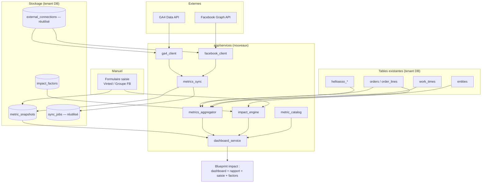
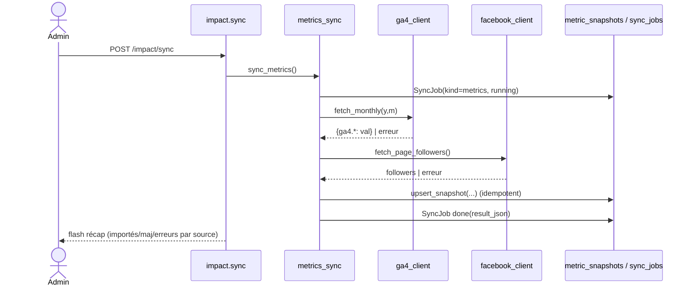
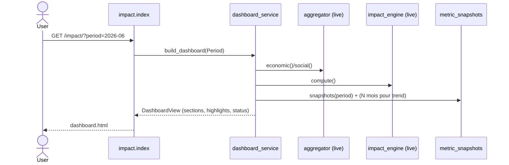

# Design — Tableau de bord « Visibilité & Impact »

> **Statut : ARCHITECTURE / DESIGN (sortie de `/sc:design`).**
> Décrit la structure, les schémas de données, les interfaces de service et les
> flux. **Aucun code d'implémentation** (ça vient avec `/sc:implement`).
> Entrée : `claudedocs/besoins_dashboard_visibilite_impact.md`. Date : 2026-06-27.

---

## 1. Principes directeurs

1. **Une seule source de vérité par donnée.** On ne duplique jamais ce qu'on sait
   recalculer. Les métriques internes (éco/social) et l'impact environnemental sont
   **calculés à la volée** depuis les tables existantes. Seules les métriques qu'on
   **ne peut pas recalculer** (API externes + saisie manuelle) sont **stockées** en
   série temporelle.
2. **Réutilisation maximale de l'existant** : `ExternalConnection`/`external_config`
   pour les secrets, `SyncJob` pour les synchros, helpers `list_filters` pour les
   périodes, filtre `| euros`, module `work_times`, `membership_status`, `orders`,
   `helloasso`.
3. **Dégradation gracieuse** : une source en panne ou non configurée n'empêche pas
   le reste du dashboard de s'afficher (KPI « N/A » + raison).
4. **Traçabilité financeurs** : chaque chiffre porte sa source, sa période et — pour
   l'impact — la méthode/facteur de calcul.
5. **Multi-tenant** : toutes les nouvelles tables vivent dans la base **tenant**
   (bind par défaut), comme `entities`/`work_times`. Secrets par instance.

### Décisions de design (défauts retenus pour les questions ouvertes §8 des besoins)
| Q | Décision v1 |
|---|---|
| Q1 Vinted / groupe FB | **Formulaire de saisie mensuelle** (les seules sources non automatisables). |
| Q2 Facebook Page | **Abonnés** en v1 (simple) ; portée/engagement en **v2** (revue d'app Meta requise). |
| Q3 Articles collectés | v1 : réemploi = vendus (POS+Vinted) + dons (manuel). « Collectés » = champ manuel **optionnel** pour le taux de réemploi. |
| Q4 Facteurs env. | Table `impact_factors` éditable, **source = ADEME Base Empreinte** (actée), validée par le bureau. |
| Q5 CA Vinted | Total mensuel **saisi** (en centimes) — alimente éco **et** impact. |
| Q6 Cadence | Snapshots **mensuels** ; déclenchement manuel (bouton) + cron optionnel ; rétention illimitée. |
| Q7 Objectifs | **v2** (table `metric_targets` optionnelle). |

---

## 2. Architecture de composants



**Règle clé (live vs stored) :**

| Dimension | Données | Stratégie | Origine |
|---|---|---|---|
| Économique | CA POS, dons/adhésions | **Live** | `orders`, `helloasso_*` |
| Économique | CA Vinted | **Stored (manuel)** | `metric_snapshots` |
| Social | bénévoles, heures, adhérents | **Live** | `work_times`, `entities`, `membership_status` |
| Environnemental | kg, CO₂, eau | **Live (calcul)** | ventes × `impact_factors` |
| Visibilité | GA4 (site) | **Stored (auto)** | `metric_snapshots` |
| Visibilité | Facebook Page | **Stored (auto, v1=abonnés)** | `metric_snapshots` |
| Visibilité | Groupe FB, Vinted | **Stored (manuel)** | `metric_snapshots` |

---

## 3. Schéma de données

> Spécification de schéma (pas la migration Alembic). Conventions du projet :
> montants en **centimes entiers** ; une table = un fichier modèle ré-exporté
> dans `app/models/__init__.py` ; `server_default` pour tout champ non nullable
> ajouté ; FK avec `ondelete` explicite.

### 3.1 `metric_snapshots` (nouvelle)
Série temporelle générique pour tout ce qui n'est pas recalculable.

| Colonne | Type | Notes |
|---|---|---|
| `id` | Integer PK | |
| `source` | String(30), not null, index | `ga4` / `facebook_page` / `facebook_group` / `vinted` |
| `metric_key` | String(60), not null, index | clé du catalogue, ex. `ga4.active_users` |
| `period_start` | Date, not null, index | 1er jour de la période couverte |
| `granularity` | String(10), not null, default `month` | `month` (v1) / `day` (extensible) |
| `value` | Numeric(18,4), not null | valeur brute selon `unit` |
| `unit` | String(20), not null | `count`/`cents`/`kg`/`ratio`/`seconds`… |
| `is_manual` | Boolean, not null, server_default false | distingue saisie vs API |
| `captured_at` | DateTime, default utcnow | horodatage de capture |
| `entered_by_user_id` | Integer FK `users.id` ON DELETE SET NULL, nullable | qui a saisi (manuel) |
| `note` | Text, nullable | |

- **Unicité** `(source, metric_key, period_start, granularity)` → **upsert** (idempotence des synchros et corrections de saisie).
- Index `(metric_key, period_start)` pour les courbes de tendance.

### 3.2 `impact_factors` (nouvelle)
Facteurs de conversion ventes → impact environnemental, éditables et sourcés.

| Colonne | Type | Notes |
|---|---|---|
| `id` | Integer PK | |
| `key` | String(60), unique, not null | ex. `textile.avg_weight_kg` |
| `value` | Numeric(18,6), not null | |
| `unit` | String(20), not null | `kg`, `kg_co2e_per_kg`, `l_per_kg`… |
| `source_label` | String(200) | « ADEME Base Empreinte 2024 » |
| `source_url` | String(500), nullable | |
| `updated_at` | DateTime, onupdate utcnow | |
| `updated_by_user_id` | Integer FK `users.id` ON DELETE SET NULL, nullable | |

Clés v1 attendues : `textile.avg_weight_kg`, `textile.co2e_per_kg`,
`textile.water_l_per_kg`, `equiv.car_km_per_co2e_kg` (équivalent pédagogique).

### 3.3 `metric_targets` (v2, optionnelle)
`(metric_key, period_start, target_value)` pour colorer les KPI selon des objectifs.

### 3.4 Réutilisé (aucune nouvelle table)
- **`external_connections`** — ajouter les services `ga4` et `facebook` au registre
  `external_config.SERVICE_KEYS` (cf. §6).
- **`sync_jobs`** — ajouter la constante `SYNC_KIND_METRICS = "metrics"`
  (`payout_id` reste nul). Réutilise le suivi statut/progress/result_json existant.

---

## 4. Catalogue de métriques (registre `metric_catalog`)

Module `app/services/metric_catalog.py` : **registre déclaratif** qui pilote
affichage, stockage, unités et sens (hausse = bien ?). Source unique pour le
dashboard, l'export et le formulaire de saisie.

Contrat d'une entrée :
```
Metric(
  key:        str,          # 'ga4.active_users'
  label:      str,          # 'Utilisateurs actifs'
  dimension:  str,          # 'visibility'|'environmental'|'social'|'economic'
  source:     str,          # 'ga4'|'facebook_page'|'vinted'|'internal'|'computed'
  unit:       str,          # 'count'|'cents'|'kg'|'co2e_kg'|'ratio'|'hours'
  origin:     str,          # 'live'|'snapshot'|'manual'
  higher_is_better: bool,
  format:     str,          # 'int'|'euros'|'decimal'|'percent'|'duration'
)
```

Extrait du catalogue v1 :

| key | dimension | source | origin | unit |
|---|---|---|---|---|
| `ga4.active_users`, `ga4.sessions`, `ga4.engagement_rate`, `ga4.avg_session_duration` | visibility | ga4 | snapshot | count/ratio/seconds |
| `facebook_page.followers` | visibility | facebook_page | snapshot | count |
| `facebook_group.members` | visibility | facebook_group | manual | count |
| `vinted.followers`, `vinted.items_listed` | visibility | vinted | manual | count |
| `vinted.items_sold`, `vinted.revenue_cents` | economic | vinted | manual | count/cents |
| `econ.pos_revenue_cents`, `econ.donations_cents`, `econ.memberships_cents` | economic | internal | live | cents |
| `social.active_volunteers`, `social.volunteer_hours`, `social.volunteer_value_cents` | social | internal | live | count/hours/cents |
| `social.members_count`, `social.renewal_rate` | social | internal | live | count/ratio |
| `env.items_reused`, `env.weight_kg`, `env.co2e_avoided_kg`, `env.water_saved_l`, `env.reuse_rate` | environmental | computed | live | count/kg/ratio |

**Agrégats / indicateurs phares** (dérivés, calculés par `dashboard_service`) :
- `agg.total_audience` = `ga4.active_users` + `facebook_page.followers` +
  `facebook_group.members` + `vinted.followers`.
- `agg.total_revenue_cents` = `econ.pos_revenue_cents` + `vinted.revenue_cents`.
- Équivalent pédagogique : `env.co2e_avoided_kg` × `equiv.car_km_per_co2e_kg`.

---

## 5. Interfaces de service (contrats)

> Signatures uniquement — pas de logique. Tous les retours sont des structures
> simples (dataclass/dict) pour rester testables sans I/O.

### 5.1 Connecteurs externes
```python
# app/services/ga4_client.py
class GA4ConfigError(Exception): ...
def from_app_config() -> "GA4Client"            # lit external_config('ga4', ...)
class GA4Client:
    def fetch_monthly(self, year: int, month: int) -> dict[str, float]:
        """Retourne {metric_key: value} pour le mois (active_users, sessions, ...)."""

# app/services/facebook_client.py
class FacebookConfigError(Exception): ...
def from_app_config() -> "FacebookClient"
class FacebookClient:
    def fetch_page_followers(self) -> int: ...
    def fetch_page_insights(self, year: int, month: int) -> dict[str, float]:  # v2
        ...
```

### 5.2 Synchronisation
```python
# app/services/metrics_sync.py
def sync_metrics(months_back: int = 1) -> dict:
    """Orchestre GA4 + Facebook : fetch → upsert metric_snapshots → SyncJob.
    Retour {source: {imported, updated, errors[]}, ...}. Tolérant aux pannes
    par source (n'interrompt pas les autres)."""

def upsert_snapshot(source, metric_key, period_start, value, unit,
                    granularity="month", is_manual=False, user_id=None,
                    note=None) -> "MetricSnapshot":
    """Upsert idempotent sur la clé unique."""
```

### 5.3 Agrégateur interne (live)
```python
# app/services/metrics_aggregator.py
def economic(period: "Period") -> dict[str, int]:     # cents
def social(period: "Period") -> dict[str, float]:     # bénévoles/heures/adhérents
# Réutilise membership_status pour renewal_rate, work_times pour heures/valorisation,
# orders + helloasso pour les montants.
```

### 5.4 Moteur d'impact (live)
```python
# app/services/impact_engine.py
def compute(period: "Period") -> dict[str, float]:
    """items_reused = ventes POS + vinted.items_sold (+ dons manuels).
    weight_kg = items_reused * factor('textile.avg_weight_kg').
    co2e_avoided_kg = weight_kg * factor('textile.co2e_per_kg').
    water_saved_l   = weight_kg * factor('textile.water_l_per_kg').
    reuse_rate      = items_reused / items_collected (si collecté saisi)."""
def factor(key: str) -> float          # lit impact_factors, défaut documenté
```

### 5.5 Service de dashboard (assemblage)
```python
# app/services/dashboard_service.py
@dataclass
class Period:           # bornes + libellé, construit depuis les query args
    start: date; end: date; label: str; previous: "Period|None"

@dataclass
class Kpi:
    key: str; label: str; value; unit: str; formatted: str
    delta_pct: float | None       # vs période précédente
    trend: list[float]            # n derniers points pour sparkline
    source: str; origin: str; fresh_at: datetime | None; available: bool

@dataclass
class DashboardView:
    period: Period
    sections: dict[str, list[Kpi]]      # 'visibility'|'environmental'|'social'|'economic'
    highlights: list[Kpi]               # agrégats phares + équivalents
    sources_status: list[dict]          # fraîcheur/erreur par source

def build_dashboard(period: Period) -> DashboardView
def build_report(period: Period) -> DashboardView      # même vue, format rapport
```

**Fusion** : `build_dashboard` interroge `aggregator` + `impact_engine` (live) et
`metric_snapshots` (stored), mappe via `metric_catalog`, calcule `delta_pct` (vs
`period.previous`) et `trend` (N derniers mois de snapshots ou de calculs).

---

## 6. Intégrations externes — spécifications

### 6.1 GA4 (Google Analytics Data API)
- **Propriété** : `472641442` (cf. URL fournie).
- **Auth** : compte de service Google ; JSON de clé stocké en `ExternalConnection`
  `ga4.credentials_json` ; `ga4.property_id`. Le compte de service doit être ajouté
  comme *Viewer* sur la propriété GA4.
- **Lib** : `google-analytics-data` (`BetaAnalyticsDataClient.run_report`) → **nouvelle dépendance** `requirements.txt`.
- **Métriques** : `activeUsers`, `newUsers`, `sessions`, `engagementRate`,
  `averageSessionDuration`, `screenPageViews` ; **dimension** `yearMonth` (+
  `sessionDefaultChannelGroup` pour l'acquisition, v2).
- **Quota** : Data API à jetons → **1 appel/mois/synchro** suffisant, mise en cache
  par `metric_snapshots`.

### 6.2 Facebook (Graph API)
- **Auth** : *Page Access Token* longue durée (`facebook.page_token`), `facebook.page_id`,
  `facebook.app_id`/`facebook.app_secret` (rafraîchissement du token).
- **v1 — abonnés** : `GET /{page_id}?fields=followers_count,fan_count`. Permission de
  base, pas de revue d'app.
- **v2 — insights** : `GET /{page_id}/insights?metric=page_impressions,page_post_engagements&period=month`
  → nécessite `read_insights` + **revue d'app Meta** (délai). Documenté comme jalon séparé.
- **Limites assumées** : **groupe Facebook** (API dépréciée) et **Vinted** (pas
  d'API) → **non automatisables**, traités par le formulaire de saisie.

### 6.3 Registre `external_config` à étendre
```
SERVICE_KEYS["ga4"]      = ["property_id", "credentials_json"]
SERVICE_KEYS["facebook"] = ["page_id", "page_token", "app_id", "app_secret"]
SERVICE_REQUIRED_KEYS["ga4"]      = ["property_id", "credentials_json"]
SERVICE_REQUIRED_KEYS["facebook"] = ["page_id", "page_token"]
SERVICE_LABELS["ga4"] = "Google Analytics (GA4)"; ["facebook"] = "Facebook Page"
```

---

## 7. Couche web — blueprint `impact`

`app/views/impact.py`, `url_prefix="/impact"`, enregistré dans `app/__init__.py`.

| Route | Méthode | Rôle |
|---|---|---|
| `/impact/` | GET | Dashboard live (filtre période + comparaison) |
| `/impact/report` | GET | Vue rapport imprimable (PDF via impression navigateur) |
| `/impact/manual` | GET, POST | Saisie mensuelle Vinted + groupe FB (+ collectés/dons optionnels) |
| `/impact/factors` | GET, POST | Paramétrage des facteurs d'impact (**admin**) |
| `/impact/sync` | POST | Déclenche `sync_metrics` (GA4 + Facebook) |
| `/impact/export.xlsx` | GET | Export données (pattern `members_export` : pandas/openpyxl) |

**Templates** `app/templates/impact/` : `dashboard.html`, `report.html`,
`manual_form.html`, `factors.html`.

**Filtre de période** : réutilise `app/utils/list_filters.py`
(`parse_month`, `month_options_for_fy`, bornes) + un sélecteur
mois/trimestre/année/plage. `Period.previous` dérivé pour les variations.

**Navigation** (`base.html`) : nouvelle entrée de 1er niveau **« Visibilité &
Impact »** (le module transverse plusieurs domaines), `active` si
`request.blueprint == 'impact'`. Sync/factors visibles selon `current_user.is_admin`
comme le menu Configuration.

**Composants UI** (Bootstrap 5, cohérents avec le dashboard existant) : cartes KPI
(valeur + Δ% + flèche), mini-sparklines (léger, ex. SVG/inline ou lib légère),
bandeau « fraîcheur des sources », sections par dimension, bloc « chiffres
parlants ». HTMX pour le rechargement du dashboard au changement de période.

---

## 8. Flux

### 8.1 Synchronisation externe


### 8.2 Rendu du dashboard


---

## 9. Export / rapport
- **v1** : `report.html` mis en page « rapport d'activité » + **CSS d'impression**
  (`@media print`) → l'utilisateur imprime/enregistre en PDF. Inclut période, les 4
  dimensions, agrégats, **équivalents** et **sources/méthodes** (exigence financeurs).
- **Données brutes** : `/impact/export.xlsx` (pandas/openpyxl, pattern `members_export`).
- **PDF serveur** (option v2) : `weasyprint` si un rendu identique hors navigateur
  est requis (dépendance + libs système → jalon séparé).

---

## 10. Sécurité, RGPD, robustesse
- **Secrets** par instance dans `external_connections` (jamais versionnés), comme
  Stancer/Odoo/HelloAsso. JSON de service GA4 = champ `Text` sensible.
- **RGPD** : on ne stocke que des **métriques agrégées** (aucune donnée d'audience
  individuelle) ; GA4 renvoie déjà de l'agrégat.
- **Robustesse** : `sync_metrics` isole chaque source (try/except par connecteur) ;
  le dashboard marque `available=False` + raison si une source manque, sans planter.
- **Quotas/coût** : pas d'appel externe au rendu — uniquement à la synchro (manuelle
  ou cron). Le dashboard lit le store + calcule en local.
- **Permissions** : `factors` et `sync` réservés aux admins ; consultation pour tout
  utilisateur connecté.

---

## 11. Fichiers (cible)

**Créés**
- Modèles : `app/models/metric_snapshot.py`, `app/models/impact_factor.py`
- Services : `ga4_client.py`, `facebook_client.py`, `metrics_sync.py`,
  `metrics_aggregator.py`, `impact_engine.py`, `metric_catalog.py`, `dashboard_service.py`
- Vue : `app/views/impact.py`
- Templates : `app/templates/impact/{dashboard,report,manual_form,factors}.html`
- Migration : `migrations/versions/<rev>_add_metric_snapshots_impact_factors.py`
- Tests : `tests/test_impact_dashboard.py`

**Modifiés**
- `app/models/__init__.py` (imports + `__all__`)
- `app/services/external_config.py` (services `ga4`, `facebook`)
- `app/models/sync_job.py` (`SYNC_KIND_METRICS`)
- `app/__init__.py` (`register_blueprint(impact_bp)`)
- `app/templates/base.html` (entrée nav)
- `requirements.txt` (`google-analytics-data` ; `requests` déjà présent pour Facebook)

---

## 12. Découpage proposé (entrée pour `/sc:workflow`)
1. **Socle** : modèles + migration + `metric_catalog` + `dashboard_service` (squelette) + blueprint + nav.
2. **Interne (éco + social)** : `metrics_aggregator` → dashboard sans dépendance externe (valeur immédiate).
3. **Environnemental** : `impact_factors` + `/factors` + `impact_engine` + équivalents.
4. **Saisie manuelle** : `/manual` (Vinted, groupe FB, collectés/dons) → complète éco/visibilité/impact.
5. **GA4** : `ga4_client` + intégration `metrics_sync` + config.
6. **Facebook Page (abonnés)** : `facebook_client` + sync.
7. **Restitution** : `report.html` (impression) + `export.xlsx`.
8. **v2** : insights Facebook (revue d'app), objectifs (`metric_targets`), cron de synchro, PDF serveur.

---

## 13. Risques & points de validation
- **Facteurs environnementaux** : crédibilité = source officielle validée (ADEME/Refashion).
  À acter avant communication externe.
- **Token Facebook** : expiration/rafraîchissement à gérer ; v1 abonnés seulement.
- **Cohérence CA** : éviter le double comptage Vinted (saisie) vs POS (auto) — canaux disjoints par construction.
- **Discipline de saisie** : la qualité des blocs Vinted/groupe FB dépend d'une saisie
  mensuelle régulière → rappel d'« attente de saisie » dans le bandeau de fraîcheur.

**Prochaine étape** : `/sc:workflow claudedocs/design_dashboard_visibilite_impact.md`
pour le plan d'implémentation phasé, puis `/sc:implement` phase par phase.
