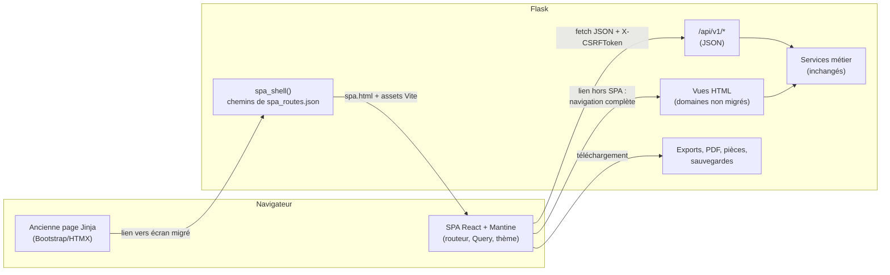
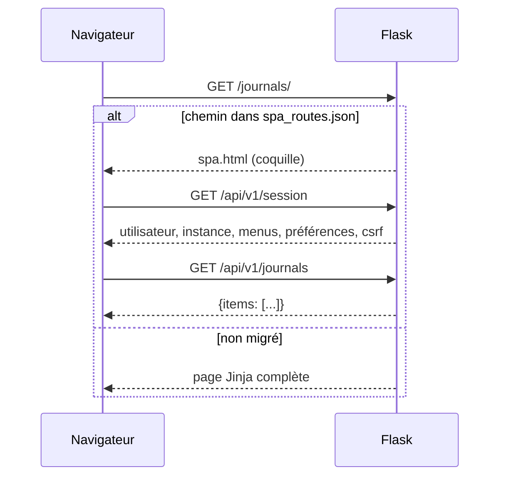

# Design — Front React + Mantine

> Statut : **proposé** (2026-10-22), à valider. Besoins : [`besoins_front_mantine.md`](besoins_front_mantine.md)
> (FM1 à FM16, F1 à F14, NF1 à NF9). Étape suivante : `/sc:workflow`.
> Remplace à terme [`design_front_reactif.md`](design_front_reactif.md) (HTMX + îlots).

## 1. Décisions

| # | Sujet | Décision | Raison |
|---|-------|----------|--------|
| D1 | Pile | React **19.2**, Mantine **9.7** (`core`, `hooks`, `form`, `dates`, `notifications`, `modals`, `spotlight`, `dropzone`, `charts`), **react-router 8** (mode données, routes paresseuses), **TanStack Query 5**, **mantine-datatable 9**, dayjs (`fr`), TypeScript strict, Vite 8 | Mantine 9 exige React ≥ 19.2 ; mantine-datatable est la table native Mantine 9 (tri, sélection, pagination, colonnes masquables) ; Query gère cache, invalidation, états de chargement |
| D2 | Coexistence | **Table des routes SPA unique** `app/spa_routes.json` lue par Flask (sert la coquille SPA sur ces URL) et par le routeur React ; toute autre URL = ancienne page (navigation complète) | Mêmes URL (FM3), une seule source de vérité, bascule d'un domaine = ajouter ses chemins |
| D3 | Coquille | Gabarit minimal `spa.html` (sans Bootstrap) : assets Vite + jeton CSRF ; le reste vient de `GET /api/v1/session` | Démarrage simple, session et menus à jour à chaque chargement |
| D4 | API | Extension de `/api/v1` par domaine, conventions §5 ; **types TypeScript écrits à la main** par domaine, contrat vérifié par les tests pytest | Au plus vite (FM15) : pas de couche de schémas / génération OpenAPI à introduire |
| D5 | Listes | **Côté serveur** (pagination, tri, filtres) pour les listes potentiellement longues (écritures, transactions, grand livre, factures, adhérents, temps) ; **côté client** pour les référentiels (journaux, exercices, plan, produits, règles, utilisateurs) | Volumes réels : référentiels < 1 000 lignes, mouvements illimités |
| D6 | Préférences | Colonne JSON **`users.preferences`** (base meta) ; `GET` dans la session, `PATCH /api/v1/me/preferences` (fusion) | FM14 ; base meta hors Alembic : `ALTER` idempotent comme `Instance.chart` |
| D7 | Thème | Fichier unique `frontend/src/app/theme.ts` (couleur principale, palette, police, rayons) + `assets/logo.svg` provisoire ; schéma clair / sombre via un `colorSchemeManager` adossé aux préférences | FM11 : la charte arrive plus tard sans toucher aux écrans |
| D8 | Formulaires | `@mantine/form` ; validation serveur source de vérité (`fields` de l'erreur 422 → erreurs au champ) ; contrôles client limités au format | Comme les îlots actuels (D5 du design précédent) |
| D9 | Îlots existants | Logique gardée (`entryState.ts`, `ReconcileWorkspace/logic.ts`, raccourcis, API) ; **composants réécrits en Mantine** | NF2 sans régression, moins de travail |
| D10 | Graphiques | `@mantine/charts` par défaut ; ECharts (paquet npm, composant `EChart`) seulement si un graphique n'a pas d'équivalent | FM6 |
| D11 | Rapport d'activité | Aperçu = HTML rendu par le serveur (même gabarit que le PDF) dans un `iframe` ; seuls les formulaires d'édition passent en React | Le gabarit `_body.html` reste nécessaire au PDF : pas de double rendu à maintenir |
| D12 | Téléchargements | Liens directs vers les routes Flask existantes (exports, PDF, pièces, sauvegardes) ; dépôts via `XMLHttpRequest` (progression) | FM5 |
| D13 | Tests | pytest API (`tests/api/`), Vitest (composants sous `MantineProvider`), **Playwright** (`frontend/e2e/`) contre un serveur Flask de test sur base jetable | FM8 |
| D14 | Retrait | À la bascule d'un domaine : chemins ajoutés à `spa_routes.json`, routes GET HTML et gabarits supprimés, tests de vues remplacés par tests d'API ; à la fin : Bootstrap, HTMX, `base.html`, hooks HTMX supprimés | F14, pas de double maintenance |

## 2. Vue d'ensemble



Une requête de page :



## 3. Arborescence

```
app/
  spa_routes.json          # chemins servis par la SPA (D2)
  spa.py                   # enregistrement des chemins → spa_shell()
  templates/spa.html       # coquille
  api/
    __init__.py            # bp, erreurs, json_body (existant) + pagination, notices
    session.py             # session, login, logout, instances, préférences
    search.py              # palette (F8)
    <domaine>.py           # un module par domaine migré
frontend/
  src/
    main.tsx               # point d'entrée SPA (+ entrée « islands » jusqu'à la fin)
    app/
      App.tsx, providers.tsx (Mantine, Query, Dates, Notifications, Modals)
      router.tsx           # routes = spa_routes.json → composants paresseux
      routes.ts            # chemin → import() de la page
      theme.ts             # charte (D7)
      AppShell/            # en-tête, navigation, sélecteur d'instance, thème
      Spotlight.tsx
    api/
      client.ts            # fetch JSON, CSRF, erreurs typées, 401/409
      upload.ts            # XHR avec progression
      session.ts           # useSession, usePreferences
    components/            # DataGrid, MoneyInput, MoneyText, AccountSelect,
                           # EntitySelect, ProductSelect, MonthSelect, FiscalYearSelect,
                           # ConfirmButton, FileDropzone, PageHeader, FilterBar, EChart
    features/<domaine>/    # pages, formulaires, hooks Query, types du domaine
    lib/                   # money.ts, dates.ts, format.ts (existants à étendre)
  e2e/                     # Playwright
```

Les îlots actuels (`islands/`, `mount.tsx`) restent servis aux pages Jinja jusqu'à la migration de
leur domaine (Compta, Banque), puis sont supprimés.

## 4. Coquille et coexistence (D2, D3)

### 4.1 `spa_routes.json`

```json
{ "routes": [
    {"rule": "/login", "endpoint": "auth.login", "public": true},
    {"rule": "/purchases/<int:purchase_id>", "endpoint": "purchases.detail"}
] }
```

- *Mis en œuvre (phase A)* : chaque entrée donne la **règle Flask** et le **nom d'endpoint** de
  l'ancienne vue. `app/spa.py` enregistre `spa_shell()` en GET sous ce même nom, **avant** les
  blueprints : `url_for("purchases.detail", purchase_id=…)` (menus, liens et redirections des
  pages Jinja restantes) continue de fonctionner, et une ancienne vue GET encore présente sur le
  même endpoint fait échouer le démarrage (Flask refuse d'écraser un endpoint) — la bascule
  supprime donc forcément la vue HTML. Test : `tests/api/test_spa_shell.py`.
- Côté React : `routes.ts` convertit la règle (`<int:purchase_id>` → `:purchase_id`) et associe
  une page à chaque endpoint ; un test Vitest vérifie que chaque endpoint du JSON a une page et
  inversement. Route `*` : chargement complet (ancienne page).
- Les liens internes passent par un composant `AppLink` : `<Link>` si le chemin est SPA, `<a>` sinon.
- Les routes POST HTML existantes restent jusqu'à la bascule de leur domaine.

### 4.2 `spa_shell()` et `spa.html`

- Accessible sans connexion pour `/login` ; sinon `login_required` comme les vues (redirection
  `/login?next=…`). La sélection d'instance et le contrôle `is_active` restent dans `app.tenant`.
- `spa.html` : `<meta name="csrf-token">`, `<div id="root">`, `vite_assets("src/main.tsx")`,
  favicon ; aucune donnée métier.
- Dev : inchangé (`VITE_DEV_SERVER`, HMR via Flask) ; prod : manifest Vite.

### 4.3 Session (`GET /api/v1/session`)

```json
{
  "user": {"id": 1, "email": "…", "full_name": "…", "is_admin": true},
  "instance": {"id": 2, "slug": "chenes-verts", "label": "SCI des Chênes Verts", "chart": "sci"},
  "instances": [{"id": 1, "label": "Seconde Nature"}, {"id": 2, "label": "SCI des Chênes Verts"}],
  "nav": [{"key": "compta", "label": "Compta", "items": [{"label": "Écritures", "url": "/entries/"}]}],
  "preferences": {"color_scheme": "auto", "tables": {"purchases": {"hidden": ["due_date"]}}},
  "csrf_token": "…"
}
```

- `nav` = `menu_config.build_nav(chart, is_admin)` avec les URL résolues (`url_for`) ; les
  séparateurs sont conservés.
- Sans instance choisie : `instance: null` → la SPA va sur `/select-instance`.
- Changement d'instance : `POST /api/v1/session/instance {"instance_id"}` → session mise à jour,
  **cache Query vidé**, retour au tableau de bord.

### 4.4 Connexion

| Méthode | Chemin | Corps / effet |
|---------|--------|---------------|
| POST | `/api/v1/session/login` | `{email, password}` → 200 session (comme §4.3) ; 422 « Email ou mot de passe incorrect. » ; compte désactivé → 422 |
| POST | `/api/v1/session/logout` | Déconnexion, instance oubliée |
| POST | `/api/v1/session/instance` | Choix de l'instance |

- `next` n'est suivi que s'il s'agit d'un **chemin relatif** (`/…`, pas `//`) — corrige au passage
  la redirection ouverte de l'actuel `auth.login`.
- Le jeton CSRF renvoyé après connexion remplace celui de la coquille.
- Un 401 sur n'importe quel appel → `/login?next=<chemin courant>` ; un 409 `no_instance` →
  `/select-instance?next=…`.

### 4.5 Préférences (D6)

- `users.preferences` : `Text` JSON, défaut `{}` ; ajout par `seed_meta` (`ALTER` idempotent).
- `PATCH /api/v1/me/preferences` : fusion profonde, 16 Ko maximum, clés libres sous `tables.*`,
  `color_scheme` ∈ `light|dark|auto`.
- Front : `usePreferences()` met à jour l'état local tout de suite et envoie la fusion avec un
  délai de 500 ms (regroupement).

## 5. Conventions de l'API (D4, D5)

Règles existantes conservées (session, CSRF `X-CSRFToken`, centimes, dates ISO, format d'erreur
`{"error": {code, message, fields}}`). Ajouts :

| Sujet | Convention |
|-------|-----------|
| Ressources | `GET /api/v1/<domaine>` (liste), `GET …/<id>`, `POST …` (création, 201), `PATCH …/<id>`, `DELETE …/<id>` (204) ; actions métier : `POST …/<id>/<action>` (`post`, `unpost`, `send-to-qonto`…) |
| Liste serveur | Paramètres `page`, `per_page` (≤ 200), `sort` (`champ` / `-champ`, plusieurs séparés par `,`), filtres nommés comme aujourd'hui (`q`, `month`, `fy_id`, `status`…) ; réponse `{"items": [...], "total": n, "page": p, "per_page": k}` |
| Liste client | `{"items": [...]}` complet |
| Agrégats d'écran | Les compteurs et bandeaux d'une liste (« 3 à compléter », « 2 à revoir ») sont dans `"meta": {...}` de la réponse de liste |
| Messages métier | Une action peut renvoyer `"notices": [{"level": "success|info|warning|danger", "message": "…"}]` (ex. « 2 facture(s) comptabilisée(s) », erreurs partielles) → notifications Mantine |
| Validation | 422 `validation_error` avec `fields` (clé = nom du champ du formulaire, `lines[2].account_id` pour les listes) |
| Refus métier | 409 `conflict` + message (ex. suppression d'une facture validée dans Qonto) |
| Tâches longues | `POST …/sync` → `{"job": {id, status, message, progress}}` ; `GET /api/v1/jobs/<id>` interrogé toutes les 1 s par Query (`refetchInterval`) jusqu'à `done|failed` |
| Fichiers | Dépôt `multipart/form-data` (même limite et contrôles que les vues) ; téléchargement = URL Flask existante renvoyée dans la ressource (`attachment_url`, `export_urls`) |

**Services partagés (F13)** : l'API appelle les mêmes fonctions que les vues ; quand une vue mêle
logique et rendu (filtres de liste, compteurs), la logique est extraite dans le service ou dans un
module `app/queries/<domaine>.py` (requêtes de liste réutilisées par la vue tant qu'elle existe).

## 6. Composants transverses

| Composant | Rôle | Base |
|-----------|------|------|
| `AppShell` | En-tête (logo, instance, sélecteur, utilisateur, thème), navigation (menus de `nav`), zone de contenu | `AppShell` Mantine |
| `DataGrid<T>` | Table avancée : tri (**une colonne** : limite de mantine-datatable, écart à F6 accepté en phase A), sélection + barre d'actions groupées, colonnes masquables (préférences `tables.<id>.hidden`), pagination serveur ou client, état vide, chargement | mantine-datatable |
| `FilterBar` | Filtres d'une liste synchronisés avec l'URL (`useSearchParams`) : recherche (anti-rebond 300 ms), exercice, mois, listes | Mantine inputs |
| `MoneyInput` / `MoneyText` | Saisie et affichage `1 234,56 €`, conversion centimes | `NumberInput` (`decimalSeparator=","`, `thousandSeparator=" "`) |
| `AccountSelect`, `EntitySelect`, `ProductSelect` | Combobox avec recherche (sans accents), récents | `Combobox` ; reprend `AccountCombobox` |
| `MonthSelect`, `FiscalYearSelect` | Filtres d'exercice et de mois | `Select` / `MonthPickerInput` |
| `ConfirmButton` | Action destructive avec confirmation (texte explicite) | `modals.openConfirmModal` |
| `FormModal` / `FormDrawer` | Création / modification sans quitter la liste (F7) | `Modal`, `Drawer` |
| `FileDropzone` | Dépôt glisser-déposer avec progression et refus typés | `Dropzone` + `upload.ts` |
| `AttachmentPreview` | PDF (`iframe`) / image | — |
| `PageHeader` | Titre, sous-titre, actions | — |
| `EChart` | Graphique ECharts (D10) chargé à la demande | `echarts` |
| `Spotlight` | Ctrl+K : écrans (`nav`), recherche (`GET /api/v1/search?q=` → tiers, factures, écritures, 5 par type), actions F8 | `@mantine/spotlight` |

Formats : `lib/format.ts` (montants, dates `jj/mm/aaaa`, pourcentages) ; `DatesProvider`
(`locale: "fr"`, `firstDayOfWeek: 1`) ; valeurs de date échangées en chaînes `YYYY-MM-DD` (format
natif des composants de dates Mantine 9).

## 7. Données côté client

- **Query** : clés `[domaine, "list", params]`, `[domaine, id]` ; `staleTime` 30 s ; après une
  mutation, invalidation du domaine (et des domaines touchés : comptabiliser une facture invalide
  `entries`, `purchases`, `dashboard`).
- **Erreurs** : `client.ts` lève `ApiError {status, code, message, fields}` ; les formulaires
  posent `fields` sur leurs champs ; le reste part en notification rouge. 401 / 409 `no_instance` :
  redirections §4.4.
- **URL = état** : filtres, tri, page, onglet dans la query string (F3) ; préférences = colonnes
  et thème seulement.
- **Annulation** (rapprochement) : mécanisme `undo` de l'API actuelle conservé.

## 8. Écrans riches portés

| Écran | Reprise |
|-------|---------|
| Saisie d'écriture | `entryState.ts` et raccourcis inchangés ; lignes en `Table` Mantine, `AccountSelect`, `MoneyInput` ; page `/entries/new` et `/entries/:id/edit`, ouvrable en `Drawer` depuis le rapprochement |
| Rapprochement | `logic.ts` inchangé ; deux `DataGrid` (transactions / suggestions), barre d'annulation = notification avec action |
| Factures d'achat | Liste (`DataGrid` serveur, badges, suppression `ConfirmButton`), saisie : `FileDropzone` → lecture → formulaire avec champs « à vérifier » (`error`/bordure jaune) et `AttachmentPreview` ; fiche avec lignes éditables, règlements, envoi Qonto |
| Tableau de bord, rapports | Graphiques Mantine Charts ; balance, grand livre, bilan, CDR en tables ; exports par liens |
| Rapport d'activité | Formulaires en React ; aperçu `iframe` du HTML serveur (D11) ; PDF inchangé |

## 9. Sécurité (NF5)

- Même origine, cookie de session `HttpOnly` / `SameSite=Lax` existant ; CSRF sur toute méthode
  non GET (y compris connexion).
- `next` limité aux chemins relatifs (§4.4).
- Les secrets d'intégration ne sont jamais renvoyés (déjà vrai : `mask_secrets`) ; l'API
  d'intégrations ne renvoie que l'état et les empreintes.
- Contrôle d'accès répété côté serveur sur chaque route API (`login_required`, `admin_required`,
  instance) : la navigation filtrée côté client n'est qu'une commodité.
- Aucune donnée sensible dans les URL (recherche de la palette en `GET ?q=` : texte saisi seulement).

## 10. Tests (D13, NF1, NF7)

| Niveau | Contenu | Outil |
|--------|---------|-------|
| API | Chaque route : droits (401/403/409), validation (422 + `fields`), cas métier repris des tests de vues supprimés, forme des réponses (contrat des types TS) | pytest `tests/api/` |
| Coexistence | Chemins SPA servis par la coquille, aucun GET HTML sur un chemin SPA, conversion des motifs | pytest |
| Composants | `DataGrid`, `MoneyInput`, `FilterBar`, formulaires, logique des îlots (tests existants gardés) | Vitest + Testing Library (`MantineProvider`, shims `matchMedia`/`ResizeObserver`) |
| Routes | Chaque chemin de `spa_routes.json` a une page, et inversement | Vitest |
| Bout en bout | Connexion + choix d'instance ; écran simple (créer / modifier / supprimer) ; saisie d'écriture ; rapprochement + annulation ; facture d'achat (dépôt PDF → comptabilisée) | Playwright, serveur Flask de test sur base temporaire semée (`scripts/e2e_server.py`), Chromium |

`make check` = pytest + Vitest + typecheck + build ; `make e2e` = Playwright (lancé à chaque
bascule de domaine et avant un push).

## 11. Build et déploiement (NF6)

- `package.json` : passage à React 19.2, ajout des paquets D1, `postcss` + `postcss-preset-mantine`
  + `postcss-simple-vars` (`postcss.config.cjs`), `@playwright/test`.
- Vite : entrée unique `src/main.tsx` (SPA) ; l'entrée des îlots est gardée tant qu'il en reste.
  Découpage par route (`lazy`) : le bundle initial ne contient que la coquille.
- Dockerfile multi-étapes inchangé dans son principe (Node au build seulement) ; `spa_routes.json`
  fait partie du paquet `app/` (présent dans l'image).

## 12. Phases (détail dans le futur `workflow_front_mantine.md`)

| Phase | Contenu | Bascule |
|-------|---------|---------|
| A — Socle | React 19, Mantine, providers, thème, coquille + `spa_routes.json`, session / connexion / instance / préférences, `AppShell`, `client.ts`, `DataGrid`, `FilterBar`, `ConfirmButton`, `FormModal`, harnais Playwright | `/login`, `/select-instance` |
| B — Référentiels | Journaux, exercices, plan comptable, catalogue, types de tâches, règles, utilisateurs | listes + modales |
| C — Tiers | Entités (fiche), adhérents, temps de travaux | |
| D — Compta | Écritures (liste + saisie), balance, grand livre, bilan, CDR, tableau de bord | îlot `EntryForm` supprimé |
| E — Banque | Comptes bancaires, transactions, contreparties, rapprochement, Stancer, import OFX | îlot `ReconcileWorkspace` supprimé |
| F — Achats | Factures d'achat (liste, saisie, fiche, règlements, fournisseurs, remplacements) | |
| G — Asso | Odoo (commandes, factures clients), indicateurs, impact, rapport d'activité, imports tonnages | |
| H — Configuration | Intégrations, instances (sauvegarde / restauration), paramètres | |
| I — Nettoyage | Suppression Bootstrap, HTMX, `base.html`, hooks HTMX, îlots, docs | US7 |

Chaque phase B à H : API + tests API → écrans React → E2E → ajout à `spa_routes.json` →
suppression des vues GET, gabarits et tests de vues → docs.

## 13. Risques et parades

| Risque | Parade |
|--------|--------|
| Montée React 18 → 19 des îlots encore servis aux pages Jinja | Faite en phase A, tests Vitest existants comme filet |
| mantine-datatable ne couvre pas un besoin (ex. regroupement) | `DataGrid` encapsule la bibliothèque : remplaçable par TanStack Table sans toucher aux écrans |
| Deux navigations visuellement différentes pendant la migration | Accepté (FM2) ; domaines basculés entiers |
| Couverture de tests en baisse pendant la migration | Tests API écrits **avant** la suppression des tests de vues (NF1) |
| Logique de liste enfouie dans les vues | Extraction dans `app/queries/` au moment de la phase du domaine |
| Volume de travail (FM15) | Pas d'écran « amélioré » au-delà des besoins ; composants transverses d'abord, écrans ensuite par copie de modèles |
