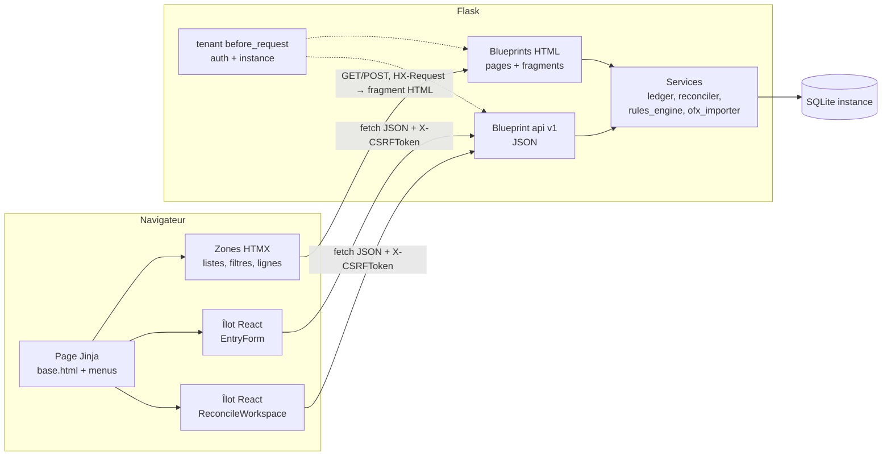

# Design — Front réactif hybride (HTMX + îlots React)

> Statut : proposition de conception (2026-10-20), à valider avant `/sc:workflow` puis `/sc:implement`.
> Besoins : [`besoins_front_reactif.md`](besoins_front_reactif.md).

## 1. Décisions

| # | Décision | Justification (besoins) |
|---|----------|-------------------------|
| D1 | **Flask + Jinja reste le socle** : routage, authentification, menus, mise en page, impression et exports restent rendus côté serveur | NF3 migration progressive, NF4 effort limité, F4.2 |
| D2 | **HTMX généralisé** pour les listes, les filtres, les actions sur une ligne et les imports : le serveur renvoie des **fragments Jinja** | F1, F3.4, F4.1 — réutilise les templates existants |
| D3 | **Deux îlots React** montés dans des pages Jinja (pas de SPA) : **Saisie d'écriture** et **Espace de rapprochement** | F2, F3.1 à F3.3 : clavier, sélection multiple, état riche côté client |
| D4 | **API JSON limitée aux besoins des îlots**, sous `/api/v1`, réutilisant les services existants (`ledger`, `reconciler`, `rules_engine`) | NF4 : pas d'API générale à maintenir (question ouverte 2) |
| D5 | **Le serveur reste la source de vérité** pour la validation comptable ; le client n'ajoute que des indications instantanées (équilibre, champs requis) | NF4, NF9 |
| D6 | **React 18 + TypeScript + Vite** dans `frontend/`, compilé vers `app/static/dist/` ; Node 22 LTS utilisé en dev et au build seulement (Dockerfile multi-étapes construit par Dokploy) | NF1, NF2 |
| D7 | **Annulation = « annuler la dernière action »**, sans état côté serveur : l'API renvoie de quoi appeler l'opération inverse | F3.3 (question ouverte 4) |
| D8 | **Exports et impression inchangés** (pages serveur dédiées) | question ouverte 5 |

React a été retenu pour D3 (plutôt que Preact ou Alpine.js) pour son écosystème : composants combobox
accessibles, tests avec Testing Library, et le typage TypeScript, utile quand une seule personne maintient le code.

---

## 2. Vue d'ensemble



**Règle de répartition :**

| Besoin d'interaction | Technologie |
|----------------------|-------------|
| Afficher, filtrer, trier, paginer, agir sur une ligne, soumettre un formulaire simple | HTMX + fragment Jinja |
| Saisie multi-lignes au clavier, sélection multiple, état local riche, annulation | Îlot React |
| Graphiques (tableau de bord, impact) | ECharts existant, rechargé via HTMX |

---

## 3. Arborescence

```
compta-asso/
├── frontend/                         # NOUVEAU — source des îlots (Node en dev/CI)
│   ├── package.json                  # react, react-dom, typescript, vite, vitest, @testing-library/react
│   ├── tsconfig.json
│   ├── vite.config.ts                # build → ../app/static/dist, manifest, base /static/dist/
│   └── src/
│       ├── main.tsx                  # chargeur d'îlots : scanne [data-island], monte le composant
│       ├── islands/
│       │   ├── EntryForm/            # EntryForm.tsx, useEntryState.ts, keyboard.ts, *.test.tsx
│       │   └── ReconcileWorkspace/   # Workspace.tsx, TransactionTable.tsx, SuggestionPanel.tsx, BulkBar.tsx
│       ├── components/               # AccountCombobox, EntityCombobox, MoneyInput, Toast, Kbd
│       └── lib/
│           ├── api.ts                # fetch JSON + CSRF + gestion d'erreurs normalisée
│           ├── money.ts              # "12,50" ⇄ 1250 centimes, Intl fr-FR
│           └── types.ts              # types des payloads /api/v1
├── app/
│   ├── api/                          # NOUVEAU — blueprint JSON
│   │   ├── __init__.py               # bp "api", url_prefix /api/v1, gestion d'erreurs JSON
│   │   ├── lookups.py                # comptes, tiers (autocomplétion)
│   │   ├── entries.py
│   │   └── reconciliation.py
│   ├── frontend.py                   # NOUVEAU — vite_assets(), macro island(), helpers HTMX
│   ├── static/dist/                  # build Vite (ignoré par git)
│   └── templates/
│       ├── _island.html              # macro {{ island("entry-form", props) }}
│       ├── _toasts.html              # conteneur de notifications (flash + HX-Trigger)
│       └── <écran>/_table.html       # fragments HTMX extraits des pages existantes
```

---

## 4. Intégration Flask ⇄ Vite

### 4.1 Chargement des assets — `app/frontend.py`

- `vite_assets(entry="src/main.tsx")` : fonction Jinja globale.
  - **Production** : lit `app/static/dist/.vite/manifest.json` (mis en cache au démarrage) et émet
    `<script type="module">` et `<link rel="stylesheet">` vers `/static/dist/assets/…` (noms de fichiers hashés, cache long).
  - **Développement** (variable `VITE_DEV_SERVER=http://localhost:5173`) : émet le préambule React Refresh,
    `@vite/client` et `src/main.tsx` depuis le serveur de dev Vite → rechargement à chaud (HMR) en conservant Flask sur :5000.
  - Manifest absent en production → message d'erreur explicite dans la page (au lieu d'un îlot vide silencieux).
- Inclus **uniquement** dans les pages qui contiennent un îlot (``), pas dans `base.html`.

### 4.2 Montage d'un îlot

```jinja
{# app/templates/_island.html #}

<div data-island="{{ name }}" data-props="{{ props | tojson | forceescape }}">
  <noscript>Cette page nécessite JavaScript.</noscript>
</div>

```

```ts
// frontend/src/main.tsx — principe
const registry = { "entry-form": () => import("./islands/EntryForm"),
                   "reconcile-workspace": () => import("./islands/ReconcileWorkspace") };
document.querySelectorAll<HTMLElement>("[data-island]").forEach(async el => {
  const mod = await registry[el.dataset.island!]();
  createRoot(el).render(<mod.default {...JSON.parse(el.dataset.props!)} />);
});
```

- **Props initiales** fournies par la vue Flask (pas d'aller-retour au premier affichage) :
  exercices ouverts (id, libellé, dates), journaux, préremplissage, URLs de l'API et des pages
  (`url_for`), montant et libellé de la transaction bancaire si on vient du rapprochement.
- Un fichier JS par îlot (découpage du code par Vite) : la page de saisie ne charge pas le rapprochement.

### 4.3 Build et déploiement

| Contexte | Commande | Résultat |
|----------|----------|----------|
| Dev | `npm --prefix frontend run dev` + `python run.py` avec `VITE_DEV_SERVER` | HMR sur les îlots |
| Build | `npm --prefix frontend run build` | `app/static/dist/` + manifest |
| Vérification locale | `make check` : `npm ci && npm run typecheck && npm test && npm run build`, puis `pytest` (pas de CI) | — |
| Docker / Dokploy | étape `FROM node:22-slim AS front` (build) → `COPY --from=front … app/static/dist` ; Dokploy construit l'image depuis le Dockerfile ou le compose | image finale **sans Node** (NF1) |

`app/static/dist/` est ajouté à `.gitignore` ; `frontend/node_modules` à `.dockerignore`.

---

## 5. Conventions HTMX (D2)

### 5.1 Page complète ou fragment

```python
# app/frontend.py
def render_page(template, partial, **ctx):
    """Page complète, ou seulement le fragment si la requête vient d'HTMX."""
    if request.headers.get("HX-Request") and not request.headers.get("HX-Boosted"):
        return render_template(partial, **ctx)
    return render_template(template, **ctx)
```

La page inclut le fragment (``) : une seule source de rendu.

> **Mise en œuvre (phase B, 2026-10-20)** : pour les listes et sélecteurs, pas d'extraction de
> `_table.html`. `base.html` enveloppe le contenu dans `<main id="page-content">` ; les macros
> `hx_nav` / `hx_filter` (`_list_helpers.html`) demandent la **page complète** et HTMX n'en extrait que
> la zone ciblée (`hx-select`). Aucune vue n'est modifiée, l'URL et l'historique fonctionnent, et le
> surcoût (rendu de la barre de navigation) est négligeable. Une recherche au fil de la frappe cible
> une zone `#list` qui n'inclut pas le champ saisi. `render_page` (fragments dédiés) s'est révélé
> inutile et a été retiré en phase G.

> **Mise en œuvre (phase C, 2026-10-20)** : les formulaires POST (imports, actions sur une ligne,
> formulaires simples, synchronisations) utilisent la macro `hx_submit` (`hx-boost` + même zone
> `#page-content`). Les vues ne changent pas : une réponse re-rendue remplace la zone, et une
> **redirection après action devient `HX-Location`** (rechargement AJAX de la zone, URL mise à jour,
> message en toast) quand la requête cible la zone de contenu ; vers `/login` ou le choix d'instance,
> elle reste `HX-Redirect`. Formulaire invalide → **422** + erreurs sous les champs
> (macros `field_attrs` / `invalid` / `field_error`, `responseHandling` HTMX configuré pour afficher les 422).
> Confirmations via `hx-confirm` (HTMX ignore `onsubmit="return confirm()"`). Les synchronisations
> Odoo / HelloAsso restent synchrones (bouton désactivé + barre de chargement + toast) : la
> généralisation de `sync_jobs` n'a pas été jugée nécessaire.

### 5.2 Filtres sans rechargement (F1.1, F1.2)

```html
<form hx-get="{{ url_for('entries.index') }}" hx-target="#list" hx-push-url="true"
      hx-trigger="change, keyup changed delay:300ms from:input[type=search]"
      hx-indicator="#list-loading">
```

- Remplace les 10 `onchange="this.form.submit()"` ; `hx-push-url` met l'URL à jour (F5 et le bouton
  Précédent fonctionnent) ; seule la zone `#list` est remplacée, donc le scroll de la page est conservé.
- Les en-têtes de tri (`sortable_date_header`) et `month_filter_select` (`_list_helpers.html`)
  reçoivent les mêmes attributs `hx-*` : un seul endroit à modifier pour les 8 listes datées.

### 5.3 Actions sur une ligne (F1.4)

`hx-post` vers la route existante. Pour une requête HTMX, la route renvoie la **ligne mise à jour**
(`hx-swap="outerHTML"`) au lieu de rediriger ; sans HTMX, le comportement actuel (redirection + flash) reste inchangé.

### 5.4 Messages, chargement, CSRF, erreurs

| Sujet | Convention |
|-------|------------|
| Messages | Les `flash()` d'une réponse HTMX sont transmis par l'en-tête `HX-Trigger: {"toast": [...]}` (hook `after_request`) → affichés par `_toasts.html` ; même composant visuel que les toasts des îlots |
| Chargement | Classe globale `htmx-request` → barre fine en haut de page + `hx-indicator` local ; délai d'affichage 300 ms (F1.3) |
| CSRF | `<meta name="csrf-token">` dans `base.html` ; `htmx:configRequest` ajoute `X-CSRFToken` (en-tête accepté nativement par Flask-WTF) |
| Erreurs | 4xx/5xx sur une requête HTMX → toast d'erreur via `htmx:responseError` ; 401 → redirection vers `/login` (`HX-Redirect`) |
| Version | HTMX épinglé (déjà en 2.0.3) |

### 5.5 Imports (F3.4)

Formulaire OFX/CSV/xlsx en `hx-post` + `hx-encoding="multipart/form-data"` ; progression d'envoi via
`htmx:xhr:progress` ; la route renvoie le fragment récapitulatif (`{imported, duplicates, errors}`) déjà calculé par les services.

---

## 6. API JSON `/api/v1` (D4)

### 6.1 Règles communes

- **Authentification** : session Flask-Login existante. Sur `/api/v1`, une requête non authentifiée
  reçoit **401 JSON** (pas de redirection vers la page de connexion).
- **Instance** : le `before_request` multi-instance existant s'applique tel quel ; aucune route API n'est exemptée.
- **CSRF** : obligatoire sur POST/PUT/DELETE via `X-CSRFToken`. Même origine uniquement, pas de CORS.
- **Montants** : entiers en **centimes** dans les deux sens ; dates ISO `YYYY-MM-DD`.
- **Erreurs** (format unique) :

```json
{ "error": { "code": "validation_error", "message": "Écriture déséquilibrée.",
             "fields": { "lines[1].account_id": "Compte d'en-tête non utilisable." } } }
```

Codes : `validation_error` (422), `not_found` (404), `conflict` (409 : exercice clôturé, transaction déjà rapprochée), `unauthenticated` (401), `forbidden` (403).

### 6.2 Endpoints

| Méthode | URL | Rôle | Service |
|---------|-----|------|---------|
| GET | `/api/v1/accounts?q=&limit=20` | Autocomplétion des comptes (non en-tête), par code ou libellé | `Account` |
| GET | `/api/v1/entities?q=&limit=20` | Autocomplétion des tiers | `Entity` |
| POST | `/api/v1/entries/validate` | Validation à blanc, sans écriture (erreurs par champ) | `ledger.validate_entry_payload` |
| POST | `/api/v1/entries` | Crée l'écriture ; `bank_transaction_id` facultatif → rapproche dans la même transaction | `ledger.post_entry` + `reconciler` |
| GET | `/api/v1/entries/<id>` | Charge une écriture pour modification | — |
| PUT | `/api/v1/entries/<id>` | Modifie | `ledger` |
| POST | `/api/v1/entries/bulk-delete` | Supprime des écritures créées à l'instant (annulation des règles) | `ledger` |
| GET | `/api/v1/bank-accounts/<id>/transactions?status=unreconciled&month=&sort=` | Transactions + compteurs | `BankTransaction` |
| GET | `/api/v1/bank-transactions/<id>/suggestions` | Lignes candidates avec score | `reconciler.suggest_matches` |
| POST | `/api/v1/reconciliations` | Rapproche un lot `[{bank_transaction_id, journal_line_id}]` | `reconciler.reconcile_many` |
| POST | `/api/v1/reconciliations/delete` | Annule un lot de rapprochements `{bank_transaction_ids}` | `reconciler.unreconcile_many` |
| POST | `/api/v1/reconciliations/auto` | Rapprochement automatique `{bank_account_id, dry_run}` | `reconciler.auto_reconcile` |
| POST | `/api/v1/bank-transactions/apply-rules` | Applique les règles à une sélection `{ids}` | `rules_engine.apply_rules` |

### 6.3 Exemple — création d'écriture

```json
// POST /api/v1/entries
{ "fiscal_year_id": 3, "journal_id": 2, "entry_date": "2026-10-20",
  "description": "Facture EDF octobre", "bank_transaction_id": null,
  "lines": [ { "account_id": 412, "label": "EDF", "debit_cents": 8450, "credit_cents": 0 },
             { "account_id": 87,  "label": "EDF", "debit_cents": 0, "credit_cents": 8450 } ] }

// 201
{ "id": 1287, "reference": "AC-2026-0154", "url": "/entries/1287", "reconciled": false }
```

### 6.4 Réponse d'une action groupée (annulation, D7)

```json
// POST /api/v1/reconciliations → 200
{ "results": [ { "bank_transaction_id": 51, "status": "ok" },
               { "bank_transaction_id": 52, "status": "error", "message": "Déjà rapprochée." } ],
  "counters": { "unreconciled": 37 },
  "undo": { "method": "POST", "url": "/api/v1/reconciliations/delete",
            "body": { "bank_transaction_ids": [51] } } }
```

Le client affiche un toast « 1 rapprochée — Annuler » pendant 10 s ; « Annuler » rejoue `undo`.
Pour `apply-rules`, `undo` pointe vers `entries/bulk-delete` avec les écritures créées.
Aucun historique côté serveur : un rechargement de page fait perdre l'annulation, ce qui est acceptable.

### 6.5 Évolutions des services (partagées par HTML et API)

| Service | Évolution |
|---------|-----------|
| `ledger` | `validate_entry_payload(payload) -> dict[champ, message]` : exercice ouvert, date dans l'exercice, comptes existants **non en-tête**, ≥ 2 lignes, débit XOR crédit par ligne, équilibre. Utilisé par `post_entry`, la vue HTML et `/entries/validate` (une seule implémentation) |
| `reconciler` | `reconcile_many(pairs)` / `unreconcile_many(ids)` : **une seule transaction** SQL, résultat par élément. Contrôles ajoutés : transaction non rapprochée, montant de la ligne = montant bancaire, ligne pas déjà rapprochée (aujourd'hui `reconcile` ne vérifie rien) |
| `reconciler.reconcile` | paramètre `commit=True` pour être composé dans une transaction englobante (création d'écriture + rapprochement atomiques) |
| `rules_engine.apply_rules` | renvoie aussi les identifiants des écritures créées (pour l'annulation) |

---

## 7. Îlot « Saisie d'écriture » (`EntryForm`)

**Montage** : `/entries/new` et `/entries/<id>/edit` (le formulaire Jinja actuel est remplacé ; `_line_row.html` et
`/entries/new-line` sont supprimés en fin de phase). Également réutilisé dans un panneau latéral de l'espace de rapprochement.

### 7.1 État

```ts
type Line  = { key: string; accountId?: number; accountLabel?: string; label: string;
               debit: number; credit: number };           // centimes
type Entry = { fiscalYearId: number; journalId: number; date: string; description: string;
               bankTransactionId?: number; lines: Line[] };
// dérivés : totalDebit, totalCredit, gap = totalDebit - totalCredit, canSubmit
```

### 7.2 Clavier (F2.1)

| Touche | Action |
|--------|--------|
| Tab / Maj+Tab | Champ suivant / précédent, de ligne en ligne |
| Entrée sur la dernière cellule d'une ligne | Nouvelle ligne, **préremplie avec l'écart** dans la colonne qui équilibre |
| Ctrl+Entrée | Enregistrer et enchaîner (journal, exercice et date conservés — F2.4) |
| Ctrl+Maj+Entrée | Enregistrer et ouvrir l'écriture |
| Ctrl+Suppr | Supprimer la ligne courante |
| Alt+↓ / Échap | Ouvrir / fermer l'autocomplétion |
| `=` dans un montant | Recopier l'écart restant |

L'aide clavier est affichée sous le formulaire (composant `Kbd`).

### 7.3 Validation (F2.3, D5)

| Niveau | Contrôles | Moment |
|--------|-----------|--------|
| Client (indication) | Équilibre et écart, champs requis, débit XOR crédit, date dans les bornes de l'exercice (fournies en props) | À chaque frappe |
| Serveur (`/entries/validate`) | Toutes les règles de `validate_entry_payload` | 400 ms après la dernière modification d'une ligne complète, et avant l'enregistrement |
| Serveur (`POST /entries`) | Mêmes règles, font foi | À l'enregistrement |

Les erreurs du serveur (`fields`) s'affichent sous la cellule concernée ; le bouton Enregistrer reste
désactivé tant que l'écart ≠ 0 ou qu'une erreur est présente (US2).

### 7.4 Autocomplétion (F2.2)

`AccountCombobox` (motif ARIA combobox) : recherche par préfixe de code ou mot du libellé,
résultats via `/api/v1/accounts` avec un délai de 150 ms et un cache local par saisie ; les 20 derniers comptes utilisés
(stockés dans `localStorage` par instance) sont proposés quand le champ est vide.

---

## 8. Îlot « Espace de rapprochement » (`ReconcileWorkspace`)

**Montage** : `/reconciliation/` (remplace la page actuelle ; `_suggestions.html` et `/suggest`, `/link`, `/unlink`, `/auto`
restent jusqu'à la fin de la phase, puis sont retirés).

```
┌ Compte : [Banque ▾]  Mois : [2026-10 ▾]  37 non rapprochées ─────────────────┐
│ ☐ Date     Libellé                    Montant │ Suggestions (ligne active)   │
│ ☑ 03/10   PRLV EDF                   -84,50  │ ★ AC-2026-0154  -84,50  03/10│
│ ☐ 05/10   VIR HELLOASSO             +120,00  │   AC-2026-0149  -84,50  01/10│
│ ▸ 07/10   CB LEROY MERLIN            -32,90  │ [Entrée] rapprocher          │
│ …                                             │ [N] créer l'écriture         │
├───────────────────────────────────────────────┴──────────────────────────────┤
│ 2 sélectionnées : [Rapprocher les suggestions ★] [Appliquer les règles] [Annuler] │
└──────────────────────────────────────────────────────────────────────────────┘
```

| Touche | Action |
|--------|--------|
| ↑ / ↓ (ou j / k) | Transaction active ; ses suggestions se chargent dans le panneau de droite |
| Espace / Maj+↑↓ / Ctrl+A | Sélectionner / étendre la sélection / tout sélectionner |
| Entrée | Rapprocher la transaction active avec la meilleure suggestion (★) |
| 1…9 | Rapprocher avec la suggestion n° |
| N | Ouvrir `EntryForm` dans un panneau, prérempli avec la transaction (montant, libellé, ligne banque) ; à l'enregistrement : écriture créée **et** rapprochée |
| R | Appliquer les règles à la sélection |
| Ctrl+Z | Annuler la dernière action (D7) |

- **Mise à jour en place** (F3.1) : une transaction rapprochée sort de la liste avec une animation et
  les compteurs sont mis à jour à partir de la réponse ; le focus passe à la ligne suivante.
- **Masse** (F3.2) : « Rapprocher les suggestions ★ » envoie en un seul `POST /reconciliations` les
  transactions sélectionnées qui ont une meilleure suggestion unique ; les autres sont signalées.
- **Suggestions** : récupérées pour la ligne active, puis préchargées pour les 3 suivantes ; mises en cache tant que la liste ne change pas.
- **Volumétrie** : quelques centaines de transactions non rapprochées au maximum par compte et par mois → pas
  de virtualisation de la liste au départ (à revoir si > 1 000 lignes).

---

## 9. Écrans HTMX (D2)

| Lot | Écrans | Changement |
|-----|--------|------------|
| Listes datées (8) | écritures, transactions, versements Stancer (liste + détail), commandes POS, factures clients, lot Odoo | `_list_helpers.html` passe en `hx-*`, extraction de `_table.html`, `render_page` |
| Autres `onchange=submit` | sélecteurs d'exercice (balance, grand livre, bilan, compte de résultat), tableau de bord, impact, rapport d'activité | `hx-get` + `hx-push-url` vers la même page, zone de contenu ciblée |
| Actions sur une ligne | tiers (bénévole, mise à jour Odoo), règles (activer, monter, descendre), temps de travaux, types de tâches | réponse = ligne mise à jour pour une requête HTMX |
| Imports | OFX, CSV Odoo, tonnages xlsx, temps de travaux | §5.5 |
| Synchronisations | Stancer (existant), Odoo, HelloAsso | généraliser le suivi de `sync_jobs` déjà en HTMX |

Les graphiques ECharts sont réinitialisés après un remplacement HTMX (`htmx:afterSettle` → `echarts.init` sur les nouveaux conteneurs).

---

## 10. Sécurité (NF5)

- Toutes les routes `/api/v1` : `@login_required` (variante JSON 401), instance résolue par le `before_request` existant,
  `@admin_required` quand l'écran HTML équivalent l'exige.
- CSRF obligatoire pour les requêtes HTMX et `fetch` ; aucune route exemptée.
- Les props des îlots passent par `tojson | forceescape` (pas d'injection dans l'attribut).
- Pas de nouveau mécanisme d'authentification (pas de JWT), pas de CORS.
- Le contrôle d'accès est fait côté serveur : un identifiant de transaction ou d'écriture qui n'existe pas dans
  l'instance courante renvoie 404 (isolement par base, inchangé).

---

## 11. Tests (NF7)

| Niveau | Outil | Portée |
|--------|-------|--------|
| Services | pytest | `validate_entry_payload` (tous les cas d'erreur), `reconcile_many` / `unreconcile_many` (atomicité, contrôles), `apply_rules` (identifiants renvoyés) |
| API | pytest + client de test Flask | Chaque endpoint : 200/201, 401, 404, 409, 422, CSRF manquant → 400, format d'erreur |
| HTMX | pytest | Avec `HX-Request` → fragment (sans `<html>`) ; sans → page complète ; en-tête `HX-Trigger` des toasts |
| Îlots | Vitest + Testing Library | Clavier (US2), calcul de l'écart, affichage des erreurs serveur, sélection et annulation (US3), `money.ts` |
| Bout en bout (facultatif) | Playwright | US1 à US4 sur une instance de démonstration |

Les 133 tests existants restent verts à chaque phase.

---

## 12. Phases de migration (détail en `workflow_front_reactif.md`)

Décisions du 2026-10-20 : **listes HTMX en premier**, **bascule directe** sans écran de repli,
Node 22 LTS, build par Dokploy (pas de CI).

| Phase | Contenu | Livrable utilisable |
|-------|---------|---------------------|
| A — Socle HTMX | CSRF HTMX, toasts, barre de chargement, `render_page` | Rien de visible |
| B — Listes HTMX | helpers de liste, 8 listes datées, sélecteurs d'exercice | US1 |
| C — Reste HTMX | imports, actions sur une ligne, formulaires, synchronisations | US4, US5 — déployable sans Node |
| D — Socle React/API | `frontend/` + Vite, macro `island`, blueprint `api`, Dockerfile multi-étapes | Rien de visible |
| E — Saisie | `validate_entry_payload`, API saisie, îlot `EntryForm` | US2 |
| F — Rapprochement | `reconcile_many` & co, API rapprochement / règles, îlot `ReconcileWorkspace` | US3 |
| G — Finitions | accessibilité, code mort, documentation, mesures | — |

À chaque bascule, l'ancien écran et ses routes sont supprimés dans le même lot.

---

## 13. Risques

| Risque | Impact | Parade |
|--------|--------|--------|
| Deux technologies front (HTMX + React) | Charge cognitive pour un mainteneur seul | Frontière stricte (§2) : React limité à 2 îlots, composants partagés minimes |
| Divergence entre validation client et serveur | Erreurs incohérentes | Le client n'affiche que des indications ; `/entries/validate` et `POST` font foi (D5) |
| Build front oublié en production | Îlot vide | Build dans le Dockerfile (Dokploy), erreur explicite si le manifest est absent (§4.1), `make check` |
| `reconcile` actuel sans contrôle | Rapprochements erronés en masse | Contrôles ajoutés dans `reconcile_many` (§6.5) avant d'exposer la masse |
| Annulation perdue au rechargement | Confusion | Toast explicite, durée 10 s ; l'opération inverse reste possible manuellement |
| Graphiques ECharts après remplacement HTMX | Graphiques vides | Réinitialisation sur `htmx:afterSettle` (§9) |

---

## 14. Bilan de la mise en œuvre (phase G, 2026-10-20)

**Mesures NF6** — temps serveur (client de test Flask) sur une **copie de la base réelle**
(185 écritures, 370 lignes, 783 comptes, 328 tiers, 185 transactions), médiane de 15 appels :

| Requête | Médiane | Max |
|---------|---------|-----|
| `GET /entries/` (liste, requête HTMX) | 4,4 ms | 4,8 ms |
| `GET /entries/?q=TPE` (recherche) | 3,8 ms | 3,9 ms |
| `GET /entities/members?q=ma` | 6,4 ms | 12,5 ms |
| `GET /` (tableau de bord) | 27,6 ms | 28,7 ms |
| `GET /reports/bilan` | 47,7 ms | 51,4 ms |
| `GET /api/v1/accounts?q=6` | 3,3 ms | 3,3 ms |
| `GET /api/v1/accounts?q=electricite` | 4,0 ms | 19,7 ms |
| `POST /api/v1/entries/validate` | 0,7 ms | 0,8 ms |
| `GET /api/v1/bank-accounts/1/transactions?status=all` | 4,3 ms (47,3 ms avant chargement groupé) | 4,4 ms |
| `GET /api/v1/bank-transactions/<id>/suggestions` | 0,9 ms | 1,1 ms |

Objectif « action courante < 500 ms » largement tenu ; le seul point corrigé est une requête N+1
sur la liste des transactions (`joinedload` de l'écriture et du tiers). Le retour visuel < 100 ms
est assuré côté client (barre de chargement après 300 ms, écart et indications calculés localement).

**Écarts assumés par rapport au design** : pas de fragments `_table.html` (approche `hx-select`),
synchronisations Odoo / HelloAsso restées synchrones, pas d'animation de sortie des transactions
rapprochées.
