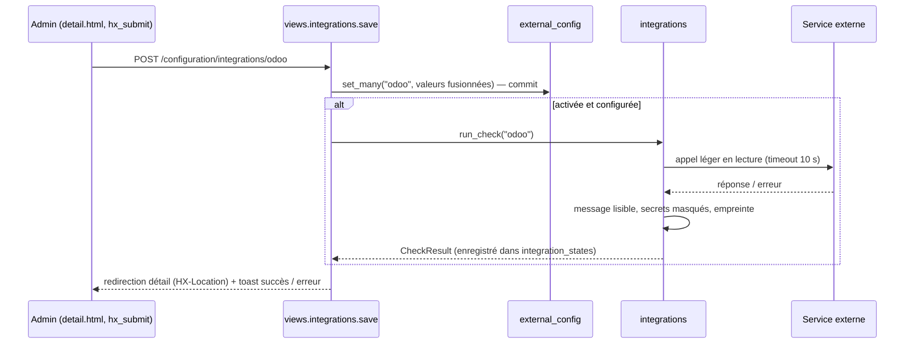

# Design — Écran des intégrations

> Statut : design proposé (2026-10-20), à valider. Source : `besoins_integrations.md`.
> Étape suivante : `/sc:workflow` pour le plan d'implémentation.

## 1. Décisions (questions ouvertes des besoins)

| # | Question | Décision | Raison |
|---|----------|----------|--------|
| D1 (Q1) | Où stocker l'activation et le dernier test ? | **Nouvelle table tenant `integration_states`**, une ligne par service, créée à la demande | Colonnes typées (booléen, dates) ; `external_connections` reste un simple stockage clé/valeur et `set_many` n'a pas à éviter de clés réservées. **Absence de ligne = activée, jamais testée** : aucune donnée à migrer (F4.3). |
| D2 (Q2) | L'interrupteur coupe-t-il une intégration configurée par `.env` ? | **Oui, l'interrupteur prime** sur la base et sur `.env` | Une seule règle partout : `is_available = activée ET configurée`. |
| D3 | Comment savoir qu'un test est périmé (F3.4) ? | **Empreinte de la configuration effective** (SHA-256 des valeurs base + `.env`) enregistrée avec le résultat | Détecte aussi un changement de `.env` ou un redéploiement, pas seulement un enregistrement dans l'UI. |
| D4 (Q3) | Dernière synchronisation | Stancer → `SyncJob` `payouts` / `payout_payments` ; GA4 et Facebook → dernier `SyncJob` `metrics`, **avec la partie propre à la source** lue dans `result_json["ga4"]` / `["facebook"]` ; Odoo, HelloAsso, SMTP → « Non suivie » | Pas de généralisation de `sync_jobs` (choix déjà fait en phase C du front réactif). |
| D5 (Q4) | Test synchrone ou en arrière-plan ? | **Synchrone**, borné à 10 s par sonde, via `hx_submit` (bouton désactivé + barre de chargement + toast) | Même modèle que les synchronisations Odoo / HelloAsso ; pas de nouvelle mécanique. Pire cas : 10 s d'attente avec indicateur. |
| D6 (Q5) | Nom et URL | Menu **« Intégrations »**, URL `/configuration/integrations/`, blueprint `integrations` ; l'ancienne URL redirige (301) | Le mot de l'utilisateur ; ancien favori toujours valide. |
| D7 | Secrets dans le HTML (NF1) | **Les secrets ne sont plus jamais réaffichés**, même en base (aujourd'hui, un secret enregistré en base est rendu dans `value=""`) : champ vide = conserver, case « Effacer » pour supprimer | Les besoins (F2.2) supposaient ce comportement ; le code actuel ne le respecte pas. |

## 2. Vue d'ensemble

```
app/
├── models/integration_state.py        (nouveau)  IntegrationState
├── services/
│   ├── external_config.py             (modifié)  + SERVICE_DESCRIPTIONS, SECRET_KEYS,
│   │                                              is_enabled, set_enabled, is_available,
│   │                                              fingerprint
│   └── integrations.py                (nouveau)  sondes, run_check, status, overview, last_sync
├── views/integrations.py              (remplace external_connections.py)
└── templates/integrations/
    ├── index.html                     (nouveau)
    ├── detail.html                    (nouveau)
    └── _macros.html                   (nouveau)  status_badge, unavailable_notice
```

Séquence « enregistrer puis tester » (F3.1) :



## 3. Modèle de données

### 3.1 Table `integration_states` (base tenant)

| Colonne | Type | Contrainte | Rôle |
|---------|------|-----------|------|
| `id` | Integer | PK | |
| `service` | String(30) | unique, non nul | slug (`stancer`, `odoo`…) |
| `enabled` | Boolean | non nul, défaut `True` | interrupteur (F2.1) |
| `checked_at` | DateTime | nullable | date du dernier test (UTC) |
| `check_ok` | Boolean | nullable | résultat ; `NULL` = jamais testé |
| `check_message` | Text | nullable | message lisible, secrets masqués |
| `check_duration_ms` | Integer | nullable | durée de l'appel |
| `checked_fingerprint` | String(64) | nullable | empreinte de la configuration testée (D3) |
| `updated_at` | DateTime | non nul | |

Migration Alembic : `create_table` seule, `down_revision = "b5e9d2c4f071"` (tête actuelle). Pas de
FK. Une ligne n'existe que si l'interrupteur a été touché ou un test lancé.

### 3.2 Empreinte

```python
def fingerprint(service) -> str:
    """SHA-256 of the effective configuration (DB, else .env), keys sorted."""
    payload = json.dumps(get_all(service), sort_keys=True)
    return hashlib.sha256(payload.encode()).hexdigest()
```

Elle ne sert qu'à comparer ; elle n'est jamais affichée.

## 4. Services

### 4.1 `external_config` (ajouts)

```python
SERVICE_DESCRIPTIONS: dict[str, str]        # usage dans l'app, affiché sur l'index (F1.1)
SECRET_KEYS: set[tuple[str, str]]           # jamais réaffichées (D7)
#   stancer.secret_key, odoo.api_key, helloasso.client_secret, smtp.password,
#   ga4.credentials_json, facebook.page_token, facebook.app_secret

def is_enabled(service) -> bool             # ligne absente → True
def set_enabled(service, enabled: bool)     # upsert + commit
def is_available(service) -> bool           # is_enabled and is_configured
def fingerprint(service) -> str
```

`is_configured` garde son sens actuel (champs obligatoires remplis) : il sert au statut « À configurer ».

### 4.2 `integrations` (nouveau)

```python
STATUS_DISABLED, STATUS_UNCONFIGURED, STATUS_UNTESTED, STATUS_OK, STATUS_ERROR = (
    "disabled", "unconfigured", "untested", "ok", "error")

@dataclass(frozen=True)
class CheckResult:
    ok: bool
    message: str
    checked_at: datetime
    duration_ms: int

@dataclass(frozen=True)
class IntegrationView:                      # ce que les templates affichent
    slug: str; label: str; description: str
    status: str                             # une des 5 constantes
    enabled: bool; configured: bool
    last_check: CheckResult | None          # même périmé, pour l'historique visible
    last_sync: SyncInfo | None              # détail seulement (D4)

PROBES: dict[str, Callable[[], str]]        # slug → sonde ; renvoie le message de succès ou lève

def run_check(service) -> CheckResult       # exécute, mesure, traduit, masque, enregistre, commit
def status(service) -> str                  # règle §4.3 ; aucun appel réseau
def overview() -> list[IntegrationView]     # index : une requête integration_states + config
def detail(service) -> IntegrationView      # + last_sync
```

### 4.3 Règle de statut (F1.2)

```
pas activée                                   → disabled
pas configurée                                → unconfigured
pas de test, ou checked_fingerprint ≠ actuelle → untested
check_ok                                      → ok
sinon                                         → error
```

Précision par rapport aux besoins : un échec obtenu sur une configuration **modifiée depuis** est
affiché « Non testée » (le résultat reste visible sur le détail, marqué « configuration modifiée depuis »).

### 4.4 Sondes (F3.2)

Chaque sonde lit la configuration via les fabriques existantes (`from_app_config`) et fait **un seul
appel en lecture**, timeout `CHECK_TIMEOUT = 10` s.

| Service | Appel | Message de succès |
|---------|-------|-------------------|
| Stancer | `GET /v2/payouts?limit=1` (Basic, clé) | « Clé acceptée par Stancer (mode live) » ; avertissement si le préfixe de clé (`stest_` / `sprod_`) contredit `mode` |
| Odoo | `common.version()` puis `common.authenticate()` | « Connecté à Odoo 17.0 (utilisateur n° 5) » |
| HelloAsso | jeton OAuth2 puis `GET /v5/organizations/{org_slug}` | « Organisation « Seconde Nature » accessible » |
| SMTP | `_open_smtp` + `NOOP` (logique de `check_smtp_connection`) | « Serveur smtp.x:587 joignable, TLS activé, authentifié » |
| GA4 | `run_report` : `activeUsers`, hier, `limit=1`, `timeout=10` | « Propriété 472641442 accessible » |
| Facebook | `GET /{page_id}?fields=name` | « Page « … » accessible » |

Évolutions nécessaires dans les clients (sans changer leur comportement par défaut) :
- `OdooClient(…, timeout=None)` : `xmlrpc.client.Transport` dont `make_connection` fixe le timeout
  (aujourd'hui `ServerProxy` n'en a aucun) ; nouvelle méthode `version()`.
- `HelloAssoClient.get_organization()` (simple `_get`), `timeout` paramétrable.
- `FacebookClient.fetch_page_name()`.
- `GA4Client.ping()` (rapport minimal).
- `stancer_sync` : réutilise `_api_get` avec un paramètre `timeout`.
- `membership_reminders.check_smtp_connection` devient un appel à `integrations.run_check("smtp")`
  (ou est supprimé : seul l'écran l'utilisait).

### 4.5 Erreurs lisibles et secrets masqués (NF1, NF3)

`run_check` attrape toute exception et la traduit :

| Exception | Message |
|-----------|---------|
| `requests.Timeout`, `socket.timeout` | « Délai dépassé (10 s) : le service ne répond pas. » |
| `requests.ConnectionError`, `OSError` réseau, `gaierror` | « Serveur injoignable (adresse ou réseau). » |
| HTTP 401 / 403 | « Identifiants refusés par {service} (HTTP 401). » |
| HTTP 404 | « Ressource introuvable : vérifiez {champ identifiant} (ID de Page, slug, propriété). » |
| `xmlrpc.client.Fault` / `ProtocolError` | « Odoo a répondu une erreur : {faultString court} » |
| `smtplib.SMTPAuthenticationError` | « Identifiant ou mot de passe SMTP refusé. » |
| `*ConfigError` des clients | leur message (déjà en français) |
| autre | « Erreur inattendue : {type} — {message court} » |

Puis **masquage** : toute valeur de `SECRET_KEYS` du service (et le jeton OAuth en cours) présente dans
le message est remplacée par `••••`. Message tronqué à 500 caractères. Le détail technique complet
part dans `current_app.logger.warning` **après le même masquage**.

## 5. Effet de l'activation (F4)

### 5.1 Côté services — garde unique dans les fabriques

Chaque point d'entrée vérifie l'activation **avant** la configuration :

| Fabrique | Exception levée si désactivée |
|----------|-------------------------------|
| `odoo_client.from_app_config` | `OdooConfigError("Intégration Odoo désactivée — Configuration › Intégrations.")` |
| `helloasso_client.from_app_config` | `HelloAssoConfigError(…)` |
| `ga4_client.from_app_config` / `facebook_client.from_app_config` | `GA4ConfigError` / `FacebookConfigError` → déjà captées par `metrics_sync` (source ignorée, message dans le récap) |
| `stancer_sync._get_secret_key` | `RuntimeError(…)` |
| `membership_reminders.smtp_configured` | renvoie `is_available("smtp")` |

Les sondes passent par ces mêmes fabriques : `run_check` refuse un service désactivé avec
« Intégration désactivée » (cohérent avec F2.4, qui désactive le bouton). Les messages « renseignez-la dans Configuration → Connexions
externes » des clients deviennent « … Configuration › Intégrations ».

### 5.2 Côté écrans

Les helpers des vues passent de `is_configured` à `is_available` : `payouts.index` (`has_key`),
`orders._odoo_configured`, `customer_invoices._odoo_configured`, `entities._helloasso_configured` /
`_odoo_configured` / `_smtp_configured`, `odoo_partner_update.is_configured`.

Message (F4.2) : macro `unavailable_notice(slug)` dans `integrations/_macros.html`, exposée via un
global Jinja `integration_state(slug)` (`"disabled"` / `"unconfigured"` / `None`) :

> ⓘ Intégration **Odoo désactivée**. [Ouvrir l'intégration](/configuration/integrations/odoo)

Elle remplace les messages « non configuré » actuels de `payouts/index.html`, `orders/index.html`,
`customer_invoices`, `entities/index.html`, `entities/create_helloasso_memberships.html`. Sur
`impact`, le bouton de synchronisation est désactivé si GA4 **et** Facebook sont indisponibles.

## 6. Routes (blueprint `integrations`, `admin_required`)

| Méthode | URL | Action |
|---------|-----|--------|
| GET | `/configuration/integrations/` | index (`overview()`, aucun appel réseau) |
| GET | `/configuration/integrations/<service>` | détail ; 404 si service inconnu |
| POST | `/configuration/integrations/<service>` | enregistre (§7), puis `run_check` si disponible ; redirection détail + toast |
| POST | `/configuration/integrations/<service>/enabled` | `enabled=1\|0` → `set_enabled` ; redirection détail |
| POST | `/configuration/integrations/<service>/check` | `run_check` ; redirection détail + toast (succès → `success`, échec → `danger`) |
| GET | `/configuration/external-connections/` | 301 → index (ancien favori) |

La route `external_connections.test_smtp` disparaît (remplacée par `/check`). Les formulaires POST
utilisent `hx_submit` : la redirection devient `HX-Location`, le message un toast (conventions §5.4
de `design_front_reactif.md`). `menu_config` : entrée `integrations`, libellé « Intégrations ».

## 7. Enregistrement du formulaire (D7)

```python
for key in SERVICE_KEYS[service]:
    if (service, key) in SECRET_KEYS:
        if request.form.get(f"clear_{key}"):
            values[key] = ""                                   # suppression explicite
        else:
            values[key] = request.form.get(key) or current_db_value(service, key)  # vide = conserver
    else:
        values[key] = request.form.get(key, "")
external_config.set_many(service, values)
```

`current_db_value` lit la ligne `external_connections` seulement (pas le repli `.env`, qui ne doit
jamais être recopié en base).

## 8. Écrans

### 8.1 Index

Grille de cartes (2 colonnes ≥ lg, 1 colonne mobile), chaque carte entièrement cliquable (lien étiré) :

```
┌──────────────────────────────────────┐ ┌──────────────────────────────────────┐
│ Odoo                  [Opérationnelle]│ │ Facebook (Page)          [Désactivée]│
│ Commandes, factures, mise à jour des  │ │ Abonnés de la Page pour Visibilité & │
│ partenaires                           │ │ Impact                               │
│ Testée le 20/10 14:02 · 0,4 s         │ │ —                                    │
└──────────────────────────────────────┘ └──────────────────────────────────────┘
```

Badges : Opérationnelle `bg-success`, En erreur `bg-danger`, Non testée `bg-info`, À configurer
`bg-warning text-dark`, Désactivée `bg-secondary`. Le libellé du statut est textuel (pas seulement
la couleur). En erreur : première ligne du message sous la date.

### 8.2 Détail

```
← Intégrations
Odoo                                                    [En erreur]
Commandes, factures, mise à jour des partenaires

┌ État ────────────────────────────────────────────────────────────┐
│ [■ Activée]  (interrupteur, formulaire séparé)                    │
│ Dernier test : 20/10/2026 14:02 (0,4 s)                           │
│ ✗ Identifiants refusés par Odoo (HTTP 401).                       │
│                                          [Tester maintenant]      │
└───────────────────────────────────────────────────────────────────┘
┌ Configuration ───────────────────────────────────────────────────┐
│ URL *            [https://erp.example.org        ] (en base)      │
│ Clé API *        [                              ] ••• enregistrée │
│                  ☐ Effacer                                        │
│ …                                       [Enregistrer et tester]   │
└───────────────────────────────────────────────────────────────────┘
┌ Dernière synchronisation ────────────────────────────────────────┐
│ Non suivie pour cette intégration.                                │
└───────────────────────────────────────────────────────────────────┘
```

- Le bouton s'intitule « Enregistrer et tester » quand l'intégration est activée, « Enregistrer » sinon.
- « Tester maintenant » désactivé si désactivée ou incomplète (avec `title` expliquant pourquoi).
- Dernière synchronisation (D4) : date de fin, statut, message ; pour GA4/Facebook, `imported` et
  `errors` de la source ; lien vers `payouts.index` ou `impact.index`.
- Les métadonnées de champs (`field_meta`, aujourd'hui dans le template) passent dans
  `views/integrations.py` (`FIELD_META`), avec un type `secret` en plus de `text` / `textarea`.

## 9. Sécurité

- Accès : `login_required` + `admin_required` sur toutes les routes (inchangé), CSRF sur les POST.
- Aucun secret dans le HTML (D7), dans `check_message`, ni dans les journaux (§4.5).
- Les sondes ne font que des lectures ; aucune n'écrit chez le service externe.
- Le test n'est déclenchable qu'en POST : pas de déclenchement par simple lien ou préchargement.

## 10. Tests (NF6)

Aucun appel réseau : `PROBES` est un dictionnaire, les tests remplacent l'entrée du service par une
fonction factice (`monkeypatch.setitem(integrations.PROBES, "odoo", …)`).

| Fichier | Contenu |
|---------|---------|
| `tests/test_integrations_status.py` | les 5 statuts ; empreinte modifiée (base et `.env`) → Non testée ; absence de ligne = activée ; interrupteur prime sur `.env` |
| `tests/test_integrations_checks.py` | traduction de chaque famille d'exception ; masquage d'un secret présent dans un message ; troncature ; durée enregistrée ; service désactivé refusé |
| `tests/test_integrations_views.py` | index sans champ de formulaire ni appel de sonde ; détail par service ; 404 service inconnu ; enregistrer → sonde appelée une fois ; secret non réaffiché ; champ secret vide conserve la valeur, « Effacer » la supprime ; toggle ; redirection 301 ; non-admin refusé |
| `tests/test_integrations_gating.py` | intégration désactivée → fabriques lèvent, boutons désactivés et message « désactivée » sur payouts / orders / entities |
| `tests/test_external_config_smtp.py` | adapté (route de test SMTP supprimée) |

Sondes elles-mêmes : un test par service avec `requests` / `smtplib` / `ServerProxy` simulés, pour
vérifier l'appel attendu (URL, paramètres, timeout).

## 11. Documentation

`doc/routes.md` (nouvelles routes, suppression de `test_smtp`), `doc/services.md` (`integrations`,
ajouts `external_config`), `doc/installation.md` et `doc/docker.md` (l'interrupteur prime sur `.env`),
`claudedocs/config_acces_ga4_facebook.md` (chemin du menu).

## 12. Risques

| Risque | Mesure |
|--------|--------|
| Test bloquant 10 s × requête synchrone (worker Gunicorn occupé) | Timeout strict par sonde ; un seul service testé par requête ; usage admin ponctuel |
| Dépendance GA4 absente en environnement de dev | La sonde renvoie l'erreur `GA4ConfigError` « dépendance manquante » : statut En erreur, pas de plantage |
| Oubli d'un point d'entrée dans la garde F4 | Garde placée dans les fabriques (un seul endroit par service) + test de gating par écran |
| Changement de comportement pour les secrets (D7) | Couvert par tests ; un secret ne peut plus être effacé par erreur en vidant le champ |

## 13. Bilan de la mise en œuvre

**Phase B (2026-10-20)** — écarts et précisions :
- Les erreurs HTTP reprennent l'explication fournie par l'API (`error.message` de Graph / Stancer,
  `error_description` OAuth2) : « Facebook (Page) a répondu HTTP 400. Détail : Invalid OAuth access
  token… ». Sans elle, un token Facebook invalide (HTTP 400) donnait un message inutilisable.
- L'échec d'obtention du jeton HelloAsso garde son exception `HelloAssoConfigError` (utilisée
  ailleurs) mais porte la réponse HTTP (`err.response`), traduite comme une erreur HTTP.
- `check_smtp_connection` est supprimée ; l'ancien bouton SMTP appelle `run_check("smtp")` jusqu'au
  remplacement de l'écran (phase C).
- Erreurs `google.api_core` traduites par leur code HTTP (`exc.code`), quel que soit leur type.
- Vérifié avec de vrais appels (copie de la base) : SMTP et GA4 opérationnels (0,5 s et 4,4 s) ;
  identifiants factices Stancer / HelloAsso / Facebook et URL Odoo inexistante → messages corrects,
  secrets masqués jusque dans les journaux.

**Phase C (2026-10-20)** — écarts et précisions :
- Blueprint `integrations` + petit blueprint `external_connections` conservé pour la seule
  redirection 301 de l'ancienne URL.
- Interrupteur rendu par un bouton « Activer / Désactiver » (formulaire `hx_submit`) plutôt qu'un
  `form-switch`, qui exigerait du JavaScript pour se soumettre.
- Heures affichées en Europe/Paris (filtre Jinja `local_dt`) ; les dates restent stockées en UTC.
- **Délai des sondes** : un timeout par opération laissait une sonde SMTP durer 25 à 50 s (connexion,
  TLS, authentification, NOOP). La sonde SMTP partage désormais **un délai unique** entre ses étapes ;
  Odoo et HelloAsso (deux appels) reçoivent chacun la moitié du budget. Limite connue : la connexion
  TCP essaie chaque adresse du serveur (IPv6 puis IPv4) avec le délai restant, donc un serveur
  injoignable sur deux adresses peut porter la sonde à ~20 s.
- `SMTPServerDisconnected` traduit en « Le serveur SMTP a fermé la connexion… » (ou « Délai dépassé »
  si la cause est un timeout).
