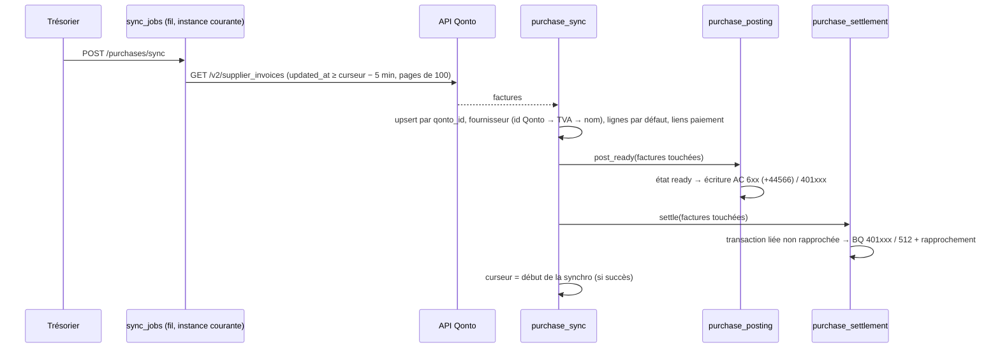

# Design — Qonto, lot 2a : factures d'achat, catalogue et engagement

> Statut : design proposé (2026-10-21), à valider. Source : [`besoins_qonto_achats.md`](besoins_qonto_achats.md)
> (décisions QA1 à QA12). Lot précédent : [`design_qonto_transactions.md`](design_qonto_transactions.md).
> Étape suivante : `/sc:workflow`.

## 1. Décisions

| # | Sujet | Décision | Raison |
|---|-------|----------|--------|
| D1 | Tables | `purchases` / `purchase_lines` (noms de `qonto.md`), `products`, `purchase_payments`, `sync_cursors` | `purchases` porte aussi les factures saisies du lot 2b (`source = 'manual'`, `qonto_id` NULL) |
| D2 | Montants | TTC **positif** + `is_credit_note` ; centimes entiers ; chaînes Qonto converties par `Decimal` | Une seule règle de signe, appliquée à l'écriture (avoir = sens inverse) |
| D3 | Taux de TVA | Entier en **points de base** (`2000` = 20 %, `550` = 5,5 %) ; NULL = à confirmer | Pas de flottant ; `taxes[].tax_rate` Qonto (« 20 », « 5.5 », « 22.00 ») converti par `Decimal` |
| D4 | Lignes par défaut | Une ligne par taux (`taxes[]`) : un seul taux → HT = `total_amount_excluding_taxes` ; plusieurs → HT = TVA ÷ taux, la dernière absorbe l'écart avec le HT Qonto ; sinon une ligne (HT / TVA si connus, sinon TTC à taux NULL) ; produit = **produit par défaut du fournisseur**, à défaut « Achats divers » | API sans lignes (QA2) ; total des lignes = TTC Qonto par construction |
| D5 | Lignes modifiées | `purchases.lines_edited` : tant qu'il est faux, une synchro **régénère** les lignes (OCR Qonto terminé plus tard) ; vrai → plus jamais touchées | Ne jamais écraser la saisie du trésorier |
| D6 | État comptable | Calculé par `purchase_state(p)` → `hidden` / `to_complete` (+ motifs) / `ready` / `posted` ; seul `posted` est stocké (FK `journal_entry_id`) | Un état dérivé ne se désynchronise pas |
| D7 | Comptabilisation | **Automatique** dès `ready` (QA9) : après synchro, enregistrement des lignes, validation d'un fournisseur ; journal **AC**, date de facture, `source = 'PURCHASE'`, `source_ref = 'PURCHASE:<id>'` | QA1, QA9 |
| D8 | Compte fournisseur | `Entity.account_code` (convention existante `401NNN`, ex. MAIF `401001`) ; si vide → prochain `401NNN` libre ; compte **créé** dans `accounts` (parent `401`, type `TIERS`, libellé = nom) à la première écriture | QA10 ; les codes existent déjà sur les fiches mais pas dans le plan |
| D9 | TVA | `fiscal_years.vat_liable` (défaut **faux**) ; vrai → débit TVA sur `44566`, à défaut `4456` ; faux → charge **TTC** par ligne | QA11 ; le plan SCI n'a que `4456` |
| D10 | Lien paiement | `purchase_payments(purchase_id, qonto_transaction_id, bank_transaction_id)` alimentée par `matched_transactions[]` ; résolution par **`fitid`** | Vérifié sur la SCI (phase A) : `transaction_id` est l'UUID de la transaction |
| D11 | Règlement | Transaction liée à une facture **comptabilisée**, non rapprochée → écriture **BQ** 401xxx / 512 et rapprochement, atomiques ; les **règles ignorent** toute transaction liée à une facture | QA8 |
| D12 | Écriture de règle antérieure | Transaction rapprochée d'une écriture **de règle** (`source` `QONTO_IMPORT`/`OFX_IMPORT`, `source_ref = FITID:…`, 2 lignes dont une 6xx) → « règlement à remplacer » ; remplacement **en lot** (suppression via `ledger.delete_entries`, règlement 401, rapprochement) ; rapprochement manuel → signalé seulement | QA12 ; on ne supprime jamais une saisie manuelle |
| D13 | Fournisseurs inconnus | Proposés dans l'écran **Contreparties** existant (section « Fournisseurs des factures ») ; même `name_key`, mêmes refus (`ignored_counterparties`) ; accepter rattache **factures et transactions** de même nom | QA3, une seule file de validation |
| D14 | Curseur | Table `sync_cursors(key, sync_from, synced_at)`, clé `qonto_supplier_invoices` | Les factures sont à l'échelle de l'organisation, pas d'un compte bancaire |
| D15 | Arrière-plan | `sync_jobs` avec `SYNC_KIND_QONTO_INVOICES = "qonto_supplier_invoices"` ; dernière synchro Qonto = la plus récente des deux sortes | Acquis du lot 1 |
| D16 | Facture comptabilisée modifiée dans Qonto | Montant, date ou passage en `rejected`/`discarded` → `review_reason` renseigné, **écriture inchangée** ; « Annuler la comptabilisation » supprime l'écriture AC (règlements intacts) | Comme `reversed` au lot 1 : signaler, ne rien défaire |

## 2. Vue d'ensemble

```
app/
├── models/
│   ├── product.py                (nouveau)   catalogue achat / vente
│   ├── purchase.py               (nouveau)   Purchase, PurchaseLine, PurchasePayment
│   ├── sync_cursor.py            (nouveau)
│   ├── entity.py                 (modifié)   + default_product_id, qonto_supplier_id, vat_number, iban
│   ├── fiscal_year.py            (modifié)   + vat_liable
│   ├── journal_entry.py          (modifié)   SOURCES + "PURCHASE"
│   └── sync_job.py               (modifié)   SYNC_KIND_QONTO_INVOICES
├── services/
│   ├── qonto_client.py           (modifié)   list_supplier_invoices
│   ├── catalog.py                (nouveau)   produits, produit « Achats divers », taux
│   ├── purchase_sync.py          (nouveau)   synchro, champs, lignes par défaut, fournisseurs
│   ├── purchase_posting.py       (nouveau)   état, compte fournisseur, écriture AC, annulation
│   ├── purchase_settlement.py    (nouveau)   liens paiement, règlement 401/512, remplacement en lot
│   ├── qonto_sync.py             (modifié)   ref. de transaction ; liens + règlements avant les règles
│   ├── rules_engine.py           (modifié)   ignore les transactions liées à une facture
│   ├── counterparties.py         (modifié)   propositions issues des factures
│   └── integrations.py           (modifié)   dernière synchro (deux sortes), description
├── views/
│   ├── purchases.py              (nouveau)   liste, fiche, lignes, synchro, règlements à remplacer
│   ├── products.py               (nouveau)   catalogue (Paramètres)
│   └── entities.py, fiscal_years.py, bank_accounts.py (modifiés)
└── templates/purchases/, products/ (nouveaux) ; entities/form, fiscal_years/form,
    bank_accounts/{transactions,counterparties}, base.html (modifiés)
```



Synchro des **transactions** (lot 1), par page : upsert → `purchase_settlement.link_transactions(créées)`
→ `settle(transactions)` → règles sur les transactions **non liées** → contreparties.

## 3. Données

Migration Alembic unique (tenant), `down_revision = "d7a2e6f0b318"`.

### 3.1 `products` (nouvelle)

| Colonne | Type | Rôle |
|---------|------|------|
| `id` | Integer PK | |
| `name` | String(200), unique | libellé |
| `reference` | String(50), nullable | code interne |
| `kind` | String(10) : `purchase` / `sale` / `both` | sens |
| `purchase_account_id` | FK `accounts.id`, nullable | 6xx (requis si `purchase`/`both`) |
| `sale_account_id` | FK `accounts.id`, nullable | 7xx (requis si `sale`/`both`) |
| `vat_rate_bp` | Integer, nullable | taux par défaut |
| `active` | Boolean, défaut vrai | archivé = faux |
| `created_at` | DateTime | |

Suppression refusée si utilisé (ligne de facture ou produit par défaut) → archivage.

### 3.2 `purchases` (nouvelle)

| Colonne | Type | Rôle |
|---------|------|------|
| `id` | Integer PK | |
| `source` | String(10), défaut `qonto` | `qonto` / `manual` (2b) |
| `qonto_id` | String(36), unique, nullable | `id` Qonto |
| `entity_id` | FK `entities.id` SET NULL, indexé | fournisseur rattaché |
| `supplier_name` | String(200) | `supplier_snapshot.name` › `supplier_name` › `issuer_name` |
| `qonto_supplier_id`, `supplier_vat`, `supplier_iban` | String, nullable | instantané Qonto (rattachement, création d'entité) |
| `invoice_number` | String(100) | |
| `issue_date`, `due_date`, `payment_date` | Date, nullable | |
| `currency` | String(3), défaut `EUR` | autre devise → « à compléter » (non géré) |
| `total_cents` | Integer, non nul | TTC, positif |
| `untaxed_cents`, `tax_cents`, `payable_cents` | Integer, nullable | |
| `is_credit_note`, `is_einvoice` | Boolean | |
| `qonto_status` | String(20), indexé | statut Qonto tel quel |
| `is_hidden` | Boolean, indexé | `rejected` / `discarded` / non financier (QA4) |
| `attachment_id` | String(36), nullable | pièce Qonto (lot Google Drive) |
| `related_qonto_ids` | Text (JSON), nullable | facture(s) liée(s) d'un avoir |
| `lines_edited` | Boolean, défaut faux | D5 |
| `journal_entry_id` | FK `journal_entries.id` SET NULL | écriture AC (= comptabilisée) |
| `review_reason` | Text, nullable | D16 |
| `source_updated_at` | DateTime | `updated_at` Qonto |
| `raw_payload` | Text | réponse brute (diagnostic, comme `customer_invoices`) |
| `created_at`, `updated_at` | DateTime | |

### 3.3 `purchase_lines` (nouvelle)

| Colonne | Type | Rôle |
|---------|------|------|
| `id` | Integer PK | |
| `purchase_id` | FK CASCADE, indexé | |
| `position` | Integer | ordre |
| `product_id` | FK `products.id` SET NULL | |
| `account_id` | FK `accounts.id`, nullable | repris du produit, modifiable |
| `label` | String(300) | |
| `untaxed_cents`, `vat_cents`, `total_cents` | Integer | `total = HT + TVA` |
| `vat_rate_bp` | Integer, nullable | NULL = à confirmer |

### 3.4 `purchase_payments` (nouvelle)

| Colonne | Type | Rôle |
|---------|------|------|
| `id` | Integer PK | |
| `purchase_id` | FK CASCADE | |
| `qonto_transaction_id` | String(36) | `matched_transactions[].transaction_id` (= `fitid`) |
| `bank_transaction_id` | FK `bank_transactions.id` SET NULL, indexé | résolu quand la transaction est importée |
| `journal_entry_id` | FK `journal_entries.id` SET NULL | écriture de règlement |

Contrainte unique `(purchase_id, qonto_transaction_id)`. Une référence disparue de Qonto est supprimée
si son règlement n'est pas passé, sinon signalée (`review_reason`).

### 3.5 Ajouts

| Table | Colonne | Rôle |
|-------|---------|------|
| `entities` | `default_product_id` FK `products.id` SET NULL | produit par défaut (A1.3) |
| `entities` | `qonto_supplier_id` String(36) indexé, `vat_number` String(30) indexé, `iban` String(34) | rattachement (A4.1) ; renseignés seulement s'ils sont vides |
| `fiscal_years` | `vat_liable` Boolean non nul, server_default faux | QA11 |
| `sync_cursors` | `id`, `key` String(50) unique, `sync_from` Date, `synced_at` DateTime | D14 |

## 4. Services

### 4.1 `qonto_client.list_supplier_invoices(page, per_page, updated_at_from, updated_at_to)`

`GET /supplier_invoices` avec `filter[updated_at_from/to]` (RFC 3339), `sort_by=updated_at:asc` ;
même gestion 429 / 5xx / 401 et garde « intégration désactivée » que `list_transactions`.

### 4.2 `catalog.py`

```python
parse_rate_bp("5.5") -> 550 ; format_rate(550) -> "5,5 %"
default_purchase_product()   # « Achats divers », créé à la demande : compte 6068, à défaut 628, puis 606
product_for(entity)          # entity.default_product (actif) sinon default_purchase_product()
```

### 4.3 `purchase_sync.py`

```python
sync_supplier_invoices(client=None, progress_cb=None) -> dict
#   fenêtre : 1er passage = sync_from (défaut début d'exercice) découpé par mois sur created_at ;
#   ensuite updated_at ≥ synced_at − 5 min ; commit par page ; curseur = début si succès
upsert_invoice(inv, result) -> Purchase   # sans commit
default_lines(purchase, product) -> list[PurchaseLine]   # D4
match_entity(purchase) -> Entity | None   # qonto_supplier_id → vat_number → name_key ; complète l'entité (A4.3)
```

Après chaque page : `purchase_settlement.link_invoice(p)` pour chaque facture,
`purchase_posting.post_ready(touchées)`, `purchase_settlement.settle(touchées)`.
Résultat : `created`, `updated`, `unchanged`, `hidden`, `posted`, `settled`, `to_complete`,
`to_review`, `errors`, `proposed_suppliers`.

### 4.4 `purchase_posting.py`

```python
purchase_state(p) -> State(code, reasons)
#   hidden | posted | to_complete si : devise ≠ EUR, pas de fournisseur, pas de date, aucun exercice
#   ouvert ne couvre la date, aucune ligne, ligne sans compte, taux NULL alors que l'exercice est
#   assujetti, Σ total des lignes ≠ total_cents | sinon ready
supplier_account(entity) -> Account          # D8 (création incluse, sans commit)
post(p) -> JournalEntry                      # LedgerError si non ready
post_ready(purchases) -> dict                # chaque facture dans sa propre transaction ; erreurs collectées
unpost(p)                                    # supprime l'écriture AC, lines_edited inchangé
save_lines(p, lines_payload)                 # valide, remplace, lines_edited = True, puis post_ready([p])
```

Écriture (facture ; avoir = débit et crédit inversés) :

| Compte | Débit | Crédit |
|--------|-------|--------|
| compte de chaque ligne | HT (assujetti) ou TTC (non assujetti) | |
| 44566 / 4456 (assujetti, si Σ TVA ≠ 0) | Σ TVA | |
| 401xxx du fournisseur | | TTC |

### 4.5 `purchase_settlement.py`

```python
link_invoice(p)                 # synchronise purchase_payments avec matched_transactions, résout bank_transaction_id
link_transactions(txns)         # résout les liens en attente pour des transactions nouvellement importées
linked_transaction_ids(ids)     # sous-ensemble lié à une facture (utilisé par rules_engine)
settle(purchases=None, transactions=None) -> dict
#   pour chaque lien résolu : facture posted, transaction non annulée et non rapprochée
#   → écriture BQ (401xxx débit / 512 crédit, montant de la transaction ; avoir/remboursement inversé)
#   + reconcile, atomiques ; plusieurs factures d'un même fournisseur payées par une transaction
#   → une écriture ; fournisseurs différents → signalé
to_replace() -> list            # D12 : liées, rapprochées d'une écriture de règle
replace_many(transaction_ids) -> {results, counters}   # une transaction par élément, résultat par élément
```

### 4.6 Modifications

- `qonto_sync` : par page, `link_transactions`
  et `settle` **avant** `apply_rules`, qui reçoit les créées non liées.
- `rules_engine.apply_rules` : exclut `linked_transaction_ids` (y compris sur application manuelle).
- `counterparties` : `proposals()` ajoute les factures sans entité, visibles, par `name_key` ;
  `accept()` rattache aussi les factures (et complète TVA / IBAN / id Qonto), puis `post_ready` + `settle`.

## 5. Écrans et routes

| Route | Rôle |
|-------|------|
| `GET /purchases` | liste : date, n°, fournisseur, TTC, statut Qonto, état (badge + motifs en infobulle), payée / liée, e-facture ; filtres période, état, statut Qonto, fournisseur, non payée, masquées ; bandeau « N à compléter », « N règlements à remplacer » |
| `POST /purchases/sync`, `GET /purchases/sync/status` | synchro en arrière-plan (fragment de suivi du lot 1) ; date de début modifiable avant le premier passage |
| `GET /purchases/<id>` | fiche : en-tête, lignes (formulaire HTMX : produit → compte et taux préremplis, ajout / suppression, total vs TTC en direct), ventilation TVA, règlements, écritures, lien Qonto, `review_reason` |
| `POST /purchases/<id>/lines` | `save_lines` (refusé si comptabilisée) |
| `POST /purchases/<id>/unpost` | annuler la comptabilisation |
| `POST /purchases/post-ready` | rattrapage : comptabilise toutes les prêtes |
| `GET /purchases/settlements`, `POST /purchases/settlements/replace` | D12 : liste cochable, remplacement en lot, résumé par élément |
| `/products` (Paramètres) | liste, création, modification, archivage |
| entités | produit par défaut, TVA, IBAN ; fiche : factures et solde du 401xxx |
| exercices | case « Soumis à la TVA » (aide : s'applique aux comptabilisations futures) |
| compte bancaire | badge « Facture n° … » sur une transaction liée ; filtre « débit sans facture » |
| contreparties | section « Fournisseurs des factures » |

Menu principal : « Factures d'achat » ; Paramètres : « Catalogue ».

## 6. Sécurité et intégrité

- Lecture seule côté Qonto ; aucune URL de pièce conservée (30 min).
- Toute écriture passe par `ledger.post_entry` (équilibre, exercice ouvert) ; règlement et
  rapprochement dans la même transaction SQL.
- Une écriture rapprochée ou comptabilisée n'est jamais supprimée implicitement ; `delete_entries`
  seulement dans `replace_many` (écriture de règle, choix explicite) et `unpost`.
- Routes POST protégées comme le reste (connexion, CSRF existant).

## 7. Tests (aucun appel réseau)

| Fichier | Cas |
|---------|-----|
| `test_catalog.py` | taux « 20 », « 5.5 », « 22.00 » ; produit par défaut selon le plan ; archivage d'un produit utilisé |
| `test_purchase_sync.py` | création / mise à jour / idempotence ; lignes par taux et arrondi ; facture non analysée (TTC seul) ; `lines_edited` respecté ; masquées ; avoir ; rattachement id Qonto → TVA → nom ; curseur non avancé sur erreur |
| `test_purchase_posting.py` | motifs d'état ; écriture assujetti / non assujetti ; 4456 sur plan SCI ; avoir ; compte 401NNN créé (code existant sur la fiche, ou suivant libre) ; exercice clos ; annulation ; review_reason |
| `test_purchase_settlement.py` | lien par fitid ; transaction avant facture ; règlement 401/512 rapproché ; règles ignorées ; écriture de règle → à remplacer → remplacement en lot ; rapprochement manuel seulement signalé ; annulée (`reversed`) ignorée |
| `test_purchases_views.py`, `test_products_views.py` | écrans, filtres, lignes, rattrapage, remplacement |
| `test_counterparties.py` | proposition issue d'une facture ; accept → facture rattachée et comptabilisée |

## 8. Risques

| Risque | Parade |
|--------|--------|
| Lien facture → transaction | Vérifié sur la SCI : `transaction_id` = UUID = `fitid` |
| Factures sans montants HT (OCR incomplet) | Ligne TTC à taux NULL : « à compléter » si exercice assujetti, comptabilisable sinon |
| Double charge (règle + facture) | Règles ignorent les transactions liées ; liste et remplacement en lot pour l'antérieur |
| Volume de la première synchro | Découpage mensuel sur `created_at` comme le lot 1 |
| Comptabilisation automatique sur une donnée Qonto erronée | Écriture modifiable par annulation ; changements Qonto ultérieurs signalés |
| Changement de `vat_liable` en cours d'exercice | N'affecte que les comptabilisations futures ; avertissement dans le formulaire |

## 9. Écarts constatés pendant la mise en œuvre

- **Phase A (SCI, 2 factures réelles)** : `matched_transactions[].transaction_id` = UUID de la
  transaction (= `fitid`) → colonne `bank_transactions.qonto_transaction_ref` abandonnée,
  `purchase_payments.qonto_transaction_id` (36). HT recalculé depuis la TVA faux de quelques
  centimes (316,36 ÷ 10 % = 3 163,60 ≠ 3 163,64) → D4 utilise le HT Qonto. Devise dans
  `total_amount.currency` (`currency` de premier niveau à `null`). `supplier_snapshot` sans `email`
  possible ; `vat_number` et `iban` présents.
