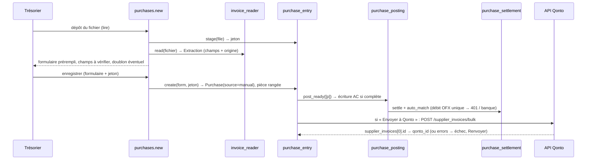

# Design — Qonto, lot 2b : saisie de factures d'achat, pièce jointe et OCR

> Statut : design proposé (2026-10-21), à valider. Source : [`besoins_qonto_achats_saisie.md`](besoins_qonto_achats_saisie.md)
> (décisions QB1 à QB8). S'appuie sur le lot 2a ([`design_qonto_achats.md`](design_qonto_achats.md)).
> Étape suivante : `/sc:workflow`.

## 1. Décisions

| # | Sujet | Décision | Raison |
|---|-------|----------|--------|
| D1 | Facture saisie | Même table `purchases`, `source = 'manual'` ; `lines_edited = True` dès la création | Tout le cycle du lot 2a (états, lignes, AC, annulation, règlement) s'applique sans changement |
| D2 | Parcours | Deux temps sur une même page : **lire** (dépôt → fichier mis en attente → extraction → formulaire prérempli) puis **enregistrer** (formulaire + jeton du fichier en attente) | Le trésorier vérifie avant toute création ; rien n'est écrit en base à la lecture |
| D3 | Lecture | Nouveau module `invoice_reader` : **Factur-X** (XML CII embarqué) → **texte PDF** → **OCR** Tesseract `fra` via PyMuPDF (`get_textpage_ocr`), 3 premières pages, pendant la requête | QB7 ; Factur-X donne des valeurs exactes, l'OCR n'est qu'un dernier recours |
| D4 | Champs incertains | L'extraction renvoie pour chaque champ sa valeur et son origine (`facturx`, `text`, `ocr`) ; les champs `text` / `ocr` et ceux qui violent HT + TVA = TTC sont marqués « à vérifier » dans le formulaire (non stocké) | S1.2 ; aucune colonne pour une information utile une seule fois |
| D5 | Fournisseur | `purchase_sync.find_supplier(qonto_id, vat, siret, iban, name)` remplace le cœur de `match_entity` ; ordre : id Qonto → TVA → **SIRET** → **IBAN** → nom | QB6 ; une seule reconnaissance pour Qonto et la saisie |
| D6 | Doublon | `duplicates(entity_id, invoice_number, issue_date, total)` : même fournisseur et même n° (normalisé), sinon même fournisseur, date et TTC ; avertissement + case « Enregistrer quand même » | S1.5 |
| D7 | Pièce | Colonnes `attachment_path` (relatif au dossier de l'instance), `attachment_name`, `attachment_mime`, `attachment_size` ; dossier `instance/uploads/<slug>/achats/AAAA/MM/<id>-<nom assaini>` ; attente dans `…/<slug>/tmp/` (purgée après 24 h) | QB4 ; séparé par instance (les autres dépôts ne le sont pas) |
| D8 | Envoi à Qonto | `qonto_client.create_supplier_invoice(path, name, idempotency_key)` → `POST /supplier_invoices/bulk` (multipart `supplier_invoices[][file]`, `supplier_invoices[][idempotency_key]`, `source=supplier_invoices`) ; `id` renvoyé → `qonto_id` ; état `qonto_upload` (`sent` / `failed` + message) ; clé d'idempotence (UUID) créée avec la facture et réutilisée au renvoi | QB1 ; une réponse 200 peut contenir des `errors` : vérifiée |
| D9 | Retour de Qonto | `upsert_invoice` trouve la facture par `qonto_id` ; pour `source = 'manual'`, **seuls les champs vides** de l'en-tête sont complétés ; statut, paiement, `payable`, liens de paiement mis à jour ; lignes jamais touchées (`lines_edited`) | QB2 |
| D10 | Paiement hors Qonto | `purchase_payments.qonto_transaction_id` devient **nullable** + colonne `origin` (`qonto` / `match` / `manual`) ; un lien OFX a `bank_transaction_id` sans identifiant Qonto ; `settle` inchangé | Le règlement 401 / banque du lot 2a sert tel quel |
| D11 | Rapprochement des montants | `purchase_settlement.match_candidates(p)` : débits non rapprochés, non annulés, non liés, de comptes **non rattachés à Qonto**, montant = −(net à payer ou TTC), date ∈ [date − 5 j ; (échéance ou date) + 60 j] ; tri : même tiers, puis écart de date. `auto_match(purchases)` : **un seul candidat** → lien `match` + `settle` (QB3) | Déclenché à la comptabilisation (`post_ready`) et après un import OFX |
| D12 | Sauvegardes | `instance_backup` produit `<slug>-AAAAMMJJ-HHMMSS.zip` : `database.db` (copie atomique) + `uploads/…` (dossier de l'instance) ; restauration et import acceptent `.zip` **et** `.db` (détection par en-tête), une archive remplace aussi les pièces (ancienne copie dans la sauvegarde `pre-restore`) | QB5 ; compatibilité avec les sauvegardes existantes |
| D13 | Dépendances | `pymupdf==1.26.*` (roues Python 3.12 et 3.14) ; Docker : `tesseract-ocr tesseract-ocr-fra` ; l'OCR se désactive proprement si Tesseract manque (lecture texte et Factur-X conservées) | NF3, NF6 |

## 2. Vue d'ensemble

```
app/
├── models/
│   ├── purchase.py            (modifié)  + supplier_siret, attachment_*, qonto_upload_*, idempotency_key ;
│   │                                      PurchasePayment.qonto_transaction_id nullable, origin
│   └── entity.py              (modifié)  + siret
├── services/
│   ├── invoice_reader.py      (nouveau)  Factur-X, texte, OCR → Extraction
│   ├── purchase_entry.py      (nouveau)  fichier en attente, création / modification, doublons, envoi à Qonto
│   ├── attachments.py         (nouveau)  chemins par instance, enregistrement sûr, purge
│   ├── qonto_client.py        (modifié)  create_supplier_invoice (POST multipart)
│   ├── purchase_sync.py       (modifié)  find_supplier ; facture saisie : vides seulement
│   ├── purchase_settlement.py (modifié)  match_candidates, auto_match, link_manual, unlink
│   ├── purchase_posting.py    (modifié)  post_ready → auto_match pour les factures saisies
│   └── instance_backup.py     (modifié)  archive .zip base + pièces, restauration .db / .zip
├── views/purchases.py         (modifié)  new (lire / enregistrer), edit, pièce, renvoi Qonto, règlement manuel
├── views/imports.py           (modifié)  auto_match après import OFX
└── templates/purchases/        new.html, _header_form.html, detail.html (pièce, envoi, suggestions)
```



## 3. Données

Migration Alembic unique (tenant), `down_revision = "24e66976825c"`.

| Table | Colonne | Type | Rôle |
|-------|---------|------|------|
| `entities` | `siret` | String(14), indexé | Reconnaissance des fournisseurs (D5) |
| `purchases` | `supplier_siret` | String(14) | Lu sur la facture |
| `purchases` | `attachment_path` | String(300) | Relatif au dossier de l'instance (`achats/2026/10/42-facture.pdf`) |
| `purchases` | `attachment_name`, `attachment_mime`, `attachment_size` | String(200), String(50), Integer | Nom d'origine, type vérifié, taille |
| `purchases` | `idempotency_key` | String(36) | UUID, créé avec une facture saisie |
| `purchases` | `qonto_upload_status` | String(10) | NULL (pas d'envoi), `sent`, `failed` |
| `purchases` | `qonto_upload_error` | Text | Dernier message d'échec |
| `purchase_payments` | `qonto_transaction_id` | String(36) → **nullable** | NULL pour un lien hors Qonto |
| `purchase_payments` | `origin` | String(10), défaut `qonto` | `qonto`, `match` (auto), `manual` (choisi) |

Contrainte unique ajoutée `(purchase_id, bank_transaction_id)`.

## 4. Services

### 4.1 `invoice_reader.py`

```python
@dataclass
class Extraction:
    fields: dict[str, Field]     # Field(value, origin: "facturx"|"text"|"ocr", check: bool)
    taxes: list[tuple[int, int, int]]   # (taux bp, HT, TVA) en centimes
    source: str                  # "facturx" | "text" | "ocr" | "none"
    warnings: list[str]          # ex. « OCR indisponible », « HT + TVA ≠ TTC »

read(path, mime, max_pages=3) -> Extraction
read_facturx(pdf) -> Extraction | None      # fichiers embarqués factur-x.xml / zugferd-invoice.xml / xrechnung.xml
parse_text(text, origin) -> Extraction      # expressions régulières (montants « 1 234,56 », dates, TVA FR, SIRET, IBAN, n°)
```

Champs : `supplier_name`, `vat_number`, `siret`, `iban`, `invoice_number`, `issue_date`, `due_date`,
`total`, `untaxed`, `tax`, `is_credit_note`. CII : `ExchangedDocument/ID`, `TypeCode` (381 = avoir),
`IssueDateTime` (format 102), `SellerTradeParty/Name`, `SpecifiedTaxRegistration/ID[@schemeID='VA']`,
`SpecifiedLegalOrganization/ID`, `ApplicableTradeTax` (taux, base, montant),
`SpecifiedTradeSettlementHeaderMonetarySummation` (`TaxBasisTotalAmount`, `TaxTotalAmount`,
`GrandTotalAmount`, `DuePayableAmount`), `DueDateDateTime`, `IBANID`. XML lu avec `xml.etree`
(expat ≥ 2.4 : entités externes non résolues, expansions bornées), taille ≤ 1 Mo.

Texte : pages dont le texte natif fait moins de 30 caractères → OCR (`page.get_textpage_ocr(language="fra",
dpi=300, full=True)`) ; image → `fitz.open(image).convert_to_pdf()` puis OCR. Tesseract absent →
avertissement, extraction partielle.

### 4.2 `attachments.py`

```python
instance_dir() -> Path                 # instance/uploads/<slug>/ (slug de l'instance courante, « default » hors requête)
stage(file_storage) -> str             # contrôle taille (10 Mo) et type (en-tête %PDF, JPEG, PNG) → jeton
staged_path(token) -> Path             # jeton validé (hex), chemin confiné au dossier tmp
store(purchase, token)                 # déplace vers achats/AAAA/MM/<id>-<nom assaini> ; colonnes attachment_*
path_of(purchase) -> Path              # résolu et vérifié (dans le dossier de l'instance)
purge_staging(older_than=24h)
```

### 4.3 `purchase_entry.py`

```python
form_from_extraction(extraction) -> dict          # valeurs du formulaire + champs à vérifier + fournisseur proposé
validate_header(form) -> (clean, errors)           # fournisseur (existant ou à créer), n°, dates, TTC > 0, avoir…
duplicates(entity_id, number, issue_date, total, exclude_id=None) -> list[Purchase]
create(clean, rows, token=None, send_to_qonto=False) -> Purchase   # lignes saisies, sinon par défaut ; post_ready ; envoi
update(purchase, clean, rows)                      # avant comptabilisation ; pièce remplaçable si non envoyée
send_to_qonto(purchase) -> bool                    # D8 ; commit de l'état ; jamais d'exception vers la vue
```

Une facture saisie sans ligne reçoit les lignes par défaut (`purchase_sync.default_lines` avec la
ventilation lue) ; `lines_edited = True` dans tous les cas.

### 4.4 `purchase_settlement.py` (ajouts)

```python
match_candidates(p, window=(5, 60)) -> list[BankTransaction]   # D11
auto_match(purchases) -> dict          # un seul candidat → PurchasePayment(origin="match") + settle
link_manual(p, bank_transaction_id)    # choix d'une suggestion (origin="manual") + settle
unlink(payment)                        # supprime le règlement (delete_entries) et le lien
```

`post_ready` appelle `auto_match` sur les factures saisies qu'il vient de comptabiliser ;
`imports.ofx` appelle `auto_match(factures saisies comptabilisées sans règlement)` après l'import.
Les factures Qonto ne passent pas par `auto_match` (Qonto désigne lui-même le paiement).

### 4.5 `instance_backup.py` (ajouts)

`create_backup` écrit une archive `.zip` (`database.db` + `uploads/…`) ; `_filename_re` accepte
`.db` et `.zip` ; `restore_from_upload` / `stage_upload_to_path` détectent l'en-tête (`SQLite format 3`
ou `PK\x03\x04`), vérifient les noms de l'archive (pas de chemin absolu ni de `..`), restaurent la base
puis remplacent le dossier des pièces de l'instance.

## 5. Écrans et routes

| Route | Rôle |
|-------|------|
| `GET /purchases/new` | Dépôt du fichier (« Lire la facture ») ou « Saisir sans fichier » |
| `POST /purchases/new` | `step=read` : mise en attente + lecture → formulaire prérempli ; `step=save` : création (doublon → réaffichage avec avertissement et case de confirmation) |
| `GET/POST /purchases/<id>/edit` | En-tête d'une facture saisie non comptabilisée |
| `GET /purchases/<id>/attachment` | Pièce (`inline` ; `?download=1`) |
| `POST /purchases/<id>/qonto` | Envoyer / renvoyer à Qonto |
| `POST /purchases/<id>/payments` | `bank_transaction_id` : régler par une suggestion |
| `POST /purchases/<id>/payments/<pid>/delete` | Défaire un règlement hors Qonto |

Formulaire (`_header_form.html`) : fournisseur (liste + « créer » avec nom, TVA, SIRET, IBAN),
n°, dates, avoir, HT / TVA / TTC, lignes (éditeur du lot 2a), case « Envoyer à Qonto » (si disponible,
cochée), pièce en aperçu à côté (PDF `<iframe>`, image ``). Liste : filtre « origine », badge
« envoi en échec », filtre « non réglée ». Fiche : pièce, état de l'envoi, suggestions de règlement.
Entité : champ SIRET.

## 6. Sécurité

- Fichiers : taille ≤ 10 Mo (contrôlée avant écriture), type par en-tête, nom assaini, chemins
  construits par le serveur et vérifiés dans le dossier de l'instance ; jeton d'attente hexadécimal.
- Pièce servie seulement aux utilisateurs connectés de l'instance (`login_required` + base tenant).
- XML Factur-X borné en taille ; aucune résolution d'entité externe.
- Qonto : seule écriture = dépôt de facture ; clé d'idempotence ; essai réel unique avec accord (QB8).
- Archives de sauvegarde : noms vérifiés à l'extraction (zip slip).

## 7. Tests

| Fichier | Cas |
|---------|-----|
| `test_invoice_reader.py` | PDF texte (montants, dates, TVA, SIRET, IBAN, n°) ; Factur-X généré (CII minimal embarqué) ; avoir ; incohérence HT + TVA ≠ TTC → à vérifier ; image/scan → OCR (ignoré sans Tesseract) ; fichier corrompu → extraction vide |
| `test_attachments.py` | Taille, type, jeton invalide, confinement des chemins, rangement par mois, purge |
| `test_purchase_entry.py` | Création → AC ; lignes par défaut ; doublons ; fournisseur créé avec TVA / SIRET / IBAN ; envoi Qonto (succès, `errors`, réseau) ; renvoi sans doublon (même clé) |
| `test_purchase_sync.py` | Facture saisie revenue de Qonto : vides complétés, saisie conservée |
| `test_purchase_settlement.py` | Candidat unique → réglé ; plusieurs → suggestions ; comptes Qonto exclus ; après import OFX ; règlement manuel ; défaire |
| `test_instance_backup.py` | Archive .zip (base + pièces), restauration .zip / .db, archive malveillante refusée |
| `test_purchases_views.py` | Parcours lire → enregistrer, doublon, édition, pièce, renvoi |

## 8. Risques

| Risque | Parade |
|--------|--------|
| OCR approximatif (scans de mauvaise qualité) | Champs « à vérifier », cohérence HT + TVA = TTC contrôlée, jamais d'enregistrement sans validation |
| Lien automatique erroné (deux factures du même montant) | Lien auto seulement si **un seul** candidat sur toutes les factures en attente ; un débit candidat de deux factures n'est jamais lié automatiquement ; lien défaisable |
| Doublon Qonto (renvoi) | Même clé d'idempotence ; `qonto_id` mémorisé dès la première réponse |
| Taille des sauvegardes | Pièces ≤ 10 Mo chacune ; affichage de la taille de l'archive |
| Tesseract absent (poste, CI) | Dégradation propre, tests OCR ignorés |
