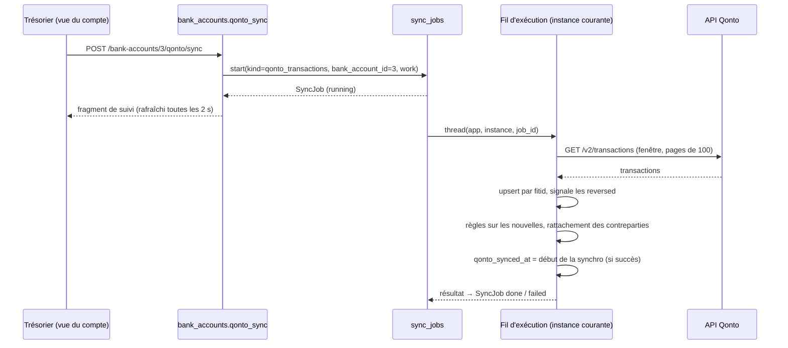

# Design — Qonto, lot 1 : comptes et transactions bancaires

> Statut : design proposé (2026-10-20), à valider. Source : [`besoins_qonto_transactions.md`](besoins_qonto_transactions.md)
> (décisions QO1 à QO6). Étape suivante : `/sc:workflow`.

## 1. Décisions

| # | Sujet | Décision | Raison |
|---|-------|----------|--------|
| D1 | Configuration | Intégration `qonto` dans `external_config` : `login`, `secret_key`, `staging_token` (bac à sable, optionnel) | QO1 ; même écran, même test, même interrupteur que les autres |
| D2 | Lien compte Qonto | **Colonnes sur `bank_accounts`** : `qonto_account_id`, `qonto_sync_from`, `qonto_synced_at` ; affichées et modifiables dans la fiche du compte | QO1 : « dans les informations du compte » |
| D3 | Identifiant d'une transaction | **`fitid` = UUID Qonto** (`id`) + nouvelle colonne `source` (`ofx` / `qonto`) | La contrainte unique `(bank_account_id, fitid)` assure déjà le dédoublonnage ; aucun code de rapprochement à changer |
| D4 | Données propres à Qonto | **Colonnes génériques** sur `bank_transactions` : `counterparty`, `note`, `is_reversed`, `attachment_count`, `attachment_required`, `attachment_lost`, `source_updated_at` ; `raw_type` élargi à 40 caractères pour `operation_type` | Filtrables en SQL (« justificatif manquant ») et réutilisables pour d'autres banques ; pas de jointure supplémentaire |
| D5 | Règles sur le type d'opération | `operation_type` rangé dans **`raw_type`**, que les règles savent déjà filtrer | Couvre une partie de QO3 sans changer le moteur de règles |
| D6 | Arrière-plan | `SyncJob` (`kind = "qonto_transactions"`, `bank_account_id`) + fil d'exécution + suivi HTMX, comme Stancer, via un module commun **`sync_jobs`** | QO2 ; une seule implémentation |
| D7 | Instance dans le fil d'exécution | Le fil reçoit **l'instance courante** et pose `g.tenant_engine` / `g.current_instance` | Aujourd'hui le fil Stancer écrit dans la base par défaut, pas dans celle de l'instance (anomalie corrigée au passage) |
| D8 | Fournisseurs | Rattachement **automatique aux entités existantes** (débits et crédits) ; contreparties de débit restantes **proposées** sur un écran de validation ; refus mémorisés dans `ignored_counterparties` | QO4 |
| D9 | Transaction annulée | `is_reversed = True` ; exclue des suggestions, du rapprochement automatique et refusée par `check_link` ; si déjà rapprochée : **signalée**, rien n'est défait | QO5 |
| D10 | Point d'entrée | Bouton « Synchroniser Qonto » et bloc Qonto dans la **vue du compte bancaire** (`bank_accounts.transactions`) ; écran de rattachement des comptes accessible depuis la liste des comptes | QO6 |

## 2. Vue d'ensemble

```
app/
├── models/
│   ├── bank_account.py              (modifié)  + qonto_account_id, qonto_sync_from, qonto_synced_at
│   ├── bank_transaction.py          (modifié)  + source, counterparty, note, is_reversed, attachment_*, source_updated_at
│   ├── sync_job.py                  (modifié)  + bank_account_id, SYNC_KIND_QONTO
│   └── ignored_counterparty.py      (nouveau)
├── services/
│   ├── external_config.py           (modifié)  service "qonto"
│   ├── integrations.py              (modifié)  sonde + dernière synchro Qonto
│   ├── sync_jobs.py                 (nouveau)  création, progression, fil d'exécution (extrait de stancer_async)
│   ├── stancer_async.py             (modifié)  utilise sync_jobs
│   ├── qonto_client.py              (nouveau)  HTTP : auth, pagination, 429, erreurs
│   ├── qonto_sync.py                (nouveau)  comptes, transactions, règles, contreparties
│   └── counterparties.py            (nouveau)  normalisation, rattachement, propositions
├── views/bank_accounts.py           (modifié)  rattachement Qonto, synchro, contreparties
└── templates/bank_accounts/         (modifiés + qonto_accounts.html, counterparties.html, _qonto_sync_status.html)
```



## 3. Données

Migration Alembic unique (tenant), `down_revision = "c3f8a1d5e297"`.

### 3.1 `bank_accounts` (ajouts)

| Colonne | Type | Rôle |
|---------|------|------|
| `qonto_account_id` | String(36), unique, nullable | `id` du compte Qonto ; NULL = pas rattaché |
| `qonto_sync_from` | Date, nullable | date de début (défaut : début de l'exercice en cours) |
| `qonto_synced_at` | DateTime, nullable | curseur : début de la dernière synchronisation **réussie** (UTC) ; NULL = jamais |

### 3.2 `bank_transactions` (ajouts / changements)

| Colonne | Type | Rôle |
|---------|------|------|
| `source` | String(10), non nul, défaut `'ofx'` (server_default) | origine (`ofx`, `qonto`) ; les lignes existantes restent `ofx` |
| `raw_type` | String(20) → **String(40)** | type OFX, ou `operation_type` Qonto |
| `counterparty` | String(200), nullable | `clean_counterparty_name`, à défaut `label` |
| `note` | Text, nullable | note Qonto |
| `is_reversed` | Boolean, non nul, défaut `False` | transaction annulée après règlement |
| `attachment_count` | Integer, nullable | nombre de pièces (NULL pour OFX) |
| `attachment_required` | Boolean, nullable | pièce exigée par Qonto |
| `attachment_lost` | Boolean, nullable | pièce déclarée perdue |
| `source_updated_at` | DateTime, nullable | `updated_at` Qonto (diagnostic) |

`fitid` (String 100) reçoit l'UUID Qonto (36 caractères). Index ajouté sur `(bank_account_id, is_reversed)`.

### 3.3 `ignored_counterparties` (nouvelle)

| Colonne | Type | Rôle |
|---------|------|------|
| `id` | Integer PK | |
| `name_key` | String(200), unique | nom normalisé (§5.4) |
| `label` | String(200) | nom tel qu'affiché |
| `created_at` | DateTime | |

### 3.4 `sync_jobs` (ajout)

`bank_account_id` (Integer, FK `bank_accounts.id`, `ondelete=SET NULL`, indexé) ;
constante `SYNC_KIND_QONTO = "qonto_transactions"`.

## 4. Intégration Qonto

- `SERVICE_KEYS["qonto"] = ["login", "secret_key", "staging_token"]`, requis : `login`, `secret_key` ;
  secrets : `secret_key`, `staging_token` ; repli `.env` : `QONTO_LOGIN`, `QONTO_SECRET_KEY`,
  `QONTO_STAGING_TOKEN` ; libellé « Qonto », description « Comptes et transactions bancaires ».
- **Base URL** : production `https://thirdparty.qonto.com/v2` ; si `staging_token` est renseigné, bac à
  sable `https://thirdparty-sandbox.staging.qonto.co/v2` + en-tête `X-Qonto-Staging-Token`.
- **Sonde** : `GET /organization` → « Organisation « X » accessible, N compte(s) » (timeout 10 s).
- **Dernière synchronisation** : `_SYNC_SOURCES["qonto"] = ((SYNC_KIND_QONTO,), None, "bank_accounts.index")`.
- `FIELD_META` (vue Intégrations) devient indexable par `(service, clé)` en plus de `clé`, car
  `secret_key` existe aussi pour Stancer avec une aide différente.

## 5. Services

### 5.1 `qonto_client.py`

```python
class QontoError(RuntimeError): ...            # message français, déjà masqué
class QontoAuthError(QontoError): ...          # 401 / 403 : arrêt immédiat (pas de rafale de 401)

class QontoClient:
    def __init__(self, login, secret_key, staging_token=None, timeout=30): ...
    def organization(self) -> dict                         # GET /organization
    def bank_accounts(self) -> list[dict]                  # organization()["bank_accounts"]
    def iter_transactions(self, bank_account_id, *, statuses, updated_from=None,
                          updated_to=None, settled_from=None, settled_to=None,
                          per_page=100) -> Iterator[dict]  # suit meta.next_page

def from_app_config(timeout=30) -> QontoClient             # garde « intégration désactivée » comme les autres
```

- En-tête `Authorization: {login}:{secret_key}` ; `requests.Session` réutilisée.
- **429** : jusqu'à 3 nouvelles tentatives, attente `Retry-After` si présent sinon 2 s, 4 s, 8 s.
- **5xx / réseau** : 2 nouvelles tentatives puis `QontoError`.
- **422 « page × per_page > 10 000 »** : ne doit pas arriver (fenêtres §5.2) ; sinon `QontoError` explicite.

### 5.2 `qonto_sync.py`

```python
def list_accounts() -> list[QontoAccountView]   # comptes Qonto + compte bancaire rattaché / proposé (même IBAN)
def link_account(qonto_account_id, bank_account_id=None, *, create_label=None,
                 gl_account_id=None, sync_from=None) -> BankAccount
def unlink_account(bank_account_id) -> None      # garde les transactions, efface le curseur
def sync_bank_account(bank_account_id, progress_cb=None) -> dict
```

**`sync_bank_account`** :
1. `started = utcnow()`.
2. Fenêtres :
   - **première fois** (`qonto_synced_at` NULL) : par **mois** de `qonto_sync_from` à aujourd'hui,
     filtre `settled_at_from/to`, `status[] = completed` (une fenêtre mensuelle reste très loin de 10 000) ;
   - **ensuite** : une fenêtre `updated_at_from = qonto_synced_at − 10 min` (marge d'horloge, sans
     risque grâce à l'idempotence), `updated_at_to = started`, `status[] = completed, reversed` ; si
     `meta.total_count > 9 000`, la fenêtre est coupée en deux, récursivement.
3. Pour chaque transaction (`_upsert`) :
   - `completed`, absente → création (`source='qonto'`, `fitid=id`, champs §5.3) ;
   - `completed`, présente → mise à jour de `label`, `counterparty`, `note`, `raw_type`, pièces,
     `source_updated_at` ; **jamais** montant, date, rapprochement, entité, catégorie (si le montant
     Qonto diffère : compteur `conflicts` + message, rien n'est modifié) ;
   - `reversed`, présente → `is_reversed = True` (compteur `reversed`, et `reversed_reconciled` si elle
     était rapprochée) ; absente → ignorée ;
   - settled_at antérieur à `qonto_sync_from` → ignorée.
   Commit **par page** (100) ; progression `(done, total_count, "Page n…")`.
4. Règles : `rules_engine.apply_rules(nouvelles)`.
5. Contreparties : `counterparties.link_existing(nouvelles sans entité)`.
6. `qonto_synced_at = started` ; commit. En cas d'exception : rollback de la page en cours, curseur
   **inchangé** (les pages déjà validées sont rejouées sans doublon la fois suivante).

Résultat (`SyncJob.result_json`) :
`{"created", "updated", "reversed", "reversed_reconciled", "skipped", "conflicts", "rules_matched",
"rules_posted", "linked_entities", "proposed_counterparties", "errors": [...]}`.

### 5.3 Correspondance des champs

| Qonto | `bank_transactions` |
|-------|---------------------|
| `id` | `fitid` |
| `settled_at` (UTC) | `transaction_date` = date **en Europe/Paris** |
| — | `value_date` = NULL (pas fourni) |
| `amount_cents` + `side` | `amount_cents` (débit → négatif) |
| `label` + `reference` | `label` = « label — reference » (500 car. max) |
| `clean_counterparty_name` ou `label` | `counterparty` |
| `operation_type` | `raw_type` |
| `note` | `note` |
| `attachment_ids`, `attachment_required`, `attachment_lost` | `attachment_count`, `attachment_required`, `attachment_lost` |
| `status = reversed` | `is_reversed = True` |
| `updated_at` | `source_updated_at` |

### 5.4 `counterparties.py`

```python
NO_SUPPLIER_TYPES = {"qonto_fee", "account_remuneration", "recall", "direct_debit_hold",
                     "card_acquirer_payout", "income", "swift_income", "direct_debit_collection",
                     "financing_installment", "pay_later", "investment"}

def name_key(name) -> str                           # casefold, accents conservés, espaces fusionnés
def link_existing(transactions) -> int              # entité dont name_key(name) == name_key(counterparty)
def proposals(bank_account_id=None) -> list[Proposal]
#   débits Qonto sans entité, non annulés, raw_type ∉ NO_SUPPLIER_TYPES, name_key non ignoré,
#   groupés par name_key : libellé, nb de transactions, total, première/dernière date,
#   entités au nom proche (même préfixe) suggérées
def accept(name_key, *, entity_id=None, create_name=None) -> int   # crée FOURNISSEUR si besoin, rattache
def ignore(name_key, label) -> None
```

Rattacher n'affecte que `entity_id` des transactions sans entité ; jamais celles déjà catégorisées.

### 5.5 `sync_jobs.py` (extrait de `stancer_async`)

```python
def running_job(kind, **filters) -> SyncJob | None
def start(app, kind, work, *, message, **job_fields) -> SyncJob
#   crée le job, capture current_instance(), lance le fil :
#   with app.app_context(): g.current_instance = inst; g.tenant_engine = get_tenant_engine(inst)
def progress_callback(job_id, throttle=5)
```

`stancer_async` garde son API publique (`start_sync_payouts`, …) et délègue à `sync_jobs` : la
correction D7 profite aux deux.

## 6. Écrans et routes (blueprint `bank_accounts`)

| Méthode | URL | Accès | Rôle |
|---------|-----|-------|------|
| GET | `/bank-accounts/qonto` | admin | Rattachement : comptes Qonto (nom, IBAN, principal, statut) ; pour chacun : rattaché à X / proposé (même IBAN) / non rattaché ; formulaire rattacher, créer (libellé, compte 512x), ignorer ; date de début |
| POST | `/bank-accounts/qonto/link` | admin | `qonto_account_id`, `bank_account_id` **ou** (`label`, `gl_account_id`), `sync_from` |
| POST | `/bank-accounts/<id>/qonto/unlink` | admin | détache (transactions conservées) |
| POST | `/bank-accounts/<id>/qonto/sync` | connecté | démarre la synchro → fragment de suivi |
| GET | `/bank-accounts/<id>/qonto/sync/<job_id>` | connecté | fragment de suivi (polling 2 s) |
| GET | `/bank-accounts/<id>/counterparties` | connecté | propositions de fournisseurs |
| POST | `/bank-accounts/<id>/counterparties` | connecté | `action=create\|link\|ignore`, `name_key`, `entity_id` / `name` |

**Vue du compte** (`transactions.html`) :
- Bloc **Qonto** si rattaché : compte Qonto, date de début, dernière synchro, bouton « Synchroniser
  Qonto » (désactivé + bandeau `unavailable_notice('qonto')` si l'intégration est indisponible),
  zone de suivi. Si non rattaché et Qonto disponible : lien « Rattacher à un compte Qonto » (admin).
- Bandeau « N contreparties à valider » → écran des propositions.
- Bandeau « N transactions annulées par Qonto encore rapprochées » si `reversed_reconciled > 0`.
- Liste : icônes justificatif (présent / requis manquant / perdu), badge « Annulée », filtre
  « justificatif manquant » (`attachment_required AND attachment_count = 0`).
- **Fiche du compte** (`form.html`) : section Qonto en lecture (compte, date de début modifiable,
  dernière synchro) ; le choix du compte Qonto se fait sur l'écran de rattachement.

**Espace de rapprochement (React)** : `serialize_transaction` expose `is_reversed`,
`attachment_status` ; la ligne affiche un badge « Annulée » et n'est ni sélectionnable pour un lien
ni incluse dans le rapprochement automatique ; `reconciler.check_link` renvoie « Transaction annulée
par la banque » ; `suggest_matches_scored` et `auto_pairs` excluent `is_reversed`.

## 7. Sécurité

- Clé et jeton de bac à sable : secrets de l'intégration (jamais réaffichés, masqués dans les messages
  et journaux, y compris dans `SyncJob.message`).
- Lecture seule côté Qonto. Rattachement des comptes réservé aux admins ; synchronisation et
  validation des contreparties ouvertes aux utilisateurs connectés (comme les autres synchros).
- Arrêt immédiat sur 401/403 (pas de rafale d'échecs d'authentification, cf. blocage Qonto).

## 8. Tests (aucun appel réseau)

| Fichier | Contenu |
|---------|---------|
| `tests/test_qonto_client.py` | en-tête d'auth, bac à sable, pagination `next_page`, 429 avec `Retry-After` puis succès, 401 → `QontoAuthError` sans nouvelle tentative, 5xx répétés → erreur, masquage |
| `tests/test_qonto_sync.py` | correspondance des champs (signe, date Paris, libellé), idempotence (2 synchros = 0 doublon), mise à jour sans toucher au rapprochement, conflit de montant signalé, `reversed` (non rapprochée / rapprochée), fenêtres mensuelles initiales, fenêtre incrémentale + marge, découpage > 9 000, curseur inchangé après échec, règles appliquées aux seules nouvelles |
| `tests/test_counterparties.py` | normalisation, rattachement aux entités existantes (débit et crédit), propositions (exclusions de types, ignorées, déjà catégorisées), accepter / créer / ignorer |
| `tests/test_qonto_views.py` | rattachement (IBAN identique proposé, création avec 512x, admin seulement), synchro → job + fragment, intégration désactivée → refus, vue du compte (bloc Qonto, icônes, filtre, bandeaux), propositions |
| `tests/test_sync_jobs.py` | le fil d'exécution écrit dans la base de l'**instance courante** (D7), y compris pour Stancer |
| `tests/test_reconciler_bulk.py` / API | transaction annulée refusée, exclue des suggestions et du rapprochement automatique |
| `frontend` (Vitest) | badge « Annulée », ligne non sélectionnable pour un lien |

Client simulé : un faux `QontoClient` (pages en mémoire) injecté par `monkeypatch` ; `requests`
simulé pour `qonto_client`.

## 9. Documentation

`doc/routes.md`, `doc/models.md`, `doc/services.md` (qonto_client, qonto_sync, counterparties,
sync_jobs), `doc/imports.md` (Qonto à côté d'OFX), `doc/installation.md` / `doc/docker.md`
(`QONTO_*`), `doc/multi_tenant.md` (fil d'exécution et instance).

## 10. Risques

| Risque | Mesure |
|--------|--------|
| Fil d'exécution et base de l'instance (D7) | Test dédié ; correction partagée avec Stancer |
| Champs de l'API différents de la doc (bac à sable) | Essai sur le bac à sable avant la base réelle ; correspondance isolée dans `_upsert` |
| Beaucoup de petites contreparties carte | Proposition groupée + « ignorer » mémorisé ; aucune création automatique |
| Date de règlement UTC vs date bancaire française | Conversion Europe/Paris (une opération à 23 h 30 UTC appartient au lendemain) |
| Annulation d'une transaction déjà comptabilisée | Signalée dans la vue du compte et dans le résumé ; correction manuelle |
| SQLite et écritures concurrentes (fil + requêtes) | Commit par page, progression limitée (1 écriture / 5 appels), une seule synchro par compte à la fois |

## 11. Bilan de la mise en œuvre

**Phase A (2026-10-20)** :
- `sync_jobs.run` est appelable directement ; les tests remplacent `threading.Thread` par une
  exécution immédiate pour être déterministes. Un test par mutation (sélection d'instance retirée)
  fait bien échouer 4 tests sur 6.
- Isolation des tests : les moteurs tenant sont mis en cache **par id d'instance** et la méta-base est
  recréée à chaque test (ids qui repartent à 1) ; `conftest.py` vide désormais ce cache après chaque test.
- Vérifié avec Stancer réel depuis l'interface : 27 versements et 154 paiements importés en 42 s,
  progression affichée, job enregistré dans la base de l'instance.

**Phase B (2026-10-20)** :
- Migration `d7a2e6f0b318` ; sur copie de la base réelle, les 185 transactions existantes passent en
  `source = 'ofx'`, montée / descente / remontée OK.
- `QontoClient(retry=False)` pour la sonde : un 429 ne déclenche pas d'attente qui dépasserait le
  délai du test.
- Erreurs Qonto au format `{"errors": [{"code", "detail"}]}` lues par `_api_detail` (vérifié en réel :
  fausse clé → « Identifiants refusés par Qonto (HTTP 401). Détail : Invalid credentials », 133 ms).
- Variables `QONTO_*` ajoutées à `app/config.py` (repli `.env`). Constat hors lot : `GA4_*` et
  `FACEBOOK_*` sont déclarées dans `ENV_FALLBACK` mais absentes de `config.py`, donc leur repli `.env`
  ne fonctionne pas (sans effet aujourd'hui : configurées en base).

**Phase C (2026-10-20)** :
- Essais réels avec les accès **lecture seule de la SCI des Chênes Verts** (`QONTO_API_ID` /
  `QONTO_API_SECRET` dans `.env`, noms acceptés en plus de `QONTO_LOGIN` / `QONTO_SECRET_KEY`), sur un
  **serveur isolé** (port 5001, copie de la méta-base dont l'instance pointe vers une base SCI neuve),
  jamais dans la base de Seconde Nature.
- Structure réelle des transactions conforme au §5.3 : `amount_cents` toujours positif + `side`,
  pas de date de valeur, `clean_counterparty_name`, `attachment_ids` / `attachment_required` / `attachment_lost`.
- Le plan comptable ne marque pas la classe `51` comme en-tête : l'écran de rattachement présélectionne
  le premier compte `512…` (le formulaire « Nouveau compte » existant garde son comportement).
- `set_sync_from` : reculer la date de début remet le curseur à zéro (synchro complète, sans doublon).
- Attention : le repli `.env` vaut pour **toutes** les instances ; des identifiants Qonto d'une
  organisation précise doivent être saisis **dans l'instance concernée** (Intégrations), pas dans `.env`.

**Phase D (2026-10-20)** :
- **Règles appliquées page par page**, juste après le commit de la page : si une synchro échoue en
  cours de route, les transactions déjà enregistrées ont leurs règles (sinon, existant déjà, elles ne
  seraient plus « nouvelles » à la reprise).
- Fenêtres : même mécanisme de découpage (> 9 000 résultats) pour les fenêtres mensuelles initiales et
  la fenêtre incrémentale ; date de début dans le futur → aucune lecture.
- Messages d'échec : une `QontoError` sans réponse HTTP est affichée telle quelle ; une `RuntimeError`
  métier (compte non rattaché) aussi.
- Vérifié sur le **compte réel de la SCI** (lecture seule, instance de test isolée) : 5 transactions
  importées en un clic, somme = **X XXX,XX €** = solde Qonto ; seconde synchro incrémentale : 0 lue ;
  date de début reculée d'un an → 13 fenêtres mensuelles relues, 5 inchangées, aucun doublon.
