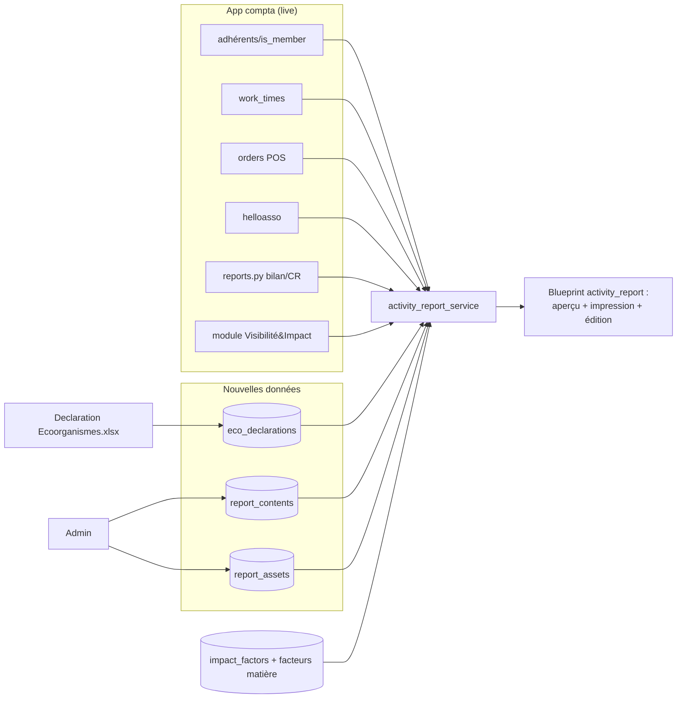
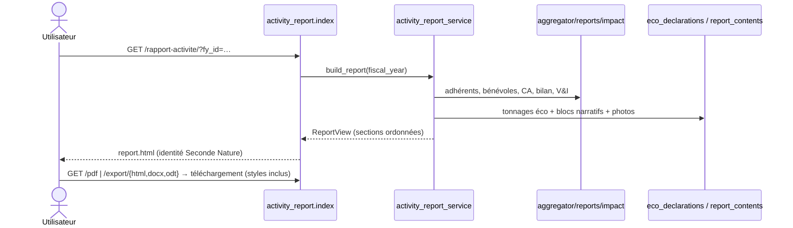

# Design — Rapport d'activité Seconde Nature

> **Statut : ARCHITECTURE / DESIGN (sortie de `/sc:design`, skill frontend-design).**
> Structure, modèle de données, système de mise en page, interfaces, flux.
> **Pas de code d'implémentation** (→ `/sc:implement`).
> Entrée : `besoins_rapport_activite.md`. Modèle : `La_Matière_Rapport_Activités_2025.pdf`.
> Date : 2026-06-28.

---

## 0. Décisions par défaut (questions ouvertes §8 des besoins)

| Q | Décision retenue |
|---|---|
| Q1 Exercice ↔ trimestres éco | Agréger les trimestres de l'éco-déclaration dont le **début tombe dans l'exercice**. Trimestre = unité indivisible (pas de pro-rata en v1). |
| Q2 Ingestion tonnages | **Import du `.xlsx` (feuille `Bilan`)** + table éditable pour correction. |
| Q3 Contenu identité/services | **Édité dans l'app** (découplé du site Jekyll), pas de lecture des `_data/*.yml`. |
| Q4 Photos | **Upload dans l'app** (dossier instance), légendes éditables. URL externe tolérée. |
| Q5 Fidélité maquette | **Structure La Matière** (couverture, sommaire numéroté, bandes de section, gros chiffres, frise) **en identité Seconde Nature**. |
| Q6 Bilan financier | **Synthèse** (produits/charges/résultat + financement éco-organismes) ; détail PCA en annexe optionnelle. |
| Q7 Versionnage | **Un rapport par exercice**, persisté et reconsultable. |

---

## 1. Direction visuelle (frontend-design)

> La palette est **imposée par la marque** (tokens du site `custom.scss`) — on la
> suit exactement. La distinction se joue sur la **mise en page** et l'**élément
> signature**, ancrés dans l'univers du réemploi.

### Tokens (verrouillés sur le site)
```
--kraft      #e7dcc4   fond papier recyclé (page)
--paper      #f4eee0   surfaces / cartes
--ink        #26231d   texte (encre chaude)
--ink-soft   #5b5446   texte secondaire
--green      #1c7a33   primaire (réemploi)
--green-deep #0f3d1c   vert profond (logo, titres)
--red        #c2452d   accent ficelle (parcimonie)
--line       #cdbf9f   filets
```
Typo : `--display` (titres, gros chiffres), `--body` (texte courant),
`--mono` (eyebrows, étiquettes de données, légendes). Le **mono** porte le
vocabulaire « donnée / étiquette » — cohérent avec la signature ci-dessous.

### Élément signature — l'**étiquette kraft** (hang-tag)
Le monde de Seconde Nature, c'est l'objet de seconde main qui reçoit une
**étiquette nouée à la ficelle**. On en fait le motif structurant :
- **marqueurs de section** : numéro + titre présentés comme une étiquette kraft
  (coin perforé + filet `--red` = la ficelle), au lieu d'un simple bandeau coloré ;
- **chiffres-clés** : « grand nombre » posé sur une étiquette `--paper` ;
- éviter toute autre décoration → la boldness vit dans ce seul motif.

### Hero / thèse de la couverture
Le plus caractéristique de l'univers SN = **l'objet qui repart pour une seconde
vie**. Couverture = photo boutique/objets collectés + **grande étiquette kraft**
portant l'exercice et « Rapport d'activité », logo vert. (Pas de gros chiffre +
gradient : ce serait le défaut.)

### Second motif — le **flux de matière** (Entrant → Réemployé)
L'histoire d'une recyclerie est un **flux** : matière collectée → triée → remise
en circulation. La section impact en fait son hero : un schéma de flux
`Collecté ──▶ Réemployé` (tonnages), barre de **taux de réemploi**, et la part
détournée du déchet. C'est *vrai* du sujet, donc structurant (pas décoratif).

### Auto-critique (anti-générique)
- ❌ défaut IA « cream + serif + terracotta » → évité : palette = marque réelle,
  display non-serif, accent rouge utilisé en *ficelle* uniquement.
- ✅ numérotation du sommaire conservée : le rapport **est** une séquence ordonnée.
- ✅ une seule audace (l'étiquette), tout le reste discipliné.

---

## 2. Système de mise en page (impression A4)

Conteneur `.report` scopant les tokens (override de Bootstrap localement).
`@page { size: A4; margin: 18mm }`, sauts de page maîtrisés (`break-inside: avoid`
sur cartes/étiquettes, `break-before: page` sur chaque section).

### Composants
| Composant | Rôle |
|---|---|
| `report-cover` | Couverture : photo pleine + étiquette titre + logo |
| `section-tag` | En-tête de section : étiquette kraft `NN — TITRE` |
| `figure-tag` | Grand chiffre sur étiquette (+ libellé mono + Δ optionnel) |
| `stat-band` | Bande de 3-4 chiffres-clés en pied de section |
| `flow-reuse` | Schéma flux Collecté ▶ Réemployé + jauge taux |
| `chart-block` | Graphe ECharts (adhérents, tonnages, CA) + légende |
| `timeline` | Frise historique / perspectives |
| `partner-grid` | Logos partenaires |
| `quote` | Citation (édito) |
| `photo-full` | Photo pleine largeur + légende mono |

### Wireframes (ASCII)

**Couverture**
```
┌───────────────────────────────────────────┐
│  [ photo boutique / objets — pleine page ] │
│                                            │
│   ╭────────────────────╮                   │
│   │ EXERCICE 2025      │  ← étiquette kraft │
│   │ Rapport d'activité │    (coin perforé,  │
│   │ Seconde Nature   ⌐ │     ficelle rouge) │
│   ╰────────────────────╯                   │
│                              [logo vert] │
└───────────────────────────────────────────┘
```

**Section type** (ex. Vie associative)
```
╭───────────────╮
│ 05 — VIE      │  section-tag (kraft)
│    ASSOCIATIVE│
╰───────────────╯
 intro narrative (éditable) ............................

 ┌─figure-tag─┐ ┌─figure-tag─┐ ┌─figure-tag─┐
 │   1 510    │ │   312 h    │ │  +20 %     │
 │ adhérents  │ │ bénévolat  │ │ vs N-1     │
 └────────────┘ └────────────┘ └────────────┘

 [ chart-block : évolution adhérents (ECharts) ]
```

**Section impact — flux de matière**
```
╭───────────────╮
│ 06 — RÉEMPLOI │
╰───────────────╯
   COLLECTÉ                 RÉEMPLOYÉ
   ┌────────┐   ──────▶   ┌────────┐
   │ 24,1 t │            │ 9,8 t  │
   └────────┘            └────────┘
   Taux de réemploi  ▓▓▓▓▓▓░░░░  41 %
   CO₂ évité : 245 kg · soit ~1 270 km voiture
   [ chart : tonnages par matière — Ecomaison / Ecologic ]
```

Responsive : à l'écran, grille fluide ; à l'impression, colonnes figées A4.
Plancher qualité : focus clavier visible, `prefers-reduced-motion` respecté
(animations réservées à l'écran, jamais à l'impression).

---

## 3. Architecture de l'information (sections → sources)



| Section | Données live | Narratif éditable | Source spécifique |
|---|---|---|---|
| Couverture | exercice | titre, photo | — |
| Édito / Rapport moral | — | ✅ | — |
| Gouvernance / Qui sommes-nous | — | ✅ | — |
| Vie associative (adhérents, bénévoles) | ✅ app | intro | — |
| **Réemploi & impact** | ✅ calculé | intro | **eco_declarations** + facteurs ADEME |
| Boutique & ventes | ✅ POS + Vinted | intro | MetricSnapshot (Vinted) |
| Collecte & éco-organismes | ✅ financement | intro | eco_declarations (facturation) |
| Repair Café & ateliers | — | ✅ | — |
| Communication & visibilité | ✅ module V&I | intro | GA4 / FB / HelloAsso |
| Partenaires | — | ✅ | report_contents |
| Bilan financier | ✅ reports.py | commentaire | — |
| Perspectives / frise | — | ✅ | timeline éditable |

---

## 4. Modèle de données (nouvelles tables, base tenant)

> Convention projet : montants en centimes ; un fichier modèle par table + export
> `__all__` ; FK avec `ondelete` ; **pas de FK vers `users`** (bind `meta`).

### 4.1 `eco_declarations` — tonnages éco-organismes
| Colonne | Type | Notes |
|---|---|---|
| id | Integer PK | |
| organism | String(20) | `ecomaison` / `ecologic` |
| material | String(40) | Meubles, Jouets, Brico-Jardin, D3E, Sports… |
| quarter_label | String(10) | « T2 2025 » |
| period_start | Date, index | 1er jour du trimestre (mapping exercice) |
| entrant_t | Numeric(10,3) | tonnage collecté |
| sortant_t | Numeric(10,3) | tonnage réemployé |
| financing_cents | Integer, default 0 | facturation éco-organisme |
| source | String(10) | `import` / `manual` |
| created_at | DateTime | |
- Unicité `(organism, material, quarter_label)` → upsert à l'import.

### 4.2 `report_contents` — blocs narratifs éditables
| Colonne | Type | Notes |
|---|---|---|
| id | Integer PK | |
| fiscal_year_id | Integer FK `fiscal_years` ON DELETE CASCADE, index | |
| block_key | String(50) | `edito`, `rapport_moral`, `intro_adherents`, … |
| title | String(200), nullable | |
| body_html | Text | contenu rédigé |
| updated_at | DateTime | |
| updated_by_user_id | Integer, nullable | (pas de FK, bind meta) |
- Unicité `(fiscal_year_id, block_key)`. Catalogue des blocs = constante module.

### 4.3 `report_assets` — photos
| Colonne | Type | Notes |
|---|---|---|
| id | Integer PK | |
| fiscal_year_id | Integer FK `fiscal_years` ON DELETE CASCADE | |
| slot | String(50) | `cover`, `section_impact`, … |
| path | String(300) | fichier sous `instance/uploads/report/<fy>/` |
| caption | String(300), nullable | |
| uploaded_at | DateTime | |

### 4.4 Réutilisé
- `fiscal_years` (période = exercice), `impact_factors` (**étendu**, §6),
  `metric_snapshots` (Vinted/FB/GA4), `work_times`, `orders`, `helloasso_*`,
  `services/reports.py` (compte de résultat + bilan).

---

## 5. Ingestion de l'éco-déclaration

`app/services/eco_declaration_import.py`
```python
def import_eco_xlsx(file_stream) -> dict:
    """Parse la feuille 'Bilan' du Declaration Ecoorganismes.xlsx.
    Lit, par organisme (Ecomaison/Ecologic) et matière, les lignes
    Entrant/Sortant par trimestre + la facturation. Upsert eco_declarations
    sur (organism, material, quarter_label). Retour {imported, updated, errors}."""
```
- Le `.xlsx` a une feuille `Bilan` (matrice matière × trimestre, lignes
  Entrant/Sortant) + des feuilles trimestrielles détaillées. v1 = lire `Bilan`.
- Après import, **table éditable** (`/rapport-activite/eco`) pour corriger/compléter.
- Tolérant : lignes vides ignorées, erreurs par cellule remontées sans bloquer.

---

## 6. Calcul d'impact depuis les tonnages

Les facteurs textiles existants ne suffisent pas (mobilier, D3E…). Extension de
`impact_factors` avec des facteurs **par matière** (source ADEME Base Empreinte) :
`reemploi.meubles.co2e_per_t`, `reemploi.d3e.co2e_per_t`, etc.

`app/services/activity_report_service.py`
```python
def eco_impact(fiscal_year) -> dict:
    """Agrège eco_declarations sur l'exercice (trimestres dont period_start ∈ FY).
    Retourne tonnage_collecte_t, tonnage_reemploye_t, reuse_rate,
    co2e_avoided_kg (Σ sortant_t × facteur matière), financing_cents."""

def build_report(fiscal_year) -> "ReportView":
    """Assemble toutes les sections : données live (adhérents, bénévoles, CA,
    bilan), impact éco, métriques V&I, + blocs narratifs (report_contents) +
    photos (report_assets). Une structure ordonnée prête pour le template."""
```
`ReportView` = liste ordonnée de sections, chacune `{key, title, kpis[], chart,
narrative_html, assets[]}` — le template n'a qu'à itérer.

---

## 7. Couche web — blueprint `activity_report`

`app/views/activity_report.py`, `url_prefix="/rapport-activite"`.

| Route | Méthode | Rôle |
|---|---|---|
| `/` | GET | Aperçu du rapport (sélecteur d'exercice) |
| `/pdf` | GET | PDF serveur (weasyprint, inline) |
| `/export/<fmt>` | GET | Export `html` \| `docx` \| `odt` (pièce jointe, styles inclus) |
| `/edit` | GET, POST | Éditeur des blocs narratifs — **WYSIWYG Quill** (**admin**) |
| `/eco` | GET, POST | Table tonnages éditable + import (**admin**) |
| `/eco/import` | POST | Upload `.xlsx` → `import_eco_xlsx` (**admin**) |
| `/photos` | GET, POST | Upload/légendes (**admin**) |

> **MàJ 2026-06-28** — Le bouton **« Imprimer »** (route `/print`, ex `print.html`)
> est **supprimé**, remplacé par les exports **PDF / HTML / DOCX / ODT**. Les exports
> HTML/DOCX/ODT passent par `report_export.py` : un **HTML autonome** (CSS inliné,
> variables CSS résolues, images en data-URI, graphes SVG) servi tel quel ou converti
> par **LibreOffice headless** (`soffice --convert-to`). L'éditeur `/edit` intègre
> **Quill 2.0.3** (lib déjà présente) ; le champ soumis reste le HTML pré-généré et
> n'est réécrit qu'en cas d'édition réelle (non destructif). La section
> « Réemploi & impact » affiche en plus l'**étiquette ADEME** (`impactco2.fr`,
> iframe JS, absente du PDF/DOCX/ODT) ; ses KPI environnementaux ne sont plus tirés
> du dashboard (évite le doublon avec le bloc éco natif).

Templates `app/templates/activity_report/` : `report.html` (aperçu),
`pdf.html` (PDF weasyprint), `export.html` (HTML autonome / source DOCX-ODT),
`edit.html` (Quill), `eco.html`, `photos.html`. CSS `static/css/report.css`
(tokens + composants §2). Réutilise ECharts (écran) / `chart_svg` (PDF & exports).

**Navigation** : menu **« Indicateurs »** regroupant « Visibilité & Impact »
(`/impact`) et « Rapport d'activité » (`/rapport-activite`). L'**import de tonnages**
(`/rapport-activite/eco`) est aussi accessible depuis **Imports/Exports** (admin).

---

## 8. Flux de génération



---

## 9. Fichiers cibles (handoff workflow)

**Créés** : `app/models/{eco_declaration,report_content,report_asset}.py` ;
`app/services/{eco_declaration_import,activity_report_service}.py` ;
`app/views/activity_report.py` ;
`app/templates/activity_report/{report,print,edit,eco,photos}.html` ;
`assets/css/report.scss` ; migration ; `tests/test_activity_report.py`.

**Modifiés** : `app/models/__init__.py` ; `app/__init__.py` (blueprint) ;
`app/templates/base.html` (nav) ; seed des facteurs matière ADEME.

---

## 10. Découpage proposé (entrée `/sc:workflow`)

1. **Socle** : modèles + migration + `report_contents` (édition) + blueprint + nav + gabarit `print.html` aux tokens SN.
2. **Sections live** : vie associative, boutique, communication (réutilise app + V&I) + graphes.
3. **Éco-organismes** : modèle + import xlsx + table éditable + facteurs matière + section flux/impact.
4. **Narratif & photos** : éditeur des blocs, upload photos, frise/perspectives.
5. **Mise en page & impression** : couverture, étiquettes, sommaire, finitions print A4.
6. **v2** : PDF serveur (`weasyprint`), archivage/versionnage consultable, pro-rata trimestres.

---

## 11. Risques & points de validation

- **Facteurs ADEME par matière** : à relever/valider (mobilier, D3E, jouets…) avant communication.
- **Parsing du xlsx** : la feuille `Bilan` a une structure matricielle ; prévoir une
  tolérance + la table éditable comme filet de sécurité.
- **Exercice ↔ trimestres** : règle « trimestre indivisible » à confirmer (sinon pro-rata).
- **Cohérence des chiffres** : éviter le double comptage Vinted (manuel) vs POS (auto)
  et CA boutique vs ventes éco-déclaration.
- **Fidélité d'impression** : tester les sauts de page A4 tôt (le print CSS est le plus risqué).

**Prochaine étape** : `/sc:workflow claudedocs/rapport_activites/design_rapport_activite.md`.
