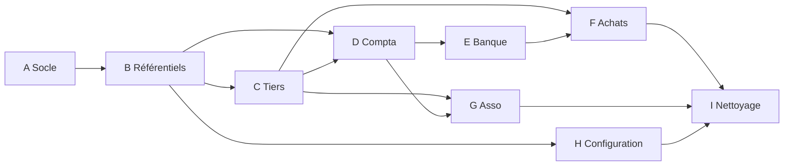

# Workflow — Front React + Mantine

> Statut : **plan** (2026-10-22). Sources : [`besoins_front_mantine.md`](besoins_front_mantine.md)
> (FM1–FM16, F1–F14, NF1–NF9, US1–US7), [`design_front_mantine.md`](design_front_mantine.md) (D1–D14).
> Exécution : `/sc:implement`, phase par phase, sur `main` local non poussé (FM16).

## 1. Objectif

Remplacer tout le front (84 gabarits Jinja, Bootstrap, HTMX, 2 îlots React 18) par une SPA React 19 +
Mantine 9 servie par Flask aux **mêmes URL**, domaine par domaine, l'application restant utilisable
après chaque phase. Le back ne change que pour exposer l'API JSON (services métier inchangés).

## 2. Conventions

- **Départ** : commit `ddc74fe`, pytest 644, Vitest 41 ; `make check` vert.
- **Un commit par étape notable, un point de contrôle (CP) par phase** : `make check` vert,
  `make e2e` vert (à partir de A), contrôle dans Chrome sur le serveur d'essai (port 5001, copies).
- **Recette d'une bascule de domaine** (phases B à H), dans cet ordre :
  1. **API** du domaine (`app/api/<domaine>.py`) + extraction des requêtes de liste dans
     `app/queries/<domaine>.py` si la vue les contient ;
  2. **tests API** (`tests/api/test_<domaine>.py`) reprenant les cas des tests de vues ;
  3. **écrans React** (`frontend/src/features/<domaine>/`) + tests Vitest des formulaires ;
  4. **bascule** : chemins ajoutés à `app/spa_routes.json`, routes **GET** HTML et gabarits
     supprimés, tests de vues HTML supprimés (après 2.) ; les POST HTML encore appelés par
     d'autres pages Jinja restent jusqu'à leur propre bascule ;
  5. **E2E** si le domaine porte un parcours critique ; **docs** (`routes.md`, guides).
- **Rien n'est « amélioré » au-delà de l'écran actuel** (FM15) sauf les composants transverses
  (tableaux, modales, palette).
- **Essais** : jamais d'envoi à Qonto ; identifiants Qonto en lecture seule ; Seconde Nature sans
  identifiants Qonto.

## 3. Dépendances

- B éprouve `DataGrid`, `FormModal`, `ConfirmButton` sur des écrans simples avant les écrans riches.
- C avant D/F/G : `EntitySelect` et la fiche tiers servent partout.
- D avant E : la saisie d'écriture est ouverte depuis le rapprochement.
- E avant F : règlements et transactions des factures d'achat.
- H est indépendant après B (peut s'intercaler pour livrer plus tôt).

## 4. Phases

### Phase A — Socle (US1, D1–D3, D6–D7, D13)

| Étape | Tâche | Fichiers |
|-------|-------|----------|
| A.1 | Dépendances : React 19.2, Mantine 9.7 (core, hooks, form, dates, notifications, modals, spotlight, dropzone, charts), react-router 8, TanStack Query 5, mantine-datatable 9, dayjs, PostCSS Mantine ; îlots existants passés en React 19 (Vitest vert) | `frontend/package.json`, `postcss.config.cjs`, `vite.config.ts` |
| A.2 | `users.preferences` (JSON, `ALTER` idempotent dans `seed_meta`) ; API session : `GET /session` étendu (nav résolue, instances, préférences, csrf), `POST /session/login` (`next` relatif seulement), `/logout`, `/instance` ; `PATCH /me/preferences` (fusion, 16 Ko) ; `GET /jobs/<id>` | `app/models/user.py`, `seed_meta.py`, `app/api/session.py` |
| A.3 | Coexistence : `app/spa_routes.json`, `app/spa.py` (conversion des motifs, `spa_shell()` GET, `login_required` sauf `/login`), `templates/spa.html` ; test « aucun GET HTML sur un chemin SPA » | `app/spa.py`, `app/__init__.py`, `tests/api/test_spa_shell.py` |
| A.4 | SPA : `main.tsx`, providers (Mantine, Query, Dates `fr`, Notifications, Modals), `theme.ts` + logo provisoire, `colorSchemeManager` sur les préférences, `router.tsx` + `routes.ts` (paresseux, route `*` → navigation complète), `AppLink` ; test Vitest routes ⇄ JSON | `frontend/src/app/*` |
| A.5 | `api/client.ts` (CSRF, `ApiError`, 401 → `/login?next`, 409 `no_instance` → `/select-instance`), `upload.ts` (XHR + progression), `session.ts` (`useSession`, `usePreferences` avec regroupement 500 ms) | `frontend/src/api/*` |
| A.6 | `AppShell` (logo, instance + sélecteur, utilisateur, thème, menus de `nav`), pages `/login` et `/select-instance` ; **bascule** des GET `auth.login` / `auth.select_instance` (POST HTML supprimés) ; `logout` → API | `frontend/src/app/AppShell/`, `features/auth/`, `app/views/auth.py` |
| A.7 | Composants transverses : `DataGrid` (serveur / client, tri multiple, sélection + actions, colonnes masquables en préférences), `FilterBar` (URL), `PageHeader`, `ConfirmButton`, `FormModal` / `FormDrawer`, `MoneyInput` / `MoneyText`, `FiscalYearSelect`, `MonthSelect`, `lib/format.ts` ; tests Vitest | `frontend/src/components/*` |
| A.8 | Palette (Ctrl+K) : navigation depuis `nav` ; recherche branchée en phase C (`GET /search`) | `frontend/src/app/Spotlight.tsx` |
| A.9 | Harnais E2E : `scripts/e2e_server.py` (base temporaire semée, utilisateur de test), Playwright Chromium, `make e2e` ; parcours **connexion + choix d'instance + changement de thème** | `frontend/e2e/`, `Makefile` |
| A.10 | Docker : PostCSS et nouvelles dépendances dans l'étape Node ; image construite, coquille servie | `Dockerfile` |

— *Réalisé (2026-10-22)* : React 19.2.9, Mantine 9.7.3, react-router 8.5, TanStack Query 5.104,
mantine-datatable 9.4. Entrées Vite : `src/main.tsx` (SPA), `src/islands.tsx` (îlots Jinja).
`app/spa_routes.json` = règle Flask + **endpoint d'origine** (url_for inchangé, cf. design §4.1).
`users.preferences` + `seed_meta._ensure_column`. Pages `/login`, `/select-instance` basculées
(gabarits Jinja supprimés ; `/logout` GET gardé pour les pages Jinja). Composants : `DataGrid`
(tri une colonne), `FilterBar`/`useUrlParams`/`SearchInput`, `PageHeader`, `ConfirmButton`,
`FormModal`/`FormDrawer`, `MoneyInput`/`MoneyText`. `FiscalYearSelect`/`MonthSelect` reportés en
B.2 (API des exercices). L'`AppShell` n'est visible qu'à partir de la première page migrée (B).
pytest 656, Vitest 59, E2E 2 (connexion → instance → page demandée ; changement d'instance).

**✅ CP A** : `make check` + `make e2e` verts ; connexion, choix / changement d'instance, menus
selon le plan (asso / sci) et les droits, thème mémorisé d'un navigateur à l'autre ; une page
Jinja ouverte depuis la SPA et inversement ; image Docker OK.

### Phase B — Référentiels (US2)

Écrans à liste client + modales. Un écran = API CRUD + liste `DataGrid` + `FormModal`.

| Étape | Écran (chemins) | Actions à reprendre |
|-------|-----------------|---------------------|
| B.1 | Journaux (`/journals`) | liste, création |
| B.2 | Exercices (`/fiscal-years`) | liste, création, clôture (confirmation), bascule TVA |
| B.3 | Plan comptable (`/accounts`) | liste filtrable (classe, recherche), création, modification |
| B.4 | Catalogue (`/products`) | liste, création, modification, archivage, suppression |
| B.5 | Règles (`/rules`) | liste ordonnée, création / modification, activer, monter / descendre, supprimer, appliquer (notices) |
| B.6 | Types de tâches (`/work-times/task-types`) | liste, création, modification, suppression |
| B.7 | Utilisateurs (`/users`, admin) | liste, création, modification, activation, suppression |

**✅ CP B** : écrans B en React, gabarits supprimés, tests API ≥ cas des anciens tests de vues ;
E2E **écran simple** (journal ou produit : créer / modifier / supprimer) ; colonnes masquées
retrouvées après reconnexion.

### Phase C — Tiers

| Étape | Tâche |
|-------|-------|
| C.1 | Entités : liste (serveur, recherche, type), fiche (identifiants fournisseur, SIRET, factures, solde, note Odoo), création / modification (drawer), suppression |
| C.2 | Adhérents (`/entities/members`) : liste, filtres, export (lien), actions groupées (bénévole, notes Odoo), relances (modèle + envoi avec confirmation), HelloAsso (création d'adhésions, synchro = tâche longue) |
| C.3 | Temps de travaux : liste (serveur), saisie / modification (modale), suppression, import (dropzone) |
| C.4 | `EntitySelect`, `ProductSelect` ; `GET /api/v1/search` (tiers, factures, écritures) branché dans la palette |

**✅ CP C** : `make check` / `make e2e` verts ; relance testée sans envoi réel (SMTP simulé) ;
palette : recherche d'un tiers ouvre sa fiche.

### Phase D — Compta (US3 saisie, US6)

| Étape | Tâche |
|-------|-------|
| D.1 | Écritures : liste serveur (exercice, journal, mois, recherche, tri), fiche, suppression (`delete_entries`) |
| D.2 | Saisie d'écriture en Mantine : `entryState.ts` et raccourcis repris, `AccountSelect` (récents), pages `/entries/new`, `/entries/:id/edit`, composant ouvrable en `Drawer` |
| D.3 | Rapports : balance, grand livre (serveur), bilan, compte de résultat ; exports CSV / ODS par liens |
| D.4 | Tableau de bord : indicateurs + graphiques (Mantine Charts ; ECharts si besoin, décidé par graphique) |
| D.5 | Bascule ; îlot `EntryForm` (version Jinja) supprimé |

**✅ CP D** : E2E **saisie d'écriture** (clavier : lignes, `=`, Ctrl+Entrée) ; rapports identiques
aux anciens sur la copie Seconde Nature (totaux comparés) ; dashboard lisible clair / sombre.

### Phase E — Banque (US3 rapprochement)

| Étape | Tâche |
|-------|-------|
| E.1 | Comptes bancaires : liste, création / modification / suppression, transactions (serveur, filtres, badges facture / justificatif / annulée) |
| E.2 | Qonto : écran `/bank-accounts/qonto` (liaison, réglages, synchro = tâche longue), contreparties |
| E.3 | Rapprochement : `logic.ts` repris, deux `DataGrid`, raccourcis, annulation (notification avec action), saisie en `Drawer` |
| E.4 | Versements Stancer (liste, fiche, synchros) ; import OFX (dropzone, résultat avec règlements automatiques) |
| E.5 | Bascule ; îlot `ReconcileWorkspace` et entrée « islands » supprimés |

**✅ CP E** : E2E **rapprochement + Ctrl+Z** ; import OFX sur la copie Seconde Nature ; synchro
Qonto **en lecture** sur la copie SCI.

### Phase F — Achats (US4)

| Étape | Tâche |
|-------|-------|
| F.1 | Liste (serveur, filtres, badges, bandeaux « à compléter / à revoir / à remplacer », synchro, date de début, comptabiliser les prêtes, suppression) |
| F.2 | Saisie : dropzone → lecture → formulaire (champs « à vérifier », doublons, nouveau fournisseur, lignes, case « Envoyer à Qonto ») + aperçu ; modification d'en-tête |
| F.3 | Fiche : lignes éditables, comptabiliser / annuler, pièce, envoi Qonto (garde inchangée), règlements (suggestions, régler, défaire) |
| F.4 | Fournisseurs à valider, règlements à remplacer |

**✅ CP F** : E2E **facture d'achat** (dépôt du PDF Free de test → comptabilisée) avec Qonto
**non configuré** dans la base E2E ; contrôle Chrome sur la copie SCI case « Envoyer à Qonto »
**décochée**.

### Phase G — Asso

| Étape | Tâche |
|-------|-------|
| G.1 | Odoo : commandes POS, factures clients (listes, fiches, synchros) ; import Odoo par lots |
| G.2 | Indicateurs et Visibilité & Impact (tableau, rapport, facteurs, saisie manuelle, export XLSX par lien, synchro) |
| G.3 | Rapport d'activité : formulaires (édition, éco, photos, logo), aperçu `iframe` du HTML serveur, PDF / exports / archives par liens |
| G.4 | Import de tonnages |

**✅ CP G** : PDF du rapport d'activité identique à l'avant-refonte ; écrans G masqués pour le plan SCI.

### Phase H — Configuration

| Étape | Tâche |
|-------|-------|
| H.1 | Intégrations : liste, fiche (secrets jamais réaffichés), activation, test de connexion |
| H.2 | Instances : liste, création, import, modification, sauvegarde `.zip`, téléchargement, suppression, restauration (dropzone + confirmation forte) |

**✅ CP H** : restauration d'une archive sur une copie ; aucun secret dans les réponses API (test).

### Phase I — Nettoyage (US7)

| Étape | Tâche |
|-------|-------|
| I.1 | Supprimer `base.html`, gabarits d'écran restants, Bootstrap, HTMX, `app.js`, `app.css`, hooks HTMX de `app/frontend.py`, macros `_list_helpers.html` ; garder gabarits d'impression / PDF |
| I.2 | Supprimer les routes POST HTML restantes et `tests/test_htmx_*`, `test_frontend` HTMX |
| I.3 | Docs : `architecture.md`, `routes.md` (pages = SPA, API complète), `installation.md`, `docker.md`, `saisie_rapprochement.md`, guides ; besoins cochés, design « réalisé » |

**✅ CP final** : `make check` + `make e2e` verts ; plus aucune référence à Bootstrap / HTMX ;
image Docker OK ; US1–US7 cochées.

## 5. Estimation indicative

| Phase | A | B | C | D | E | F | G | H | I | Total |
|-------|---|---|---|---|---|---|---|---|---|-------|
| Jours | 4 | 2 | 3 | 4 | 4 | 3 | 4 | 2 | 1 | ≈ 27 |

Le socle (A) et les composants transverses portent l'essentiel du risque ; les phases suivantes
sont de la reprise d'écrans sur un modèle établi.

## 6. Points d'attention

1. **Jamais deux versions d'un écran** : la bascule supprime l'ancien dans le même commit.
2. **Tests API avant suppression des tests de vues** (NF1) ; le compte de tests ne doit pas baisser
   sans raison notée.
3. **POST HTML partagés** : vérifier par `grep` qu'aucune page Jinja restante ne les appelle avant
   de les supprimer.
4. **Qonto** : aucun envoi pendant les essais ; synchros en lecture sur copie uniquement.
5. **Charte** (FM11) : seulement `theme.ts` et `assets/logo.svg` à remplacer quand elle arrive.
6. **Pas de push** sans accord explicite (FM16).
