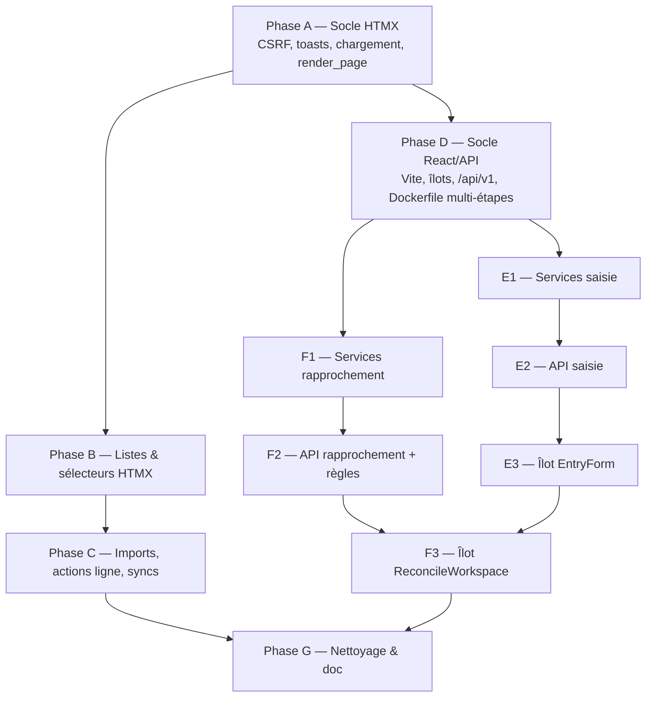

# Workflow — Front réactif hybride (HTMX + îlots React)

> **Statut : RÉALISÉ** (phases A à G, octobre 2026). Écarts et mesures : `design_front_reactif.md` §5 et §14.
> Sources : [`besoins_front_reactif.md`](besoins_front_reactif.md), [`design_front_reactif.md`](design_front_reactif.md).

## 1. Objectif

Supprimer les rechargements complets de page et rendre la **saisie d'écritures** et le
**rapprochement bancaire** utilisables entièrement au clavier, avec actions groupées :

- **HTMX généralisé** (fragments Jinja) pour les listes, les filtres, les actions sur une ligne et les imports ;
- **2 îlots React** : `EntryForm` (saisie) et `ReconcileWorkspace` (rapprochement) ;
- **API JSON** limitée sous `/api/v1` ;
- Node **en dev et au build uniquement**, image Docker finale sans Node.

### Décisions prises (2026-10-20)

| Sujet | Décision |
|-------|----------|
| Build / CI | Pas de CI GitHub. Le build est fait par **Dokploy** à partir du `Dockerfile` (multi-étapes) ou du `docker-compose.yml` ; vérification locale par `make check` |
| Transition | **Bascule directe** écran par écran, sans repli `?legacy=1` : chaque écran est remplacé quand il est prêt, l'ancien code est supprimé dans le même lot |
| Node | **22 LTS** (image `node:22-slim` pour l'étape de build) |
| Ordre | **Listes HTMX en premier**, puis saisie, puis rapprochement |

## 2. Conventions du projet (à respecter)

- **Stack** : Flask 3.1 + Blueprints + Jinja2 + HTMX 2.0.3 + Bootstrap 5.3 / SQLAlchemy + Alembic. Node 25 / npm 11 présents en local.
- **Montants** : centimes entiers partout (BDD, JSON) ; formatage `| euros` côté Jinja, `lib/money.ts` côté React.
- **Multi-instance** : `app/tenant.py` `before_request` résout l'instance pour **toute** route, y compris `/api/v1` ; `current_chart()` disponible.
- **CSRF** : `CSRFProtect` global ; les requêtes JS envoient `X-CSRFToken` (en-tête accepté nativement par Flask-WTF).
- **Menus** : `app/menu_config.py` (aucun nouveau menu prévu).
- **Listes** : `app/utils/list_filters.py` + macros `app/templates/_list_helpers.html` (8 listes datées).
- **Tests** : pytest, fixtures `app` / `session` dans `tests/conftest.py` (base SQLite jetable) ; **133 tests verts** au départ.
- **Docker** : `Dockerfile` mono-étape Python 3.12, `docker/entrypoint.sh`, `.dockerignore` exclut `claudedocs/`, `doc/`, `tests/`. Déploiement **Dokploy** (build de l'image sur le serveur).
- **Dépôt** : `origin` = GitHub `asso-seconde-nature/seconde-compta` ; pas de CI (décision).
- **Commit** : un commit par étape, message en anglais, trailers d'attribution habituels.

## 3. Vue d'ensemble et dépendances



**Ordre retenu** : A → B → C (gain visible rapide, sans React) → D → E (saisie) → F (rapprochement) → G.
**Parallélisable si besoin** : les services de rapprochement (F1, F2) dès la fin de D.

| Phase | Étapes | Dépend de | Effort estimé |
|-------|--------|-----------|---------------|
| A Socle HTMX | A.1 → A.3 | — | 0,5 à 1 j |
| B Listes HTMX | B.1 → B.5 | A | 2 à 3 j |
| C Imports, actions, syncs | C.1 → C.5 | B | 2 à 3 j |
| D Socle React/API | D.1 → D.5 | A | 1 à 1,5 j |
| E Saisie | E.1 → E.8 | D | 3 à 4 j |
| F Rapprochement | F.1 → F.8 | D (services/API), E (EntryForm pour F.6) | 4 à 5 j |
| G Nettoyage | G.1 → G.4 | C, F | 0,5 à 1 j |
| **Total** | | | **≈ 14 à 18 j** |

---

## 4. Phases d'implémentation

### Phase A — Socle HTMX (rien de visible, prépare les listes)

| # | Étape | Fichiers | Détail |
|---|-------|----------|--------|
| A.1 | CSRF + erreurs HTMX | `app/templates/base.html`, `app/static/js/app.js` | `<meta name="csrf-token">` + `htmx:configRequest` → `X-CSRFToken` ; `htmx:responseError` → toast d'erreur ; 401 → `HX-Redirect` vers `/login` |
| A.2 | Fragments + notifications | `app/frontend.py`, `app/__init__.py`, `app/templates/_toasts.html` | `render_page(template, partial, **ctx)` (fragment si `HX-Request`) ; hook `after_request` : flashes → `HX-Trigger: {"toast": …}` pour les requêtes HTMX ; conteneur de toasts Bootstrap (les flashes classiques passent aussi par lui) |
| A.3 | Chargement | `app/static/css/app.css`, `base.html` | Barre fine en haut de page sur `htmx-request` (affichée après 300 ms) ; classe utilitaire pour `hx-indicator` local |

**Tests** : `tests/test_frontend.py` — `render_page` renvoie le fragment avec `HX-Request` et la page sinon ; `HX-Trigger` contient les flashes ; meta CSRF présente ; POST HTMX sans jeton → 400.

**✅ Point de contrôle A** : `make check` vert (pytest seul à ce stade) ; aucune régression visible.

---

### Phase B — Listes et sélecteurs en HTMX (US1)

| # | Étape | Fichiers | Détail |
|---|-------|----------|--------|
| B.1 | Macros de liste | `app/templates/_list_helpers.html`, `app/utils/list_filters.py` | `sortable_date_header` et `month_filter_select` émettent `hx-get`, `hx-target`, `hx-push-url`, `hx-indicator` (cible paramétrable, défaut `#list`) |
| B.2 | 8 listes datées | `app/views/{entries,bank_accounts,payouts,orders,customer_invoices,reconciliation,imports}.py` + `_table.html` par écran | Extraire la zone tableau dans `_table.html` (incluse par la page), vue → `render_page`. Un commit par écran ou par paire |
| B.3 | Sélecteurs d'exercice | `app/templates/reports/*.html`, `dashboard/`, `impact/`, `activity_report/` | Remplacer les 10 `onchange="this.form.submit()"` par `hx-get` + `hx-push-url` ciblant le contenu ; réinitialiser ECharts sur `htmx:afterSettle` (tableau de bord, impact) |
| B.4 | Recherche | listes de tiers et d'écritures | Champ de recherche `hx-trigger="keyup changed delay:300ms"` (ajouter le filtre `q` côté vue s'il manque) |
| B.5 | Vérification | `tests/test_htmx_lists.py` | Pour chaque liste : avec `HX-Request` → fragment sans `<html>` contenant le tableau ; sans → page complète ; `sort` / `month` respectés |

> La liste de rapprochement (`reconciliation.index`) passe en HTMX ici, puis sera remplacée par l'îlot en phase F.

**✅ Point de contrôle B** : US1 — changement de mois sans rechargement, URL à jour, F5 et Précédent corrects ;
`grep -r 'this.form.submit()' app/templates` vide ; graphiques corrects après changement d'exercice.

---

### Phase C — Imports, actions sur une ligne, synchronisations (US4, US5)

| # | Étape | Fichiers | Détail |
|---|-------|----------|--------|
| C.1 | Imports | `app/views/imports.py`, `activity_report.py` (tonnages), `work_times.py` (import) + templates | `hx-post` multipart, barre de progression (`htmx:xhr:progress`), fragment récapitulatif `{imported, duplicates, errors}` ; erreurs de format affichées sans quitter l'écran |
| C.2 | Actions sur une ligne | `entities.py` (bénévole, note Odoo), `rules.py` (activer, monter, descendre, supprimer), `work_times.py`, types de tâches | Réponse HTMX = ligne ou liste mise à jour (`outerHTML`) ; sans HTMX, redirection actuelle conservée |
| C.3 | Formulaires simples | temps de travaux, types de tâches, tiers | Erreurs de validation renvoyées dans le fragment du formulaire, à côté des champs (US5) |
| C.4 | Synchronisations | `orders.py`, `customer_invoices.py`, `entities.py` (HelloAsso) | Généraliser le suivi `sync_jobs` existant (Stancer) : bouton → fragment de progression rafraîchi toutes les 2 s → récapitulatif |
| C.5 | Tests | `tests/test_htmx_actions.py` | Une action par type : fragment renvoyé, toast via `HX-Trigger`, comportement sans HTMX inchangé |

**✅ Point de contrôle C** : US4 (import OFX avec progression et récapitulatif) et US5 (temps de travaux avec erreurs au champ) dans le navigateur ; `make check` vert. **Livrable déployable sur Dokploy** (aucun Node nécessaire jusqu'ici).

---

### Phase D — Socle React / API (rien de visible)

| # | Étape | Fichiers | Détail |
|---|-------|----------|--------|
| D.1 | Projet Vite | `frontend/package.json`, `tsconfig.json`, `vite.config.ts`, `src/main.tsx`, `.nvmrc` (`22`), `.gitignore` | React 18, react-dom, TypeScript, Vite + `@vitejs/plugin-react`, Vitest, Testing Library, jsdom ; `"engines": {"node": ">=22"}`. `build.outDir = ../app/static/dist`, `build.manifest = true`, `base = /static/dist/`. Scripts `dev`, `build`, `typecheck`, `test`. Ignorer `app/static/dist/` et `frontend/node_modules/` |
| D.2 | Chargeur d'assets | `app/frontend.py`, `app/__init__.py` | `vite_assets(entry)` global Jinja : manifest en cache (prod) / préambule React Refresh + `@vite/client` depuis `VITE_DEV_SERVER` (dev) ; manifest absent → bloc d'erreur visible |
| D.3 | Montage des îlots | `app/templates/_island.html`, `frontend/src/main.tsx` | Macro `island(name, props)` (`tojson | forceescape`) ; registre d'imports dynamiques. Vérifié par un test Vitest et un test pytest (pas de page de démonstration) |
| D.4 | Blueprint API | `app/api/__init__.py`, `app/__init__.py` | `url_prefix="/api/v1"` ; erreurs JSON (`ApiError(code, message, fields, status)`, 404/405/500, `CSRFError` → 400 JSON) ; non connecté → **401 JSON** (`unauthorized_handler` selon le préfixe `/api/`) ; helper `json_body()` |
| D.5 | Docker / Dokploy | `Dockerfile`, `.dockerignore`, `docker-compose.yml`, `Makefile` | Étape `FROM node:22-slim AS front` : `npm ci` + `npm run build` dans `frontend/` ; étape Python : `COPY --from=front` du dossier `app/static/dist`. `.dockerignore` : `frontend/node_modules`. Le `docker-compose.yml` garde `build: .` (Dokploy construit depuis le Dockerfile, que le service soit déclaré en Dockerfile ou en compose). `make check` = `npm ci && npm run typecheck && npm test && npm run build` puis `pytest` |

**Tests** : `tests/test_frontend.py` (complété) — `vite_assets` en prod (manifest factice) et en dev, `island` échappe les props, `/api/v1/<inconnu>` → 404 JSON, non connecté → 401 JSON, POST sans CSRF → 400 JSON. Vitest : montage d'un îlot depuis `data-props`.

**✅ Point de contrôle D** : `make check` vert ; `docker compose build` OK ; `docker run --rm <image> which node` ne trouve rien ; déploiement de test sur Dokploy réussi.

---

### Phase E — Saisie d'écritures (US2)

#### E.a — Services

| # | Étape | Fichiers | Détail |
|---|-------|----------|--------|
| E.1 | `validate_entry_payload` | `app/services/ledger.py` | Retourne `dict[str, str]` d'erreurs par champ (`fiscal_year_id`, `entry_date`, `lines`, `lines[i].account_id`, `lines[i].amount`) : exercice existant et ouvert, date dans l'exercice, ≥ 2 lignes, compte existant et **non en-tête**, débit XOR crédit > 0 par ligne, total ≠ 0, équilibre. `validate_lines` et `post_entry` l'utilisent |
| E.2 | `update_entry` | `app/services/ledger.py` | Déplacer dans le service la logique de modification de la vue `entries.edit` (remplacement des lignes, changement d'exercice, refus si rapprochée) |
| E.3 | Création + rapprochement atomiques | `app/services/ledger.py`, `app/services/reconciler.py` | `reconcile(..., commit=True)`, `post_entry(..., commit=True)` ; `post_entry_for_bank_transaction(payload, bt_id)` : écriture + rapprochement de la ligne banque dans **une seule** transaction |

**Tests** : `tests/test_ledger_validation.py` — chaque règle de E.1, `update_entry` (rapprochée ou exercice clôturé → refus), création + rapprochement atomiques (échec → aucune écriture).

#### E.b — API

| # | Étape | Fichiers | Détail |
|---|-------|----------|--------|
| E.4 | Recherches | `app/api/lookups.py` | `GET /accounts?q=&limit=20` : non en-tête, préfixe de code puis mot du libellé (insensible à la casse et aux accents) ; `GET /entities?q=&limit=20` |
| E.5 | Écritures | `app/api/entries.py`, `frontend/src/lib/types.ts` | `POST /entries/validate`, `POST /entries` (201 / 422 / 409), `GET /entries/<id>`, `PUT /entries/<id>` ; `bank_transaction_id` → E.3 |

**Tests** : `tests/test_api_entries.py` — 201 + référence ; 422 avec `fields` ; 409 exercice clôturé ; 409 écriture rapprochée (PUT) ; recherche de comptes ; 401 ; CSRF manquant.

#### E.c — Îlot `EntryForm` (bascule directe)

| # | Étape | Fichiers | Détail |
|---|-------|----------|--------|
| E.6 | Briques partagées | `frontend/src/lib/{api,money}.ts`, `components/{MoneyInput,AccountCombobox,Toast,Kbd}.tsx` | `api.ts` : fetch JSON + CSRF (meta) + `ApiError` ; `money.ts` : `"1 234,56"` ⇄ `123456` ; combobox ARIA (délai 150 ms, cache, 20 comptes récents par instance dans `localStorage`) ; toasts au style de A.2 |
| E.7 | Formulaire | `frontend/src/islands/EntryForm/*` | État, totaux et écart, raccourcis du design §7.2, préremplissage de l'écart, indications client + `/entries/validate` 400 ms après modification, erreurs par cellule, Ctrl+Entrée = enregistrer et enchaîner, mode modification |
| E.8 | Bascule | `app/views/entries.py`, `app/templates/entries/form.html`, `app/static/js/app.js` | `new` / `edit` rendent `island("entry-form", props)` ; **suppression dans le même commit** de l'ancien formulaire, `_line_row.html`, route `/entries/new-line`, `updateBalance` (`app.js`) et du traitement POST HTML de `new` / `edit` |

**Tests** : Vitest — US2 au clavier, écart + bouton désactivé, `=` recopie l'écart, erreurs 422, enchaînement ; `money.ts`. pytest — `/entries/new` et `/entries/<id>/edit` contiennent l'îlot et des props valides ; anciennes routes supprimées (404).

**✅ Point de contrôle E** : 10 écritures saisies sans souris ; `/entries/new?bt_id=` crée **et** rapproche ; modification ; refus si rapprochée ou exercice clôturé ; `make check` vert ; déployé sur Dokploy.

---

### Phase F — Espace de rapprochement (US3)

#### F.a — Services

| # | Étape | Fichiers | Détail |
|---|-------|----------|--------|
| F.1 | Contrôles + lots | `app/services/reconciler.py` | `reconcile_many(pairs)` / `unreconcile_many(ids)` en **une transaction**, résultat par élément ; contrôles : transaction non rapprochée, ligne existante et non déjà rapprochée, **montant de la ligne = montant bancaire** (sens compris), compte de la ligne = compte comptable du compte bancaire |
| F.2 | Règles et suppression | `app/services/rules_engine.py`, `app/services/ledger.py`, `app/views/entries.py` | `apply_rules` renvoie `created_entry_ids` ; `delete_entries(ids)` : refuse un exercice clôturé, **annule d'abord les rapprochements** des lignes supprimées ; la vue `entries.delete` l'utilise (corrige les rapprochements orphelins) |

**Tests** : `tests/test_reconciler_bulk.py` — lot mixte → résultats par élément ; `unreconcile_many` ; `delete_entries` sur une écriture rapprochée → transaction remise à « non rapprochée » ; `apply_rules` → identifiants.

#### F.b — API

| # | Étape | Fichiers | Détail |
|---|-------|----------|--------|
| F.3 | Lecture | `app/api/reconciliation.py` | `GET /bank-accounts/<id>/transactions?status=&month=&sort=` + compteurs ; `GET /bank-transactions/<id>/suggestions` (score) |
| F.4 | Écriture | `app/api/reconciliation.py`, `app/api/entries.py` | `POST /reconciliations`, `/reconciliations/delete`, `/reconciliations/auto` (`dry_run`), `/bank-transactions/apply-rules`, `/entries/bulk-delete` ; réponses avec `results`, `counters`, `undo` |

**Tests** : `tests/test_api_reconciliation.py` — statuts par élément, compteurs, `undo` rejoué → état initial, `auto` en `dry_run` sans effet, 404 sur compte inconnu.

#### F.c — Îlot `ReconcileWorkspace` (bascule directe)

| # | Étape | Fichiers | Détail |
|---|-------|----------|--------|
| F.5 | Liste + suggestions | `frontend/src/islands/ReconcileWorkspace/{Workspace,TransactionTable,SuggestionPanel}.tsx` | Sélecteurs compte / mois (`history.replaceState`), ligne active ↑↓ / j k, suggestions + préchargement des 3 suivantes, Entrée / 1…9, sortie animée et focus suivant, compteurs |
| F.6 | Création d'écriture | idem + `EntryForm` | N → panneau latéral `EntryForm` prérempli (`bankTransactionId`) ; enregistrement = créée + rapprochée |
| F.7 | Masse + annulation | `BulkBar.tsx`, `lib/undo.ts` | Sélection Espace / Maj+↑↓ / Ctrl+A ; « Rapprocher les suggestions ★ », « Appliquer les règles », « Annuler les rapprochements » ; toast « Annuler » 10 s + Ctrl+Z |
| F.8 | Bascule | `app/views/reconciliation.py`, `app/templates/reconciliation/` | Page = `island("reconcile-workspace", props)` ; **suppression dans le même commit** de `_suggestions.html`, `_table.html` (phase B) et des routes `/suggest`, `/link`, `/unlink`, `/auto` |

**Tests** : Vitest — navigation clavier, sélection par plage, masse avec résultat partiel, annulation, panneau `EntryForm`. pytest — `/reconciliation/` contient l'îlot ; anciennes routes supprimées.

**✅ Point de contrôle F** : US3 (20 transactions rapprochées en une action puis annulées) ; « N » crée et rapproche ; les contrôles de montant bloquent un rapprochement incohérent ; `make check` vert ; déployé sur Dokploy.

---

### Phase G — Finitions et documentation

| # | Étape | Détail |
|---|-------|--------|
| G.1 | Accessibilité | Parcours clavier complet des deux îlots, focus visible, `aria-live` pour toasts et compteurs, erreurs liées aux champs (`aria-describedby`) — NF8 |
| G.2 | Code mort | Vérifier qu'il ne reste rien de l'ancien front (routes, templates, JS) ; `app.js` réduit au strict nécessaire |
| G.3 | Documentation | `doc/architecture.md` (frontend/, api/, frontend.py), `doc/installation.md` (Node 22, `npm run dev`, `VITE_DEV_SERVER`), `doc/docker.md` (build multi-étapes, Dokploy), `doc/routes.md` (`/api/v1`), `doc/services.md` (ledger / reconciler), raccourcis clavier dans un nouveau `doc/saisie_rapprochement.md` |
| G.4 | Mesures | Vérifier NF6 (retour < 100 ms, action < 500 ms) sur une copie de base réelle ; noter les résultats dans le design |

**✅ Point de contrôle final** : doc à jour ; `make check` et build Dokploy verts.

---

## 5. Récapitulatif des fichiers

| Nouveau | Modifié |
|---------|---------|
| `app/frontend.py` (A) | `app/__init__.py` (frontend, api) |
| `app/templates/_toasts.html` (A), `_island.html` (D) | `app/templates/base.html` (meta CSRF, toasts, chargement) |
| `app/templates/**/_table.html` (≈ 10, B) | `app/static/js/app.js`, `app/static/css/app.css` |
| `frontend/**`, `.nvmrc` (D) | `app/templates/_list_helpers.html` + templates des écrans concernés |
| `app/api/{__init__,lookups,entries,reconciliation}.py` (D-F) | `app/views/{entries,reconciliation,imports,bank_accounts,payouts,orders,customer_invoices,entities,rules,work_times,activity_report,reports,dashboard,impact}.py` |
| `Makefile` (D) | `app/services/ledger.py`, `reconciler.py`, `rules_engine.py` (E-F) |
| `tests/test_frontend.py`, `test_htmx_lists.py`, `test_htmx_actions.py`, `test_ledger_validation.py`, `test_api_entries.py`, `test_reconciler_bulk.py`, `test_api_reconciliation.py` | `Dockerfile`, `.dockerignore`, `.gitignore`, `docker-compose.yml` (si besoin) |
| `doc/saisie_rapprochement.md` (G) | `doc/*.md` (G) |

## 6. Points d'attention identifiés dans le code actuel

1. **`reconciler.reconcile` ne vérifie rien** (montant, compte, double rapprochement) → corrigé en F.1 **avant** d'exposer les actions groupées.
2. **`entries.delete` laisse des rapprochements orphelins** : supprimer une écriture rapprochée supprime ses lignes (cascade) mais laisse `bank_transactions.journal_line_id` et `reconciled=True` → corrigé en F.2.
3. **Logique de modification d'écriture dans la vue** (`entries.edit`) → `ledger.update_entry` (E.2).
4. **Création + rapprochement non atomiques** dans `entries.new` (deux commits) → E.3.
5. ~~**`docker/entrypoint.sh` appelle `seed_accounts.py` sans argument** (plan associatif)~~ — corrigé : sans argument, le script détecte le plan déjà chargé (base vide → `DEFAULT_INSTANCE_CHART`).

## 7. Ordre d'exécution (commits)

```
A.1 → A.2 → A.3                                     ✅ CP A
B.1 → B.2 (×8) → B.3 → B.4 → B.5                    ✅ CP B
C.1 → C.2 → C.3 → C.4 → C.5                         ✅ CP C   (déployable, sans Node)
D.1 → D.2 → D.3 → D.4 → D.5                         ✅ CP D   (build Dokploy multi-étapes)
E.1 → E.2 → E.3 → E.4 → E.5 → E.6 → E.7 → E.8      ✅ CP E
F.1 → F.2 → F.3 → F.4 → F.5 → F.6 → F.7 → F.8      ✅ CP F
G.1 → G.2 → G.3 → G.4                               ✅ CP final
```

Lancer avec : `/sc:implement claudedocs/workflow_front_reactif.md --phase A`.
