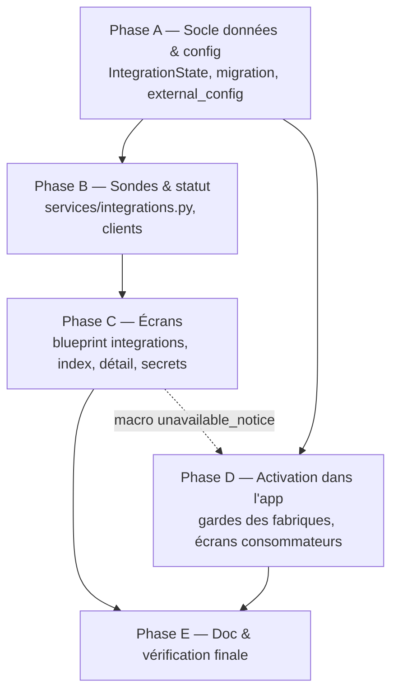

# Workflow — Écran des intégrations

> **Statut : RÉALISÉ** (phases A à E, 2026-10-20 ; révision Alembic `c3f8a1d5e297`). Écarts : `design_integrations.md` §13. Sources : [`besoins_integrations.md`](besoins_integrations.md),
> [`design_integrations.md`](design_integrations.md) (décisions D1 à D7).

## 1. Objectif

Remplacer la page unique « Connexions externes » par un **index des intégrations** (statut de chacune)
et une **page de détail** par intégration, avec un **interrupteur d'activation** et un **test de
fonctionnement** lancé après enregistrement ou à la demande.

## 2. Conventions du projet (à respecter)

- **Stack** : Flask + Blueprints + Jinja2 + HTMX (`hx_submit` → `HX-Location` + toast) + Bootstrap 5.3 / SQLAlchemy + Alembic.
- **Multi-instance** : `integration_states` est une table **tenant** (pipeline Alembic `migrations/`) ;
  toutes les bases tenant doivent être migrées (`doc/multi_tenant.md`, boucle `flask db upgrade`).
- **Menus** : `app/menu_config.py`.
- **Tests** : pytest, fixtures `app` / `session` (`tests/conftest.py`) ; **252 tests verts** au départ.
  Aucun appel réseau : les sondes sont remplacées via `monkeypatch.setitem(integrations.PROBES, …)`
  ou par simulation de `requests` / `smtplib` / `ServerProxy`.
- **Vérification** : `make check` (typecheck + Vitest + build + pytest) vert à chaque point de contrôle.
- **Commit** : un commit par phase, message en anglais, trailers d'attribution habituels.

## 3. Vue d'ensemble et dépendances



B et D peuvent avancer en parallèle après A ; D réutilise la macro `_macros.html` créée en C
(si D passe avant C, D crée la macro et C la complète).

## 4. Phases

### Phase A — Socle données et configuration

| Étape | Tâche | Fichiers |
|-------|-------|----------|
| A.1 | Modèle `IntegrationState` (design §3.1) ; export dans `app/models/__init__.py` | `app/models/integration_state.py`, `app/models/__init__.py` |
| A.2 | Migration Alembic : `create_table integration_states`, `down_revision = "b5e9d2c4f071"` ; vérifier `upgrade` / `downgrade` sur une copie de `instance/seconde-nature.db` | `migrations/versions/<rev>_integration_states.py` |
| A.3 | `external_config` : `SERVICE_DESCRIPTIONS`, `SECRET_KEYS`, `is_enabled` (ligne absente → `True`), `set_enabled`, `is_available`, `fingerprint` ; invalidation du cache par requête | `app/services/external_config.py` |
| A.4 | Tests : activation par défaut, `set_enabled` aller-retour, interrupteur prime sur `.env` (D2), empreinte stable / modifiée par la base / modifiée par `.env` (D3) | `tests/test_integrations_status.py` (partie config) |

**✅ Point de contrôle A** : `flask db upgrade` puis `downgrade -1` OK sur copie ; pytest vert ; aucun
changement visible dans l'application.

### Phase B — Sondes et statut

| Étape | Tâche | Fichiers |
|-------|-------|----------|
| B.1 | Clients : `OdooClient(timeout=)` via `Transport` à timeout + `version()` ; `HelloAssoClient.get_organization()` + `timeout` ; `FacebookClient.fetch_page_name()` ; `GA4Client.ping()` ; `stancer_sync._api_get(timeout=)`. Comportement par défaut inchangé | `app/services/{odoo_client,helloasso_client,facebook_client,ga4_client,stancer_sync}.py` |
| B.2 | `integrations.py` : constantes de statut, `CheckResult`, `IntegrationView`, `status()` (règle §4.3), `overview()`, `detail()` + `last_sync()` (D4 : Stancer → `payouts`/`payout_payments`, GA4/Facebook → `metrics` + `result_json[source]`, autres → `None`) | `app/services/integrations.py` |
| B.3 | `PROBES` : 6 sondes (design §4.4), `CHECK_TIMEOUT = 10` ; avertissement Stancer si préfixe de clé ≠ `mode` | `app/services/integrations.py` |
| B.4 | `run_check()` : refus si désactivée ou incomplète, mesure de durée, traduction des exceptions (§4.5), masquage des secrets + jeton, troncature 500 car., journalisation masquée, enregistrement avec empreinte + commit | `app/services/integrations.py` |
| B.5 | `membership_reminders.check_smtp_connection` : supprimé (ou délégué à `run_check("smtp")`) ; la logique SMTP passe dans la sonde | `app/services/membership_reminders.py` |
| B.6 | Tests : 5 statuts ; échec puis config modifiée → « Non testée » ; chaque famille d'exception → message attendu ; secret présent dans une exception → `••••` ; troncature ; `last_sync` par service ; une sonde par service avec réseau simulé (URL, paramètres, timeout) | `tests/test_integrations_status.py`, `tests/test_integrations_checks.py` |

**✅ Point de contrôle B** : pytest vert ; essai manuel en `flask shell` de `run_check()` sur les
intégrations réellement configurées en local (résultat et message plausibles, aucun secret affiché).

### Phase C — Écrans

| Étape | Tâche | Fichiers |
|-------|-------|----------|
| C.1 | Blueprint `integrations` (§6) : `index`, `detail`, `save`, `toggle` (`/enabled`), `check` ; `FIELD_META` déplacé du template (type `secret` ajouté) ; enregistrement avec fusion des secrets (§7 : vide = conserver, `clear_<key>` = effacer, jamais de recopie du repli `.env`) | `app/views/integrations.py` |
| C.2 | Suppression de `app/views/external_connections.py` et `templates/external_connections/` ; enregistrement du blueprint ; redirection 301 de `/configuration/external-connections/` | `app/__init__.py`, `app/views/integrations.py` |
| C.3 | Templates : `index.html` (grille de cartes, lien étiré, badge textuel, dernier test), `detail.html` (état + interrupteur, formulaire, « Enregistrer et tester » / « Tester maintenant », dernière synchro avec lien), `_macros.html` (`status_badge`, `unavailable_notice`) ; formulaires en `hx_submit` | `app/templates/integrations/*.html` |
| C.4 | Menu : entrée `integrations`, libellé « Intégrations », `active: ["integrations"]` | `app/menu_config.py` |
| C.5 | Tests : index sans champ de saisie et sans appel de sonde ; détail de chaque service ; 404 service inconnu ; enregistrer → sonde appelée une fois et résultat affiché ; enregistrer une intégration désactivée → pas de sonde ; secret jamais présent dans le HTML ; secret vide conservé, « Effacer » supprime ; toggle ; `/check` ; 301 ; non-admin → refus ; adaptation de `test_external_config_smtp.py` | `tests/test_integrations_views.py`, `tests/test_external_config_smtp.py` |
| C.6 | Vérification dans Chrome : index, détail Odoo / SMTP, enregistrer et tester, toggle, toast, navigation clavier (lien étiré, focus visible) | — |

**✅ Point de contrôle C** : `make check` vert ; parcours US1, US2, US3 validés dans le navigateur.

### Phase D — Activation dans le reste de l'application

| Étape | Tâche | Fichiers |
|-------|-------|----------|
| D.1 | Garde « désactivée » dans les fabriques (§5.1) ; messages « Configuration › Intégrations » | `app/services/{odoo_client,helloasso_client,ga4_client,facebook_client,stancer_sync,membership_reminders,odoo_partner_update}.py` |
| D.2 | Vues : `is_configured` → `is_available` (payouts, orders, customer_invoices, entities ×3) ; global Jinja `integration_state(slug)` | `app/views/{payouts,orders,customer_invoices,entities}.py`, `app/__init__.py` |
| D.3 | Templates : messages « non configuré » remplacés par `unavailable_notice(slug)` ; bouton de synchro `impact` désactivé si GA4 et Facebook indisponibles | `templates/{payouts,orders,customer_invoices,entities,impact}/…` |
| D.4 | Tests : par service désactivé → fabrique lève avec message « désactivée » ; écrans consommateurs → bouton désactivé + lien vers l'intégration ; `metrics_sync` ignore la source désactivée ; instance existante sans ligne → tout fonctionne comme avant (US5) | `tests/test_integrations_gating.py` |

**✅ Point de contrôle D** : pytest vert ; dans Chrome, désactiver Stancer puis ouvrir Versements
(bouton désactivé, message, lien) puis réactiver (US4).

### Phase E — Documentation et vérification finale

| Étape | Tâche | Fichiers |
|-------|-------|----------|
| E.1 | Docs : routes (nouvelles, supprimées), services (`integrations`, ajouts `external_config`), modèles (`integration_states`), installation / docker (l'interrupteur prime sur `.env`, migration de toutes les bases tenant), chemin du menu | `doc/{routes,services,models,installation,docker}.md`, `claudedocs/config_acces_ga4_facebook.md` |
| E.2 | Migration sur copie de la base réelle + `seed_accounts.py` / `seed_meta.py` inchangés ; build de l'image Docker en local | — |
| E.3 | Workflow marqué RÉALISÉ ; écarts éventuels notés dans `design_integrations.md` | `claudedocs/*_integrations.md` |

**✅ Point de contrôle final** : `make check` vert ; critères d'acceptation US1 à US5 cochés dans
`besoins_integrations.md`.

## 5. Récapitulatif des fichiers

| Nouveau | Modifié | Supprimé |
|---------|---------|----------|
| `app/models/integration_state.py` | `app/models/__init__.py`, `app/__init__.py`, `app/menu_config.py` | `app/views/external_connections.py` |
| `migrations/versions/<rev>_integration_states.py` | `app/services/external_config.py` | `app/templates/external_connections/index.html` |
| `app/services/integrations.py` | `app/services/{odoo_client,helloasso_client,facebook_client,ga4_client,stancer_sync,membership_reminders,odoo_partner_update}.py` | route `external_connections.test_smtp` |
| `app/views/integrations.py` | `app/views/{payouts,orders,customer_invoices,entities}.py` | |
| `app/templates/integrations/{index,detail,_macros}.html` | templates `payouts`, `orders`, `customer_invoices`, `entities`, `impact` | |
| `tests/test_integrations_{status,checks,views,gating}.py` | `tests/test_external_config_smtp.py`, `doc/*.md` | |

## 6. Points d'attention

1. **Secrets réaffichés aujourd'hui** (design D7) : corrigé en C.1 ; vérifier qu'aucun test existant
   ne dépend de la valeur pré-remplie.
2. **`OdooClient` sans timeout** : en B.1 le paramètre `timeout` reste optionnel (10 s pour la sonde,
   appels existants inchangés). Appliquer aussi un timeout long (ex. 60 s) aux synchros éviterait les
   blocages illimités : à décider séparément, hors de ce lot.
3. **GA4 non installé en dev** : la sonde doit renvoyer « dépendance manquante », pas planter (test dédié).
4. **Migration multi-instance** : une base tenant non migrée n'a pas la table `integration_states`.
   On suit la règle du projet (toutes les bases migrées ; l'entrypoint Docker lance `flask db upgrade`)
   plutôt que de protéger le code ; à rappeler dans la doc (E.1).
5. **Liens externes vers l'ancienne URL** (favoris, docs) : 301 en C.2 ; messages d'erreur des clients mis à jour en D.1.

## 7. Ordre d'exécution (commits)

```
A.1 → A.2 → A.3 → A.4                   ✅ CP A  (fait)
B.1 → B.2 → B.3 → B.4 → B.5 → B.6       ✅ CP B  (fait)
C.1 → C.2 → C.3 → C.4 → C.5 → C.6       ✅ CP C  (fait)
D.1 → D.2 → D.3 → D.4                   ✅ CP D  (fait)
E.1 → E.2 → E.3                         ✅ CP final  (fait)
```

Lancer avec : `/sc:implement claudedocs/workflow_integrations.md --phase A`.
