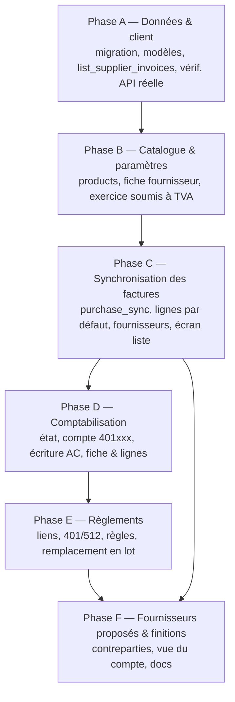

# Workflow — Qonto, lot 2a : factures d'achat, catalogue et engagement

> **Statut : à réaliser** (2026-10-21). Sources : [`besoins_qonto_achats.md`](besoins_qonto_achats.md)
> (QA1 à QA12), [`design_qonto_achats.md`](design_qonto_achats.md) (D1 à D16).

## 1. Objectif

Synchroniser les factures d'achat Qonto dans `purchases`, leur donner des lignes issues d'un catalogue,
les comptabiliser automatiquement en engagement (AC 6xx + TVA / 401xxx), et passer leurs règlements
(401xxx / 512) à la place des règles, avec remplacement en lot des écritures de règle antérieures.

## 2. Conventions et prérequis

- **Stack** : Flask + Jinja2 + HTMX / SQLAlchemy + Alembic (tenant, tête actuelle `d7a2e6f0b318`).
- **Acquis du lot 1** : `qonto_client`, `sync_jobs`, fragment de suivi, `counterparties`, `reconciler`,
  `ledger.delete_entries`.
- **Tests** : pytest (fixtures `app`, `session`, `login_as`) ; **422 tests verts** au départ ; Vitest 41.
  Aucun appel réseau : faux client Qonto (pages de factures en mémoire).
- **Vérification** : `make check` vert à chaque point de contrôle.
- **Commit** : un commit par phase, message en anglais, trailers d'attribution habituels.
- **Essai réel** : compte **SCI des Chênes Verts**, **lecture seule**, serveur isolé port 5001
  (scratchpad `sci/`), jamais l'instance Seconde Nature. Les factures d'achat de la SCI peuvent être
  peu nombreuses : compléter par les tests.

## 3. Vue d'ensemble et dépendances



## 4. Phases

### Phase A — Données et client (D1–D3, D10, D14, D15)

| Étape | Tâche | Fichiers |
|-------|-------|----------|
| A.1 | Migration : `products`, `purchases`, `purchase_lines`, `purchase_payments`, `sync_cursors` ; colonnes `entities` (`default_product_id`, `qonto_supplier_id`, `vat_number`, `iban`), `fiscal_years.vat_liable` (server_default faux) ; up / down sur copie de la base réelle | `migrations/versions/<rev>_qonto_purchases.py` |
| A.2 | Modèles + `JournalEntry.SOURCES` (`PURCHASE`) + `SYNC_KIND_QONTO_INVOICES` | `app/models/{product,purchase,sync_cursor,entity,fiscal_year,bank_transaction,journal_entry,sync_job,__init__}.py` |
| A.3 | `qonto_client.list_supplier_invoices` (filtres `updated_at` / `created_at`, tri, pagination, 429 / 401) | `app/services/qonto_client.py` |
| A.4 | ~~`qonto_sync._fields` : `qonto_transaction_ref`~~ (inutile, cf. A.5) | — |
| A.5 | **Vérification sur la SCI** (lecture seule, quelques requêtes) : forme réelle d'une facture (`taxes`, `supplier_snapshot`, `matched_transactions[].transaction_id` = UUID ou référence ?) ; écarts notés dans le design | — |
| A.6 | Tests client + modèles (contraintes, cascades) | `tests/test_qonto_client.py`, `tests/test_purchase_models.py` |

**✅ CP A** (fait) : `make check` vert ; migration up / down sur copie ; D10 tranché (UUID = `fitid`).

### Phase B — Catalogue et paramètres (A1, QA11)

| Étape | Tâche | Fichiers |
|-------|-------|----------|
| B.1 | `catalog.py` : `parse_rate_bp`, `format_rate`, `default_purchase_product` (6068 › 628 › 606), `product_for(entity)` | `app/services/catalog.py` |
| B.2 | Blueprint `products` (menu Compta › Catalogue) : liste, création, modification, archivage ; suppression refusée si utilisé ; comptes filtrés 6xx / 7xx selon le sens | `app/views/products.py`, `app/templates/products/*`, `base.html` |
| B.3 | Fiche entité : produit par défaut, TVA, IBAN ; exercice : case « Soumis à la TVA » + aide | `app/views/{entities,fiscal_years}.py`, `app/templates/{entities,fiscal_years}/form.html` |
| B.4 | Tests | `tests/test_catalog.py`, `tests/test_products_views.py` |

**✅ CP B** (fait) : US1 dans Chrome (copie SCI, port 5001).

### Phase C — Synchronisation des factures (A2, A3, A4.1, A4.3)

| Étape | Tâche | Fichiers |
|-------|-------|----------|
| C.1 | `purchase_sync.upsert_invoice` : champs (§3.2 du design), montants `Decimal` → centimes, `is_hidden`, avoir, `review_reason` si comptabilisée et montant / date / statut changés | `app/services/purchase_sync.py` |
| C.2 | `default_lines` (D4 : par taux, arrondi sur la dernière, TTC seul à taux NULL) ; régénération si `lines_edited` faux et non comptabilisée | `app/services/purchase_sync.py` |
| C.3 | `match_entity` (id Qonto → TVA → `name_key`) ; complète l'entité si champs vides | `app/services/purchase_sync.py` |
| C.4 | `sync_supplier_invoices` : fenêtres (1er passage mensuel sur `created_at` depuis `sync_from`, ensuite `updated_at` − 5 min), commit par page, progression, curseur après succès ; `start_sync` via `sync_jobs` ; `_SYNC_SOURCES["qonto"]` avec les deux sortes | `app/services/{purchase_sync,integrations}.py` |
| C.5 | Blueprint `purchases` : liste + filtres (période, statut Qonto, fournisseur, non payée, sans fournisseur, masquées ; « état » en D), synchro + suivi, date de début ; menu « Factures d'achat » | `app/views/purchases.py`, `app/templates/purchases/{index,_sync_status}.html`, `base.html` |
| C.6 | Tests synchro + vues | `tests/test_purchase_sync.py`, `tests/test_purchases_views.py` |
| C.7 | Essai SCI : première synchro, relance (0 nouvelle) | — |

**✅ CP C** (fait) : `make check` vert ; US2 (hors comptabilisation) sur la SCI : 2 factures réelles, relance → 0 lue, Dupré rattaché par nom avec son produit par défaut.

### Phase D — Comptabilisation en engagement (A5, D6–D9, D16)

| Étape | Tâche | Fichiers |
|-------|-------|----------|
| D.1 | `purchase_posting.purchase_state` (motifs) ; badges et infobulles dans la liste ; bandeau « N à compléter » | `app/services/purchase_posting.py`, `app/templates/purchases/index.html` |
| D.2 | `supplier_account` : code de la fiche, sinon prochain `401NNN` libre (entités + comptes), création du compte (parent 401, `TIERS`) | `app/services/purchase_posting.py` |
| D.3 | `post` (AC, assujetti / non assujetti, 44566 › 4456, avoir inversé), `post_ready` (une transaction par facture, erreurs collectées), `unpost` | `app/services/purchase_posting.py` |
| D.4 | Appel de `post_ready` en fin de page de synchro ; route de rattrapage `post-ready` | `app/services/purchase_sync.py`, `app/views/purchases.py` |
| D.5 | Fiche facture : en-tête, lignes en formulaire HTMX (produit → compte + taux, total vs TTC en direct), `save_lines` (→ `lines_edited`, puis `post_ready`), annulation, écriture liée, `review_reason`, lien Qonto | `app/views/purchases.py`, `app/templates/purchases/{detail,_lines}.html` |
| D.6 | Fiche entité : factures et solde du 401xxx | `app/views/entities.py`, `app/templates/entities/detail.html` |
| D.7 | Tests | `tests/test_purchase_posting.py`, `tests/test_purchases_views.py` |

**✅ CP D** : US3 dans Chrome (copie de base SCI) ; balance équilibrée.

### Phase E — Règlements (A6, D10–D12)

| Étape | Tâche | Fichiers |
|-------|-------|----------|
| E.1 | `purchase_settlement` : `link_invoice`, `link_transactions`, `linked_transaction_ids` | `app/services/purchase_settlement.py` |
| E.2 | `settle` : écriture BQ 401xxx / 512 + `reconcile` atomiques ; plusieurs factures d'un même fournisseur ; fournisseurs différents / annulée → signalé | `app/services/purchase_settlement.py` |
| E.3 | Branchements : synchro factures (après `post_ready`) ; synchro transactions (liens + règlements **avant** les règles) ; `apply_rules` exclut les liées | `app/services/{purchase_sync,qonto_sync,rules_engine}.py` |
| E.4 | `to_replace` / `replace_many` (écritures de règle seulement, résultat par élément) ; écran `/purchases/settlements` cochable ; bandeau dans la liste | `app/services/purchase_settlement.py`, `app/views/purchases.py`, `app/templates/purchases/settlements.html` |
| E.5 | Tests (ordre transaction / facture dans les deux sens, règles ignorées, remplacement, rapprochement manuel signalé, annulée) | `tests/test_purchase_settlement.py`, `tests/test_qonto_sync.py`, `tests/test_rules_engine*.py` |

**✅ CP E** : `make check` vert ; US4 sur la copie SCI.

### Phase F — Fournisseurs proposés, vue du compte, documentation (A4.2, A6.5, D13)

| Étape | Tâche | Fichiers |
|-------|-------|----------|
| F.1 | `counterparties.proposals` / `accept` étendus aux factures (rattachement, champs fournisseur, `post_ready` + `settle`) ; section « Fournisseurs des factures » | `app/services/counterparties.py`, `app/views/bank_accounts.py`, `app/templates/bank_accounts/counterparties.html` |
| F.2 | Vue du compte bancaire : badge « Facture n° … », filtre « débit sans facture » | `app/views/bank_accounts.py`, `app/templates/bank_accounts/transactions.html` |
| F.3 | Docs : routes, modèles, services, guide utilisateur (factures d'achat, catalogue, TVA de l'exercice), multi-instance | `doc/*.md` |
| F.4 | Besoins : critères cochés ; workflow RÉALISÉ ; écarts dans le design ; build Docker | `claudedocs/*_qonto_achats.md` |

**✅ CP final** : `make check` vert ; US1 à US4 cochés ; essai complet sur la SCI (lecture seule).

## 5. Points d'attention

1. **D10** (tranché en A.5) : `transaction_id` = UUID = `fitid` ; résolution par `fitid` seulement.
2. **Comptabilisation automatique** : toute erreur de `post` (exercice clos, compte absent) est
   collectée dans le résumé, jamais bloquante pour la synchro ; la facture reste « prête ».
3. **SQLite + fil d'exécution** : commit par page, une seule synchro de factures à la fois
   (`running_job` sur la sorte).
4. **Données réelles Seconde Nature** : aucune synchro de factures avant la mise en service du lot 1
   (G.3) et l'accord de l'utilisateur ; `vat_liable` à décider pour l'exercice 2026.
5. **Ordre des écritures** : une transaction payée avant la comptabilisation de sa facture attend
   (ni règle, ni règlement) ; elle sera réglée au `post_ready` suivant.

## 6. Ordre d'exécution (commits)

```
A.1 → A.2 → A.3 → A.4 → A.5 → A.6             ✅ CP A
B.1 → B.2 → B.3 → B.4                         ✅ CP B
C.1 → … → C.7                                 ✅ CP C
D.1 → … → D.7                                 ✅ CP D
E.1 → … → E.5                                 ✅ CP E
F.1 → F.2 → F.3 → F.4                         ✅ CP final
```

Lancer avec : `/sc:implement claudedocs/workflow_qonto_achats.md --phase A`.
