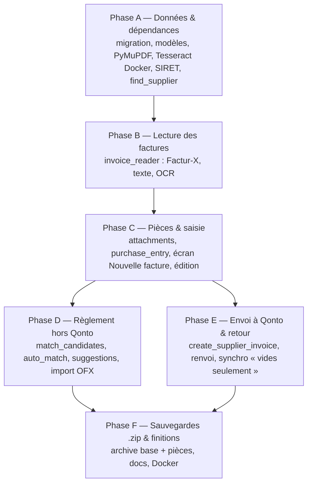

# Workflow — Qonto, lot 2b : saisie de factures d'achat, pièce jointe et OCR

> **Statut : en cours** — phases A et B réalisées (2026-10-22). Sources : [`besoins_qonto_achats_saisie.md`](besoins_qonto_achats_saisie.md)
> (QB1 à QB8), [`design_qonto_achats_saisie.md`](design_qonto_achats_saisie.md) (D1 à D13).

## 1. Objectif

Saisir une facture d'achat à partir de son fichier (Factur-X, PDF, scan) avec un formulaire prérempli,
la conserver, la comptabiliser et la régler comme au lot 2a ; l'envoyer à Qonto pour la SCI ; la régler
depuis l'OFX pour Seconde Nature ; sauvegarder les pièces avec l'instance.

## 2. Conventions et prérequis

- **Stack** : Flask + Jinja2 + HTMX / SQLAlchemy + Alembic (tenant, tête actuelle `24e66976825c`).
- **Acquis du lot 2a** : `purchases`, `purchase_posting`, `purchase_settlement`, `purchase_sync`,
  catalogue, éditeur de lignes de la fiche.
- **Tests** : pytest **532 verts** au départ ; Vitest 41 ; tests OCR ignorés si Tesseract est absent.
- **Vérification** : `make check` vert à chaque point de contrôle ; un commit par phase.
- **Essais** : serveur isolé port 5001 sur copies (scratchpad `sci/`) ; **Seconde Nature** pour le
  parcours OFX (copie `sn-test.db`), **SCI** pour Qonto ; l'**envoi réel à Qonto** (QB8) seulement
  après accord explicite de l'utilisateur, une seule facture choisie par lui.
- **Fichiers de test** : PDF générés par PyMuPDF dans les tests ; les essais manuels utilisent des
  factures fournies par l'utilisateur.

## 3. Vue d'ensemble et dépendances



## 4. Phases

### Phase A — Données et dépendances (D1, D5, D7, D8, D10, D13)

| Étape | Tâche | Fichiers |
|-------|-------|----------|
| A.1 | Migration : `entities.siret` ; `purchases` (`supplier_siret`, `attachment_*`, `idempotency_key`, `qonto_upload_status`, `qonto_upload_error`) ; `purchase_payments.qonto_transaction_id` nullable, `origin`, unique `(purchase_id, bank_transaction_id)` ; up / down sur copies des bases réelles | `migrations/versions/<rev>_purchase_entry.py` |
| A.2 | Modèles ; SIRET sur la fiche entité (formulaire, détail) | `app/models/{purchase,entity}.py`, `app/views/entities.py`, `app/templates/entities/*` |
| A.3 | `purchase_sync.find_supplier(qonto_id, vat, siret, iban, name)` ; `match_entity` l'utilise | `app/services/purchase_sync.py` |
| A.4 | `pymupdf==1.26.*` dans `requirements.txt` ; `tesseract-ocr tesseract-ocr-fra` dans le Dockerfile | `requirements.txt`, `Dockerfile` |
| A.5 | Tests (migration via modèles, SIRET, `find_supplier`) | `tests/test_purchase_models.py`, `tests/test_purchase_sync.py` |

**✅ CP A** : `make check` vert ; migration up / down sur copies ; bases locales migrées (sauvegarde avant).
— *Réalisé* : migration `9c41b7e2d5a8` ; 538 tests ; up / down / up sur copies (dont la copie SCI avec
factures et paiements du lot 2a) ; bases locales et copies d'essai migrées. Écart : l'IBAN reconnaît
désormais automatiquement le fournisseur (avant : simple suggestion) ; `link_invoice` ignore les liens
hors Qonto.

### Phase B — Lecture des factures (D3, D4)

| Étape | Tâche | Fichiers |
|-------|-------|----------|
| B.1 | `Extraction` / `Field` ; `parse_text` (montants FR, dates, TVA, SIRET, IBAN, n°, mots-clés TTC / HT / TVA / net à payer, avoir) ; contrôle HT + TVA = TTC | `app/services/invoice_reader.py` |
| B.2 | `read_facturx` (fichiers embarqués, CII, taille bornée) | idem |
| B.3 | `read` : texte natif, OCR des pages pauvres en texte et des images, 3 pages ; Tesseract absent → avertissement | idem |
| B.4 | Tests sur PDF générés (texte, Factur-X, image) ; OCR ignoré sans Tesseract | `tests/test_invoice_reader.py` |
| B.5 | Essai sur de vraies factures fournies par l'utilisateur (PDF texte, scan, Factur-X si disponible) ; ajuster les motifs | — |

**✅ CP B** : `make check` vert ; extraction correcte des totaux, dates et identifiants sur les factures réelles.
— *Réalisé* : 554 tests (16 nouveaux, OCR compris). Factures réelles (`SCI Chenes verts/doc_facture`) :
2 factures Free (PDF texte) lues entièrement (Free, TVA FR60421938861, n°, date, échéance,
39,99 / 33,33 / 6,66) ; ticket Brico Dépôt (texte + logo image) : SIRET, date, 171,16 / 142,63 / 28,53,
nom « Bricodepot » deviné depuis le site web (à vérifier) ; mêmes résultats en scan simulé (PDF image)
et en photo JPEG via OCR (≈ 1 à 2 s par page ; SIRET bruité par l'OCR rejeté par la clé de Luhn).
Écarts au design : un champ lu dans le texte natif n'est « à vérifier » que s'il est deviné (nom depuis
le site web, date sans libellé), incohérent (HT + TVA ≠ TTC) ou un IBAN ; les champs OCR le sont
toujours. IBAN masqué ou invalide (mod 97) ignoré ; `ignore_ibans` écarte les IBAN de l'organisation ;
XML avec DOCTYPE refusé.

### Phase C — Pièces et saisie (S1, S5, S7, D2, D6, D7)

| Étape | Tâche | Fichiers |
|-------|-------|----------|
| C.1 | `attachments` : dossier de l'instance, `stage`, `store`, `path_of`, purge | `app/services/attachments.py` |
| C.2 | `purchase_entry` : `form_from_extraction`, `validate_header`, `duplicates`, `create`, `update` (sans envoi Qonto) | `app/services/purchase_entry.py` |
| C.3 | Écran « Nouvelle facture » (lire → formulaire prérempli, champs à vérifier, aperçu de la pièce, fournisseur à créer) ; enregistrement, doublon ; édition de l'en-tête | `app/views/purchases.py`, `app/templates/purchases/{new,_header_form}.html` |
| C.4 | Pièce : route de consultation ; fiche (aperçu, téléchargement) ; liste (origine, filtre) | `app/views/purchases.py`, `app/templates/purchases/{detail,index}.html` |
| C.5 | Tests services + vues | `tests/test_attachments.py`, `tests/test_purchase_entry.py`, `tests/test_purchases_views.py` |

**✅ CP C** : US1, US2, US3 dans Chrome (copie Seconde Nature) : facture déposée, préremplie, comptabilisée, pièce consultable, doublon signalé.

### Phase D — Règlement hors Qonto (S6, D10, D11)

| Étape | Tâche | Fichiers |
|-------|-------|----------|
| D.1 | `match_candidates`, `auto_match` (candidat unique, jamais un débit commun à deux factures), `link_manual`, `unlink` | `app/services/purchase_settlement.py` |
| D.2 | `post_ready` → `auto_match` des factures saisies ; `imports.ofx` → `auto_match` après import (résumé dans le message) | `app/services/purchase_posting.py`, `app/views/imports.py` |
| D.3 | Fiche : suggestions (un clic), défaire un règlement ; liste : filtre « non réglée » | `app/views/purchases.py`, `app/templates/purchases/{detail,index}.html` |
| D.4 | Tests | `tests/test_purchase_settlement.py`, `tests/test_purchases_views.py` |

**✅ CP D** : US4 sur la copie Seconde Nature (débit OFX réel ou importé de test).

### Phase E — Envoi à Qonto et retour (S3, S4, D8, D9)

| Étape | Tâche | Fichiers |
|-------|-------|----------|
| E.1 | `qonto_client.create_supplier_invoice` (multipart, idempotence, `errors[]` d'une réponse 200) | `app/services/qonto_client.py` |
| E.2 | `purchase_entry.send_to_qonto` ; case « Envoyer à Qonto » (si disponible, cochée) ; bouton Renvoyer ; badge d'échec | `app/services/purchase_entry.py`, `app/views/purchases.py`, templates |
| E.3 | `upsert_invoice` : facture saisie reconnue par `qonto_id`, champs vides seulement | `app/services/purchase_sync.py` |
| E.4 | Tests (client simulé) | `tests/test_qonto_client.py`, `tests/test_purchase_entry.py`, `tests/test_purchase_sync.py` |
| E.5 | **Avec l'accord de l'utilisateur** : un envoi réel sur la SCI (facture choisie par lui), puis synchro → pas de doublon, saisie conservée | — |

**✅ CP E** : `make check` vert ; US5 (envoi réel unique autorisé).

### Phase F — Sauvegardes et finitions (S8, D12)

| Étape | Tâche | Fichiers |
|-------|-------|----------|
| F.1 | Archive `.zip` (base + pièces) ; restauration et import `.db` / `.zip` ; contrôle des noms | `app/services/instance_backup.py`, `app/views/instances.py`, templates |
| F.2 | Tests (dont archive malveillante) | `tests/test_instance_backup*.py` |
| F.3 | Docs : guide `achats.md` (saisie, OCR, envoi, règlement OFX), sauvegardes, modèles, routes, services, installation (Tesseract) | `doc/*.md` |
| F.4 | Besoins cochés, workflow RÉALISÉ, écarts au design ; image Docker (OCR fonctionnel dans le conteneur) | `claudedocs/*`, `Dockerfile` |

**✅ CP final** : `make check` vert ; US1 à US5 cochés ; sauvegarde / restauration `.zip` vérifiée sur copie ; OCR vérifié dans l'image Docker.

## 5. Points d'attention

1. **Envoi réel à Qonto** : jamais sans accord explicite au moment de l'essai ; une seule facture.
2. **Lien automatique** : seulement si le candidat est unique **pour toutes** les factures en attente.
3. **Saisie vs Qonto** : une facture saisie n'est jamais réécrite par la synchro (sauf champs vides).
4. **Fichiers** : toujours confinés au dossier de l'instance ; jamais de chemin venant du formulaire.
5. **Sauvegardes** : la restauration d'une archive remplace aussi les pièces (copie de sécurité avant).

## 6. Ordre d'exécution (commits)

```
A.1 → … → A.5      ✅ CP A
B.1 → … → B.5      ✅ CP B
C.1 → … → C.5      ✅ CP C
D.1 → … → D.4      ✅ CP D
E.1 → … → E.5      ✅ CP E
F.1 → … → F.4      ✅ CP final
```

Lancer avec : `/sc:implement claudedocs/workflow_qonto_achats_saisie.md --phase A`.
