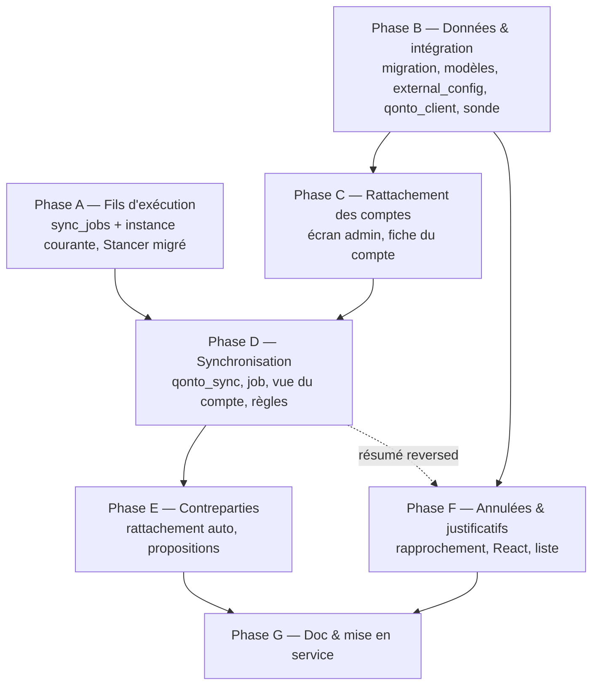

# Workflow — Qonto, lot 1 : comptes et transactions bancaires

> **Statut : EN COURS** — phase A faite. Sources : [`besoins_qonto_transactions.md`](besoins_qonto_transactions.md),
> [`design_qonto_transactions.md`](design_qonto_transactions.md) (décisions D1 à D10).

## 1. Objectif

Synchroniser les comptes et transactions Qonto dans `bank_accounts` / `bank_transactions`, en arrière-plan
avec progression, depuis la vue du compte bancaire ; appliquer les règles, rattacher les contreparties
(propositions de fournisseurs), signaler les transactions annulées et l'état des justificatifs.

## 2. Conventions et prérequis

- **Stack** : Flask + Jinja2 + HTMX (`hx_submit`, fragments de suivi en polling) + îlot React
  `ReconcileWorkspace` / SQLAlchemy + Alembic (tenant, tête actuelle `c3f8a1d5e297`).
- **Intégrations** : `external_config` + `integrations` (sonde, `last_sync`, `unavailable_notice`).
- **Tests** : pytest (fixtures `app`, `session`, `login_as`) ; **340 tests verts** au départ ; Vitest 38.
  Aucun appel réseau : faux `QontoClient` (pages en mémoire) et `requests` simulé.
- **Vérification** : `make check` vert à chaque point de contrôle.
- **Commit** : un commit par phase, message en anglais, trailers d'attribution habituels.
- **Prérequis utilisateur** :
  - **Phase D** : un accès au **bac à sable Qonto** (inscription au Developer Portal → identifiant,
    clé et `X-Qonto-Staging-Token`) pour l'essai réel.
  - **Phase G** : la **clé API de production** saisie par l'administrateur dans Intégrations › Qonto,
    et son accord avant la première synchronisation du compte réel.

## 3. Vue d'ensemble et dépendances



A et B sont indépendantes. F ne dépend que des colonnes (B) ; le bandeau « annulées encore
rapprochées » de la vue du compte attend D.

## 4. Phases

### Phase A — Fils d'exécution sur la bonne instance (D6, D7)

| Étape | Tâche | Fichiers |
|-------|-------|----------|
| A.1 | `sync_jobs.py` : `running_job`, `start(app, kind, work, …)` qui capture `current_instance()` et pose `g.current_instance` / `g.tenant_engine` dans le fil, `progress_callback` (limitation 1/5), finalisation (done / failed, message masqué) | `app/services/sync_jobs.py` |
| A.2 | `stancer_async` délègue à `sync_jobs` (API publique inchangée) | `app/services/stancer_async.py` |
| A.3 | Tests : un job lancé depuis une requête sur une instance **non par défaut** écrit dans la base de cette instance (job + données) ; Stancer idem ; erreurs → job `failed` | `tests/test_sync_jobs.py` |

**✅ CP A** : pytest vert ; synchro Stancer réelle lancée depuis l'UI (copie de base) → job terminé, versements à jour.

### Phase B — Données et intégration Qonto (D1 à D5)

| Étape | Tâche | Fichiers |
|-------|-------|----------|
| B.1 | Migration : colonnes `bank_accounts` (§3.1), `bank_transactions` (§3.2, `source` server_default `ofx`, `raw_type` → 40), table `ignored_counterparties`, `sync_jobs.bank_account_id` ; up / down sur copie de la base réelle | `migrations/versions/<rev>_qonto_bank_sync.py` |
| B.2 | Modèles : champs ajoutés, `IgnoredCounterparty`, `SYNC_KIND_QONTO` | `app/models/{bank_account,bank_transaction,sync_job,ignored_counterparty,__init__}.py` |
| B.3 | `external_config` : service `qonto` (clés, requis, secrets, repli `QONTO_*`, libellé, description) | `app/services/external_config.py` |
| B.4 | `qonto_client.py` : auth `login:secret`, bac à sable si `staging_token`, `organization`, `bank_accounts`, `iter_transactions` (pagination `next_page`), 429 (`Retry-After` / 2-4-8 s, 3 essais), 5xx / réseau (2 essais), 401/403 → `QontoAuthError` immédiat, garde « désactivée » | `app/services/qonto_client.py` |
| B.5 | Sonde Qonto + `_SYNC_SOURCES["qonto"]` + traduction `QontoError` ; `FIELD_META` indexable par `(service, clé)` | `app/services/integrations.py`, `app/views/integrations.py` |
| B.6 | Tests client (§8 du design) + sonde + page Intégrations › Qonto | `tests/test_qonto_client.py`, `tests/test_integrations_*.py` |

**✅ CP B** : `make check` vert ; Intégrations › Qonto visible, test « Identifiants refusés » avec une
fausse clé (appel réel, une seule requête).

### Phase C — Rattachement des comptes (Q2)

| Étape | Tâche | Fichiers |
|-------|-------|----------|
| C.1 | `qonto_sync.list_accounts` (comptes Qonto + rattaché / proposé par IBAN normalisé), `link_account` (existant ou création avec compte 512x, `sync_from` défaut = début de l'exercice ouvert), `unlink_account` | `app/services/qonto_sync.py` |
| C.2 | Écran admin `/bank-accounts/qonto` + POST `link` / `unlink` ; lien depuis la liste des comptes ; `unavailable_notice('qonto')` si indisponible | `app/views/bank_accounts.py`, `app/templates/bank_accounts/{qonto_accounts,index}.html` |
| C.3 | Fiche du compte : section Qonto (compte lié, date de début modifiable, dernière synchro, détacher) | `app/templates/bank_accounts/form.html`, `app/views/bank_accounts.py` |
| C.4 | Tests : IBAN identique proposé, création avec compte GL, compte Qonto déjà lié refusé ailleurs (unicité), détacher conserve les transactions, admin seulement | `tests/test_qonto_views.py` (partie rattachement), `tests/test_qonto_sync.py` (partie comptes) |

**✅ CP C** : rattachement d'un compte du bac à sable dans Chrome.

### Phase D — Synchronisation des transactions (Q3, Q4)

| Étape | Tâche | Fichiers |
|-------|-------|----------|
| D.1 | `_upsert` (correspondance §5.3, date Europe/Paris, signe, libellé, champs jamais modifiés, conflit de montant, `reversed`, avant `sync_from` ignorée) | `app/services/qonto_sync.py` |
| D.2 | Fenêtres : initiales mensuelles (`settled_at`, `completed`) ; incrémentale (`updated_at` − 10 min, `completed` + `reversed`) avec découpage si `total_count > 9 000` ; commit par page ; progression | `app/services/qonto_sync.py` |
| D.3 | `sync_bank_account` : fenêtres → règles sur les nouvelles (`apply_rules`) → curseur ; résultat (§5.2) ; curseur inchangé en cas d'échec | `app/services/qonto_sync.py` |
| D.4 | Routes `qonto/sync` (démarrage via `sync_jobs`, une seule synchro par compte) et suivi ; bloc Qonto de la vue du compte ; fragment `_qonto_sync_status.html` (résumé) ; « dernière synchronisation » dans Intégrations | `app/views/bank_accounts.py`, `app/templates/bank_accounts/{transactions,_qonto_sync_status}.html` |
| D.5 | Tests synchro (§8 du design : idempotence, mises à jour, conflit, fenêtres, découpage, échec en cours de route, règles) + vues (job, refus si désactivée) | `tests/test_qonto_sync.py`, `tests/test_qonto_views.py` |
| D.6 | Essai réel sur le **bac à sable** : première synchro, relance (0 nouvelle), modification d'une note dans Qonto puis relance ; comparer les champs réels à la correspondance §5.3 et ajuster | — |

**✅ CP D** : `make check` vert ; US3 validé sur le bac à sable dans Chrome.

### Phase E — Contreparties et fournisseurs (Q5)

| Étape | Tâche | Fichiers |
|-------|-------|----------|
| E.1 | `counterparties.py` : `name_key`, `link_existing`, `proposals` (exclusions `NO_SUPPLIER_TYPES`, ignorées, annulées, déjà catégorisées), `accept` (créer `FOURNISSEUR` / rattacher), `ignore` | `app/services/counterparties.py` |
| E.2 | Appel de `link_existing` dans `sync_bank_account` (après les règles) ; compteurs `linked_entities`, `proposed_counterparties` | `app/services/qonto_sync.py` |
| E.3 | Écran `/bank-accounts/<id>/counterparties` (groupes, total, suggestions d'entités, actions créer / rattacher / ignorer en `hx_submit`) ; bandeau « N contreparties à valider » dans la vue du compte | `app/views/bank_accounts.py`, `app/templates/bank_accounts/counterparties.html`, `transactions.html` |
| E.4 | Tests services + vues | `tests/test_counterparties.py`, `tests/test_qonto_views.py` |

**✅ CP E** : propositions validées dans Chrome sur les données du bac à sable ; US4 (partie tiers).

### Phase F — Transactions annulées et justificatifs (Q3.3, Q6, D9)

| Étape | Tâche | Fichiers |
|-------|-------|----------|
| F.1 | `reconciler` : `check_link` refuse une transaction annulée ; `suggest_matches_scored` et `auto_pairs` l'excluent | `app/services/reconciler.py` |
| F.2 | API : `serialize_transaction` expose `is_reversed`, `attachment_status` (`ok` / `missing` / `lost` / `null`) ; compteurs inchangés | `app/api/reconciliation.py` |
| F.3 | React : badge « Annulée » (non sélectionnable pour un lien, exclu de « R »), pastille justificatif | `frontend/src/islands/ReconcileWorkspace/*`, `frontend/src/lib/types.ts` |
| F.4 | Vue du compte : icônes justificatif, badge « Annulée », filtre « justificatif manquant », bandeau « N annulées encore rapprochées » | `app/templates/bank_accounts/transactions.html`, `app/views/bank_accounts.py` |
| F.5 | Tests pytest (reconciler, API, vue) + Vitest | `tests/test_reconciler_bulk.py`, `tests/test_api_reconciliation.py`, `tests/test_qonto_views.py`, `frontend/src/**/*.test.ts(x)` |

**✅ CP F** : `make check` vert ; US5 (partie annulée) et US4 (justificatifs) dans Chrome.

### Phase G — Documentation et mise en service

| Étape | Tâche | Fichiers |
|-------|-------|----------|
| G.1 | Docs : routes, modèles, services (`qonto_client`, `qonto_sync`, `counterparties`, `sync_jobs`), imports (Qonto à côté d'OFX), installation / docker (`QONTO_*`), multi-instance (fils d'exécution) | `doc/*.md` |
| G.2 | Migration sur copie de la base réelle ; build de l'image Docker | — |
| G.3 | **Avec l'accord de l'utilisateur** : clé de production, rattachement du compte réel, première synchro (date de début choisie), contrôle des montants et soldes contre l'app Qonto | — |
| G.4 | Besoins : critères cochés ; workflow RÉALISÉ ; écarts notés dans le design | `claudedocs/*_qonto_transactions.md` |

**✅ CP final** : `make check` vert ; US1 à US5 cochés ; compte réel synchronisé et vérifié.

## 5. Récapitulatif des fichiers

| Nouveau | Modifié |
|---------|---------|
| `app/services/{sync_jobs,qonto_client,qonto_sync,counterparties}.py` | `app/services/{stancer_async,external_config,integrations,reconciler}.py` |
| `app/models/ignored_counterparty.py` | `app/models/{bank_account,bank_transaction,sync_job,__init__}.py` |
| `migrations/versions/<rev>_qonto_bank_sync.py` | `app/views/{bank_accounts,integrations}.py`, `app/api/reconciliation.py` |
| `app/templates/bank_accounts/{qonto_accounts,counterparties,_qonto_sync_status}.html` | `app/templates/bank_accounts/{index,form,transactions}.html` |
| `tests/test_{sync_jobs,qonto_client,qonto_sync,counterparties,qonto_views}.py` | `frontend/src/islands/ReconcileWorkspace/*`, `tests/test_{reconciler_bulk,api_reconciliation,integrations_*}.py`, `doc/*.md` |

## 6. Points d'attention

1. **Fil d'exécution et instance (A)** : corriger avant d'ajouter Qonto ; le même défaut touche
   aujourd'hui Stancer. Tester avec une **seconde instance** dont la base n'est pas la base par défaut.
2. **Écart doc / API réelle** : la correspondance §5.3 est issue de la doc ; la valider sur le bac à
   sable (D.6) avant le compte réel (G.3).
3. **SQLite + fil d'exécution** : écritures de progression limitées, commit par page, une seule
   synchro par compte (`running_job`) ; le polling ne fait que lire.
4. **Blocage Qonto après 200 réponses 401 / heure** : arrêt immédiat sur 401, pas de nouvelle tentative.
5. **Règles et date de début** : `apply_rules` peut créer des écritures ; une date de début dans un
   exercice clôturé produira des erreurs de règles (remontées dans le résumé, transactions importées).
6. **Données réelles (G.3)** : première synchro de production seulement avec l'accord explicite de
   l'utilisateur ; sauvegarde de la base avant.

## 7. Ordre d'exécution (commits)

```
A.1 → A.2 → A.3                               ✅ CP A  (fait)
B.1 → B.2 → B.3 → B.4 → B.5 → B.6             ✅ CP B
C.1 → C.2 → C.3 → C.4                         ✅ CP C
D.1 → D.2 → D.3 → D.4 → D.5 → D.6             ✅ CP D   (bac à sable requis)
E.1 → E.2 → E.3 → E.4                         ✅ CP E
F.1 → F.2 → F.3 → F.4 → F.5                   ✅ CP F
G.1 → G.2 → G.3 → G.4                         ✅ CP final (clé de production + accord)
```

Lancer avec : `/sc:implement claudedocs/workflow_qonto_transactions.md --phase A`.
